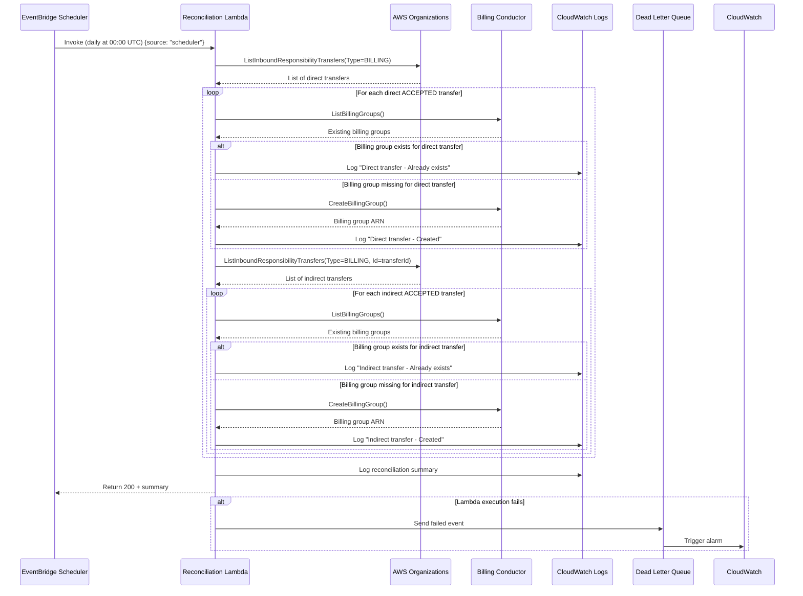

# Design Document: Billing Group Reconciliation

## Overview

The Billing Group Reconciliation feature implements a scheduled Lambda function that periodically verifies all active billing transfer relationships (both direct and indirect) have corresponding billing groups in AWS Billing Conductor. This reconciliation process acts as a safety net to catch any missed events from the event-driven handler or manually created billing transfers that weren't processed through automation.

The system runs on a configurable schedule (default: daily at midnight UTC) via EventBridge Scheduler and reuses the same billing group creation logic as the event-driven handler to maintain consistency across all billing groups.

**Key Concepts:**
- **Direct Transfers**: Billing transfers where our management account directly manages another organization's billing (retrieved by calling ListInboundResponsibilityTransfers without Id parameter)
- **Indirect Transfers**: Nested billing transfers where a Bill-Source Account from a direct relationship also manages billing for other accounts (retrieved by calling ListInboundResponsibilityTransfers with the direct transfer's Id parameter)
- **Reconciliation Workflow**: The system first lists all direct transfers, processes each direct ACCEPTED transfer to create its billing group, then retrieves and processes the indirect transfers for each direct transfer
- **Both Direct and Indirect**: Both direct and indirect transfers require billing groups to be created - direct transfers need billing groups for the primary relationship, indirect transfers need billing groups for nested relationships
- **Event Processing**: The Lambda processes all incoming events as reconciliation requests, regardless of event source

**Key Design Principles:**
- **Idempotency**: Safe to run multiple times without creating duplicates
- **Fault Tolerance**: Partial failures don't stop the entire reconciliation
- **Consistency**: Uses identical logic to event-driven handler
- **Observability**: Comprehensive logging and monitoring
- **Least Privilege**: Minimal IAM permissions required

## Architecture

### High-Level Architecture

```
┌─────────────────────────┐
│  EventBridge Scheduler  │
│  (Daily at 00:00 UTC)   │
└───────────┬─────────────┘
            │ Invokes with payload
            │ {source: "scheduler", action: "reconcile-all"}
            ▼
┌──────────────────────────────────────────────────────────────┐
│           Reconciliation Lambda Function                     │
│  ┌────────────────────────────────────────────────────────┐ │
│  │ 1. List direct billing transfers (Organizations API)   │ │
│  │    - Call ListInboundResponsibilityTransfers without   │ │
│  │      Id parameter                                      │ │
│  │ 2. Filter for ACCEPTED + BILLING type                  │ │
│  │ 3. For each direct ACCEPTED transfer:                  │ │
│  │    a. Check if billing group exists for Bill-Source    │ │
│  │    b. Create if missing (reuse handler logic)          │ │
│  │    c. Log result                                       │ │
│  │    d. List indirect transfers (pass transfer Id)       │ │
│  │       - Call ListInboundResponsibilityTransfers with   │ │
│  │         Id parameter set to direct transfer's Id       │ │
│  │    e. Filter indirect for ACCEPTED + BILLING           │ │
│  │    f. For each indirect ACCEPTED transfer:             │ │
│  │       - Check if billing group exists for Bill-Source  │ │
│  │       - Create if missing (reuse handler logic)        │ │
│  │       - Log result                                     │ │
│  │ 4. Return reconciliation summary with counts           │ │
│  │    - Direct transfers checked                          │ │
│  │    - Indirect transfers checked                        │ │
│  │    - Billing groups created/existed                    │ │
│  └────────────────────────────────────────────────────────┘ │
└──────────────────────────────────────────────────────────────┘
            │
            ├──────────────────┐
            ▼                  ▼
┌─────────────────────┐  ┌──────────────────────┐
│  CloudWatch Logs    │  │  Dead Letter Queue   │
│  (Structured JSON)  │  │  (Failed invocations)│
└─────────────────────┘  └──────────────────────┘
                                    │
                                    ▼
                         ┌──────────────────────┐
                         │  CloudWatch Alarm    │
                         │  (DLQ messages > 0)  │
                         └──────────────────────┘
```

### Component Interaction Flow



## Components and Interfaces

### 1. Reconciliation Lambda Function

**Runtime Configuration:**
- Runtime: Node.js 22.x
- Memory: 512 MB
- Timeout: 15 minutes (900 seconds)
- Architecture: arm64 (Graviton2 for cost efficiency)
- Tracing: AWS X-Ray ACTIVE mode

**Environment Variables:**
```typescript
{
  LOG_LEVEL: 'INFO' | 'DEBUG' | 'WARN' | 'ERROR',
  PRICING_PLAN_NAME: 'BasicPricingPlan',
  DRY_RUN: 'false' // For testing without creating resources
}
```

**Handler Interface:**
```typescript
interface SchedulerEvent {
  source: 'scheduler';
  action: 'reconcile-all';
  time: string; // ISO 8601 timestamp
}

interface ReconciliationResponse {
  statusCode: 200 | 500;
  body: {
    summary: ReconciliationSummary;
    timestamp: string;
  };
}

interface ReconciliationSummary {
  directTransfersChecked: number;
  indirectTransfersChecked: number;
  billingGroupsCreated: number;
  billingGroupsExisted: number;
  errors: Array<{
    accountId: string;
    transferId?: string;
    error: string;
    timestamp: string;
  }>;
  duration: number; // milliseconds
}
```

### 2. EventBridge Scheduler

**Schedule Configuration:**
```typescript
interface SchedulerConfig {
  scheduleExpression: string; // cron(0 0 * * ? *) for daily
  flexibleTimeWindow: {
    mode: 'OFF' // Execute at exact time
  };
  target: {
    arn: string; // Lambda function ARN
    roleArn: string; // IAM role for scheduler
    input: string; // JSON payload
    retryPolicy: {
      maximumRetryAttempts: 2;
      maximumEventAge: 3600; // 1 hour
    };
  };
}
```

**Supported Schedule Patterns:**
- Daily: `cron(0 0 * * ? *)` - Every day at 00:00 UTC
- Monthly: `cron(0 0 1 * ? *)` - 1st of each month at 00:00 UTC
- Custom: Configurable via CDK context

### 3. Billing Conductor Service (Reused)

**Interface:**
```typescript
interface BillingConductorService {
  /**
   * Lists all existing billing groups
   */
  listBillingGroups(): Promise<BillingGroup[]>;
  
  /**
   * Gets or creates the BasicPricingPlan
   */
  getPricingPlan(name: string): Promise<string>; // Returns ARN
  
  /**
   * Creates a billing group (idempotent)
   */
  createBillingGroup(params: {
    accountId: string;
    pricingPlanArn: string;
    name: string;
  }): Promise<string>; // Returns ARN
  
  /**
   * Checks if billing group exists for account
   */
  billingGroupExists(accountId: string): Promise<boolean>;
}
```

### 4. Organizations Service

**Interface:**
```typescript
interface OrganizationsService {
  /**
   * Lists all direct inbound billing transfer relationships
   * Calls ListInboundResponsibilityTransfers without Id parameter
   * Returns all direct transfers where our management account is the Bill-Transfer Account
   */
  listDirectBillingTransfers(): Promise<BillingTransfer[]>;
  
  /**
   * Lists indirect billing transfers for a specific direct transfer
   * Calls ListInboundResponsibilityTransfers with Id parameter
   * Returns nested transfers where the Bill-Source Account from the direct transfer
   * also manages billing for other accounts
   * @param transferId - The ID of the direct transfer to get indirect transfers for
   */
  listIndirectBillingTransfers(transferId: string): Promise<BillingTransfer[]>;
}

interface BillingTransfer {
  id: string; // Transfer ID (e.g., rt-abc123)
  billSourceAccountId: string; // Customer account
  billTransferAccountId: string; // Our management account
  status: 'ACCEPTED' | 'PENDING' | 'TERMINATED' | 'WITHDRAWN' | 'DECLINED' | 'EXPIRED' | 'CANCELED';
  type: 'BILLING';
  startTimestamp: number;
  endTimestamp?: number;
}
```

### 5. Dead Letter Queue (DLQ)

**Configuration:**
```typescript
interface DLQConfig {
  queueName: 'billing-reconciliation-dlq';
  retentionPeriod: 14 * 24 * 60 * 60; // 14 days in seconds
  visibilityTimeout: 300; // 5 minutes
  encryption: 'AWS_MANAGED'; // SQS managed encryption
}
```

### 6. CloudWatch Alarm

**Configuration:**
```typescript
interface AlarmConfig {
  alarmName: 'BillingReconciliationDLQAlarm';
  metric: 'ApproximateNumberOfMessagesVisible';
  threshold: 1; // Alert on any message
  evaluationPeriods: 1;
  period: 300; // 5 minutes
  statistic: 'Maximum';
  treatMissingData: 'notBreaching';
}
```

## Data Models

### Billing Transfer Model

```typescript
interface BillingTransfer {
  id: string; // Transfer ID
  billSourceAccountId: string; // Customer management account
  billTransferAccountId: string; // Our management account
  status: 'ACCEPTED' | 'PENDING' | 'TERMINATED';
  type: 'BILLING';
  startTimestamp: number; // Unix timestamp in milliseconds
  endTimestamp?: number; // Present if terminated
}
```

### Billing Group Model

```typescript
interface BillingGroup {
  arn: string; // Billing group ARN
  name: string; // Format: bg-{accountId}
  description: string;
  pricingPlanArn: string;
  primaryAccountId: string;
  accountIds: string[];
  status: 'ACTIVE' | 'PRIMARY_ACCOUNT_MISSING';
  creationTime: number;
}
```

### Reconciliation Result Model

```typescript
interface ReconciliationResult {
  accountId: string;
  status: 'created' | 'existed' | 'failed';
  billingGroupArn?: string;
  error?: {
    code: string;
    message: string;
    stack?: string;
  };
  timestamp: string; // ISO 8601
}
```

### Log Entry Model

```typescript
interface LogEntry {
  timestamp: string; // ISO 8601
  level: 'INFO' | 'WARN' | 'ERROR' | 'DEBUG';
  message: string;
  context: {
    requestId: string; // Lambda request ID
    functionName: string;
    accountId?: string;
    billingGroupArn?: string;
    transferId?: string;
    duration?: number;
    [key: string]: any;
  };
  error?: {
    message: string;
    code: string;
    stack: string;
  };
}
```


## Correctness Properties

*A property is a characteristic or behavior that should hold true across all valid executions of a system—essentially, a formal statement about what the system should do. Properties serve as the bridge between human-readable specifications and machine-verifiable correctness guarantees.*


### Property 1: Successful reconciliation returns valid response

*For any* valid scheduler event, when the Lambda function completes reconciliation successfully, the response SHALL contain statusCode 200 and a reconciliation summary with fields: transfersChecked, billingGroupsCreated, billingGroupsExisted, errors array, and duration.

**Validates: Requirements 1.2, 4.5**

### Property 2: All events trigger reconciliation workflow

*For any* event received by the Lambda function, the Lambda function SHALL execute the complete reconciliation workflow including listing direct billing transfers, listing indirect transfers for each direct transfer, checking for billing groups, and creating missing groups.

**Validates: Requirements 2.4, 4.1**

### Property 3: Indirect transfers are retrieved for each direct transfer

*For any* direct ACCEPTED billing transfer, the Lambda function SHALL call the Organizations API with that transfer's Id parameter to retrieve all indirect billing transfers for that relationship.

**Validates: Requirements 4.3**

### Property 4: Log entries have required structure

*For any* log entry produced by the Lambda function, the entry SHALL be valid JSON containing timestamp in ISO 8601 format, level field with value INFO, WARN, ERROR, or DEBUG, message field, and context object.

**Validates: Requirements 3.1**

### Property 5: Error log entries contain error details

*For any* error that occurs during Lambda function execution, the ERROR level log entry SHALL contain error.message field, error.stack field with the complete stack trace, and error.code field.

**Validates: Requirements 3.2**

### Property 6: Only ACCEPTED BILLING direct transfers are processed

*For any* list of direct billing transfers returned from the Organizations API, only transfers with status ACCEPTED and type BILLING SHALL be processed for indirect transfer checking.

**Validates: Requirements 4.2**

### Property 7: Only ACCEPTED BILLING indirect transfers are processed

*For any* list of indirect billing transfers returned from the Organizations API for a specific direct transfer, only transfers with status ACCEPTED and type BILLING SHALL be included in the reconciliation process.

**Validates: Requirements 4.4**

### Property 8: Billing group existence is checked before creation

*For any* ACCEPTED billing transfer (direct or indirect), the Lambda function SHALL check if a corresponding billing group exists for the Bill-Source Account before attempting to create one.

**Validates: Requirements 4.3, 4.5, 4.7**

### Property 9: Missing billing groups trigger creation

*For any* ACCEPTED billing transfer (direct or indirect) without a corresponding billing group, the Lambda function SHALL create a new billing group using the naming convention bg-{accountId} and the AWS managed BasicPricingPlan.

**Validates: Requirements 4.4, 4.6, 4.8, 5.1, 5.2**

### Property 10: Billing group creation is idempotent

*For any* account ID, attempting to create a billing group multiple times SHALL result in only one billing group being created, with subsequent attempts recognizing the existing group and skipping creation.

**Validates: Requirements 5.3, 5.5**

### Property 11: Partial failures don't stop reconciliation

*For any* reconciliation run where one or more billing transfers fail to process, the Lambda function SHALL continue processing all remaining transfers and return success status.

**Validates: Requirements 7.1, 7.3**

### Property 12: All errors are collected in summary

*For any* reconciliation run with failures, all errors SHALL be collected and included in the reconciliation summary with accountId, error message, and timestamp for each failure.

**Validates: Requirements 7.2, 7.4**

### Property 13: Critical errors throw exceptions

*For any* critical error that prevents the reconciliation from continuing (such as inability to access Organizations API or Billing Conductor), the Lambda function SHALL log the error and throw an exception to trigger EventBridge retry.

**Validates: Requirements 7.5**


## Error Handling

### Error Categories

#### 1. Transient Errors (Retryable)
- **ThrottlingException**: AWS API rate limits exceeded
- **ServiceUnavailableException**: Temporary service issues
- **NetworkError**: Temporary network connectivity issues

**Handling Strategy:**
- Implement exponential backoff with jitter
- Maximum 3 retry attempts per API call
- Log each retry attempt with context

```typescript
async function retryWithBackoff<T>(
  operation: () => Promise<T>,
  maxRetries: number = 3
): Promise<T> {
  for (let attempt = 0; attempt < maxRetries; attempt++) {
    try {
      return await operation();
    } catch (error) {
      if (attempt === maxRetries - 1 || !isRetryable(error)) {
        throw error;
      }
      const delay = Math.min(1000 * Math.pow(2, attempt), 10000);
      await sleep(delay + Math.random() * 1000); // Add jitter
    }
  }
  throw new Error('Max retries exceeded');
}
```

#### 2. Permanent Errors (Non-Retryable)
- **ValidationException**: Invalid parameters
- **AccessDeniedException**: Insufficient permissions
- **ResourceNotFoundException**: Resource doesn't exist
- **ConflictException**: Resource already exists (handle as success for idempotency)

**Handling Strategy:**
- Log error with full context
- Add to errors array in reconciliation summary
- Continue processing remaining transfers
- Do not retry

#### 3. Critical Errors (Stop Reconciliation)
- **Unable to authenticate with AWS**
- **Unable to list billing transfers** (Organizations API failure)
- **Unable to access Billing Conductor** (service unavailable)

**Handling Strategy:**
- Log critical error with ERROR level
- Throw exception to fail Lambda invocation
- EventBridge Scheduler will retry entire reconciliation

### Error Response Format

```typescript
interface ErrorDetails {
  code: string; // AWS error code or custom code
  message: string; // Human-readable error message
  accountId?: string; // Account being processed when error occurred
  transferId?: string; // Transfer ID if applicable
  stack?: string; // Stack trace (only in DEBUG mode)
  timestamp: string; // ISO 8601 timestamp
  retryable: boolean; // Whether error is retryable
}
```

### Partial Failure Handling

The reconciliation process is designed to be fault-tolerant:

1. **Process all transfers independently**: Failure in one transfer doesn't affect others
2. **Collect all errors**: Maintain array of errors throughout execution
3. **Return success with errors**: Lambda returns 200 status code with errors in summary
4. **Log each failure**: Individual ERROR log entries for each failed transfer
5. **Summary includes counts**: Clear visibility into success vs failure rates

```typescript
async function reconcileAllTransfers(
  directTransfers: BillingTransfer[]
): Promise<ReconciliationSummary> {
  const results: ReconciliationResult[] = [];
  const errors: ErrorDetails[] = [];
  let totalIndirectTransfers = 0;
  
  // Process each direct transfer and its indirect transfers
  for (const directTransfer of directTransfers) {
    try {
      // First, reconcile the direct transfer itself
      const directResult = await reconcileTransfer(directTransfer);
      results.push(directResult);
      
      // Then get and process indirect transfers for this direct transfer
      const indirectTransfers = await listIndirectBillingTransfers(directTransfer.id);
      totalIndirectTransfers += indirectTransfers.length;
      
      // Process each indirect transfer
      for (const indirectTransfer of indirectTransfers) {
        try {
          const result = await reconcileTransfer(indirectTransfer);
          results.push(result);
        } catch (error) {
          // Log error but continue processing
          logger.error('Failed to reconcile indirect transfer', {
            directTransferId: directTransfer.id,
            indirectTransferId: indirectTransfer.id,
            accountId: indirectTransfer.billSourceAccountId,
            error: error.message
          });
          
          errors.push({
            code: error.code || 'UNKNOWN_ERROR',
            message: error.message,
            accountId: indirectTransfer.billSourceAccountId,
            transferId: indirectTransfer.id,
            timestamp: new Date().toISOString(),
            retryable: isRetryable(error)
          });
        }
      }
    } catch (error) {
      // Failed to process direct transfer or list indirect transfers
      logger.error('Failed to process direct transfer', {
        directTransferId: directTransfer.id,
        accountId: directTransfer.billSourceAccountId,
        error: error.message
      });
      
      errors.push({
        code: error.code || 'UNKNOWN_ERROR',
        message: `Failed to process direct transfer: ${error.message}`,
        accountId: directTransfer.billSourceAccountId,
        transferId: directTransfer.id,
        timestamp: new Date().toISOString(),
        retryable: isRetryable(error)
      });
    }
  }
  
  return {
    directTransfersChecked: directTransfers.length,
    indirectTransfersChecked: totalIndirectTransfers,
    billingGroupsCreated: results.filter(r => r.status === 'created').length,
    billingGroupsExisted: results.filter(r => r.status === 'existed').length,
    errors: errors,
    duration: Date.now() - startTime
  };
}
```

## Testing Strategy

### Unit Testing

**Framework**: Jest (already configured in project)

**Test Coverage Areas:**

1. **Event Parsing Tests**
   - Valid scheduler event parsing
   - Invalid event handling
   - Missing required fields

2. **Billing Transfer Filtering Tests**
   - Filter ACCEPTED status transfers
   - Filter BILLING type transfers
   - Exclude TERMINATED transfers
   - Exclude PENDING transfers

3. **Billing Group Creation Logic Tests**
   - Naming convention (bg-{accountId})
   - Pricing plan selection (BasicPricingPlan)
   - Idempotency checks
   - Error handling for creation failures

4. **Error Handling Tests**
   - Transient error retry logic
   - Permanent error handling
   - Critical error exception throwing
   - Error collection in summary

5. **Logging Tests**
   - Structured log format validation
   - Required fields present
   - Error log format
   - Summary log format

**Example Unit Test:**
```typescript
describe('ReconciliationHandler', () => {
  describe('filterActiveTransfers', () => {
    it('should only include ACCEPTED BILLING transfers', () => {
      const transfers = [
        { id: 'rt-1', status: 'ACCEPTED', type: 'BILLING' },
        { id: 'rt-2', status: 'PENDING', type: 'BILLING' },
        { id: 'rt-3', status: 'ACCEPTED', type: 'OTHER' },
        { id: 'rt-4', status: 'TERMINATED', type: 'BILLING' }
      ];
      
      const result = filterActiveTransfers(transfers);
      
      expect(result).toHaveLength(1);
      expect(result[0].id).toBe('rt-1');
    });
  });
});
```

### Property-Based Testing

**Framework**: fast-check (TypeScript property-based testing library)

**Configuration:**
- Minimum 100 iterations per property test
- Use seed for reproducibility
- Generate realistic test data

**Property Test Implementation:**

Each property-based test MUST:
1. Be tagged with a comment referencing the design document property
2. Run at least 100 iterations
3. Generate realistic input data
4. Verify the property holds for all inputs

**Example Property Test:**
```typescript
import fc from 'fast-check';

describe('Property Tests', () => {
  /**
   * Feature: billing-group-reconciliation, Property 5: Only ACCEPTED BILLING transfers are processed
   * Validates: Requirements 4.2
   */
  it('should only process ACCEPTED BILLING transfers', () => {
    fc.assert(
      fc.property(
        fc.array(
          fc.record({
            id: fc.string(),
            status: fc.constantFrom('ACCEPTED', 'PENDING', 'TERMINATED'),
            type: fc.constantFrom('BILLING', 'OTHER'),
            billSourceAccountId: fc.string(),
            billTransferAccountId: fc.string()
          })
        ),
        (transfers) => {
          const processed = filterActiveTransfers(transfers);
          
          // Property: All processed transfers must be ACCEPTED and BILLING
          return processed.every(
            t => t.status === 'ACCEPTED' && t.type === 'BILLING'
          );
        }
      ),
      { numRuns: 100 }
    );
  });
  
  /**
   * Feature: billing-group-reconciliation, Property 8: Billing group creation is idempotent
   * Validates: Requirements 5.3, 5.5
   */
  it('should be idempotent when creating billing groups', async () => {
    fc.assert(
      fc.asyncProperty(
        fc.string({ minLength: 12, maxLength: 12 }), // Account ID
        async (accountId) => {
          // Create billing group twice
          const arn1 = await createBillingGroup(accountId, pricingPlanArn);
          const arn2 = await createBillingGroup(accountId, pricingPlanArn);
          
          // Property: Both calls should return the same ARN
          return arn1 === arn2;
        }
      ),
      { numRuns: 100 }
    );
  });
});
```

**Property Tests to Implement:**

1. **Property 1**: Successful reconciliation returns valid response structure
2. **Property 3**: All log entries have required JSON structure
3. **Property 4**: Error logs contain required error fields
4. **Property 5**: Only ACCEPTED BILLING transfers are processed
5. **Property 7**: Missing billing groups trigger creation with correct naming
6. **Property 8**: Billing group creation is idempotent
7. **Property 9**: Partial failures don't stop reconciliation
8. **Property 10**: All errors are collected in summary

### Integration Testing

**Test Environment**: Separate AWS account for testing

**Integration Test Scenarios:**

1. **End-to-End Reconciliation**
   - Deploy stack to test account
   - Create test billing transfers
   - Trigger scheduler manually
   - Verify billing groups created
   - Check CloudWatch logs

2. **Idempotency Test**
   - Run reconciliation twice
   - Verify no duplicate billing groups
   - Verify logs show "already exists"

3. **Partial Failure Test**
   - Create transfers with invalid account IDs
   - Run reconciliation
   - Verify valid transfers processed
   - Verify errors logged for invalid transfers

4. **DLQ and Alarm Test**
   - Cause Lambda to fail (remove permissions)
   - Verify event sent to DLQ
   - Verify CloudWatch alarm triggers

### Manual Testing Checklist

- [ ] Deploy stack to test account
- [ ] Verify EventBridge Scheduler created with correct cron expression
- [ ] Manually invoke Lambda with test scheduler event
- [ ] Verify billing groups created in Billing Conductor console
- [ ] Check CloudWatch Logs for structured log entries
- [ ] Verify X-Ray traces captured
- [ ] Test with no active transfers (empty reconciliation)
- [ ] Test with existing billing groups (idempotency)
- [ ] Verify DLQ alarm triggers when Lambda fails
- [ ] Verify CDK Nag suppressions are documented

## Implementation Notes

### Code Organization

```
lib/lambda/billing-group-reconciliation/
├── index.ts                          # Lambda handler entry point
├── services/
│   ├── billing-conductor-service.ts  # Reused from event handler
│   ├── organizations-service.ts      # New: Lists billing transfers
│   └── reconciliation-service.ts     # New: Orchestrates reconciliation
├── models/
│   ├── billing-transfer.ts
│   ├── billing-group.ts
│   └── reconciliation-result.ts
└── utils/
    ├── logger.ts                     # Structured logging utility
    ├── retry.ts                      # Retry with exponential backoff
    └── error-handler.ts              # Error categorization and handling
```

### Shared Code with Event Handler

The following components should be shared between the event-driven handler and reconciliation handler:

1. **BillingConductorService**: Reuse existing service for:
   - Listing billing groups
   - Getting pricing plan
   - Creating billing groups
   - Idempotency checks

2. **Logger Utility**: Consistent structured logging format

3. **Error Handling**: Common error categorization and retry logic

4. **Models**: Shared TypeScript interfaces for billing groups

### Environment-Specific Configuration

Use CDK context for environment-specific settings:

```json
{
  "reconciliation": {
    "dev": {
      "schedule": "cron(0 0 * * ? *)",  // Daily
      "timeout": 900,
      "memory": 512,
      "dryRun": true
    },
    "prod": {
      "schedule": "cron(0 0 * * ? *)",  // Daily
      "timeout": 900,
      "memory": 512,
      "dryRun": false
    }
  }
}
```

### Reconciliation Workflow Details

**Two-Phase Approach:**

1. **Phase 1: Process Direct Transfers**
   - Call `ListInboundResponsibilityTransfers` without Id parameter
   - Filter for ACCEPTED status and BILLING type
   - These represent direct relationships with our management account
   - For each direct ACCEPTED transfer:
     - Check if billing group exists for the Bill-Source Account
     - Create billing group if missing

2. **Phase 2: Process Indirect Transfers**
   - For each direct ACCEPTED transfer, call `ListInboundResponsibilityTransfers` with the transfer's Id
   - Filter indirect transfers for ACCEPTED status and BILLING type
   - For each indirect ACCEPTED transfer:
     - Check if billing group exists for the Bill-Source Account
     - Create billing group if missing

**Rationale for Processing Both Direct and Indirect Transfers:**
- Direct transfers represent the primary billing relationship between our management account and the customer's management account
- Indirect transfers represent nested relationships where the customer manages billing for other accounts
- Both types of relationships require billing groups to be created in our Billing Conductor for proper billing management
- This ensures comprehensive coverage of all billing transfer relationships require billing groups to be created in our Billing Conductor
- This matches the event-driven handler behavior which creates billing groups for each transfer in the chain

### Performance Considerations

1. **Sequential Processing**: Process direct transfers sequentially, then their indirect transfers
2. **Pagination**: Handle large numbers of transfers with pagination for both direct and indirect calls
3. **Timeout Management**: 15-minute timeout allows processing of multiple transfer chains
4. **Memory Optimization**: 512 MB sufficient for processing metadata (no large payloads)

### Security Considerations

1. **Least Privilege IAM**: Only grant required permissions
2. **Encryption**: Use AWS managed encryption for DLQ
3. **Secrets Management**: No secrets required (uses IAM roles)
4. **Audit Logging**: All operations logged to CloudWatch
5. **X-Ray Tracing**: Enabled for security analysis

### Monitoring and Alerting

**Key Metrics:**
- Reconciliation duration (CloudWatch metric)
- Billing groups created per run (custom metric)
- Error count per run (custom metric)
- DLQ message count (alarm threshold: 1)

**CloudWatch Dashboard:**
- Reconciliation execution timeline
- Success vs failure rates
- Average execution duration
- Error breakdown by type

**Alarms:**
1. DLQ messages > 0 (immediate alert)
2. Reconciliation duration > 10 minutes (warning)
3. Error rate > 10% (warning)
4. No successful execution in 48 hours (critical)

## Deployment Strategy

### Deployment Architecture

This feature is deployed through a **self-mutating CDK Pipeline**. For complete details, see [Deployment Architecture](../common/deployment-architecture.md).

**Key Points:**
- The `BillingGroupReconciliationStack` is instantiated in the pipeline's `ApplicationStage` (in `lib/stacks/pipeline-stack.ts`)
- Deployment happens automatically when code is pushed to CodeCommit
- The pipeline handles build, test, CDK Nag checks, and deployment
- Feature stacks are NOT deployed directly using `cdk deploy` commands

### Prerequisites

1. AWS Billing Conductor enabled in account
2. CloudTrail enabled for Organizations events
3. CDK Pipeline already deployed (PipelineStack)
4. CodeCommit repository configured
5. IAM permissions for pipeline execution

### Deployment Workflow

1. **Make Code Changes**
   - Update reconciliation Lambda code or stack configuration
   - Commit changes to git

2. **Test Locally**
   ```bash
   npm run build
   npm test
   npm run cdk:synth
   ```

3. **Push to CodeCommit**
   ```bash
   git push codecommit main
   ```

4. **Pipeline Automatically**:
   - Pulls code from CodeCommit repository
   - Runs build: `npm ci`, `npm run build`
   - Runs tests: `npm test`
   - Synthesizes CDK: `npx cdk synth`
   - Runs CDK Nag security checks
   - Updates pipeline itself if needed (self-mutation)
   - Deploys ApplicationStage (includes BillingGroupReconciliationStack)

5. **Monitor Deployment**
   - Check CodePipeline console for deployment status
   - Review CloudFormation events for stack updates
   - Verify Lambda function updated in AWS Console

### Initial Stack Addition

The reconciliation stack was added to the pipeline by:

1. Creating `BillingGroupReconciliationStack` in `lib/stacks/`
2. Importing it in `lib/stacks/pipeline-stack.ts`
3. Instantiating it in the `ApplicationStage` class:
   ```typescript
   new BillingGroupReconciliationStack(this, 'BillingGroupReconciliationStack', {
     env: props.env,
     scheduleExpression: 'cron(0 0 1 * ? *)', // Monthly
     environment: id.toLowerCase(),
     tags: {
       Project: 'SampleAutomationsForBillingTransfer',
       ManagedBy: 'CDK',
     },
   });
   ```
4. Pushing to repository to trigger pipeline deployment

### Rollback Plan

If issues occur after deployment:

1. **Revert Git Commit**:
   ```bash
   git revert HEAD
   git push codecommit main
   ```
   Pipeline will automatically deploy the previous version

2. **Disable Scheduler** (if needed immediately):
   - Manually disable EventBridge Schedule in AWS Console
   - Prevents further automatic runs while investigating

3. **Investigate Logs**:
   - Check CloudWatch Logs for errors
   - Review X-Ray traces for performance issues
   - Check DLQ for failed invocations

4. **Fix and Redeploy**:
   - Address issues in code
   - Push fix to CodeCommit (`git push codecommit main`)
   - Pipeline automatically deploys fix

5. **Manual Cleanup** (if needed):
   - Remove any incorrectly created billing groups
   - Clear DLQ messages after resolution

### Post-Deployment Validation

- [ ] Verify pipeline deployment succeeded in CodePipeline console
- [ ] Check CloudFormation stack status is UPDATE_COMPLETE
- [ ] Verify Lambda function updated with correct code
- [ ] Verify EventBridge Scheduler created/updated
- [ ] Confirm DLQ and alarm configured correctly
- [ ] Test manual Lambda invocation with test event
- [ ] Monitor first scheduled run in CloudWatch Logs
- [ ] Verify billing groups created correctly
- [ ] Confirm no duplicate billing groups created
- [ ] Test DLQ alarm by causing a failure
- [ ] Review X-Ray traces for performance

### Environment-Specific Configuration

The pipeline's ApplicationStage can be configured for different environments:

```typescript
// In pipeline-stack.ts ApplicationStage
new BillingGroupReconciliationStack(this, 'BillingGroupReconciliationStack', {
  env: props.env,
  scheduleExpression: 'cron(0 0 1 * ? *)', // Adjust per environment
  timeout: 900, // 15 minutes
  memory: 512, // MB
  environment: id.toLowerCase(), // 'deploy', 'staging', 'prod', etc.
  tags: {
    Project: 'SampleAutomationsForBillingTransfer',
    ManagedBy: 'CDK',
  },
});
```

### Monitoring Deployment

**CodePipeline Console:**
- View pipeline execution status
- Check each stage (Source, Build, UpdatePipeline, Deploy)
- Review build logs in CodeBuild

**CloudFormation Console:**
- Monitor stack update progress
- Review events for resource changes
- Check for any rollback triggers

**CloudWatch Logs:**
- Pipeline build logs: `/aws/codebuild/PipelineBuildSynthCdkBuildP-*`
- Lambda execution logs: `/aws/lambda/billing-group-reconciliation`

## Future Enhancements

1. **Configurable Schedules**: Support multiple schedule patterns via parameters
2. **Dry Run Mode**: Test reconciliation without creating resources
3. **Metrics Dashboard**: Pre-built CloudWatch dashboard for monitoring
4. **SNS Notifications**: Alert on reconciliation failures
5. **Billing Group Cleanup**: Remove billing groups for terminated transfers
6. **Cost Optimization**: Use Graviton2 (arm64) for lower costs
7. **Batch Processing**: Process transfers in parallel batches for faster execution
8. **Historical Reporting**: Track reconciliation trends over time
