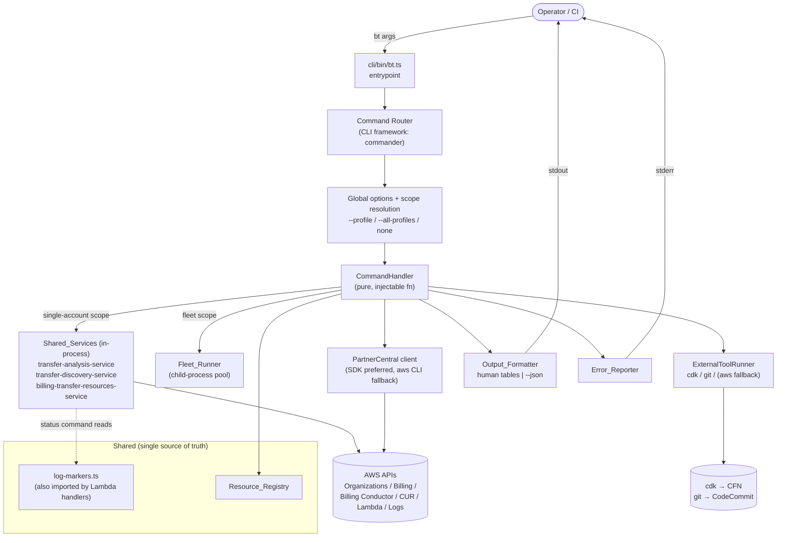

<!--
Copyright Amazon.com, Inc. or its affiliates. All Rights Reserved.
SPDX-License-Identifier: MIT-0
-->

# Design Document

## Overview

This design replaces the 12 Bash scripts and 1 TypeScript script under `scripts/` with a single
TypeScript executable, `bt`, that exposes partner-friendly Billing Transfer operations and preserves
the existing fleet (multi-account) operating model. The CLI is a thin, testable orchestration layer over
the project's existing typed services in `lib/lambda/common/services` and models in
`lib/lambda/common/models`; it does not re-implement billing logic, AWS Organizations list calls, or
resource matching.

The design is organized around five goals drawn from the requirements:

1. **One discoverable tool** (`bt`) with six command groups and twelve commands, wired through
   `package.json` `bin` (Req 1, 2, 23).
2. **Maximum reuse, zero overlap** — analysis and discovery go through `transfer-analysis-service` and
   `transfer-discovery-service`; reconciliation status parses the *typed* `ReconciliationSummary` /
   CUR summary shapes instead of `jq`; log completion/failure markers move into a shared constant module
   so the Lambda handlers and the CLI cannot drift (Req 8, 9, 12, 22). Reuse extends to the
   Shared_Utilities — the error helpers (`errors.ts`) and the retry helper (`retry.ts`) are reused rather
   than re-implemented — and because those reused paths emit diagnostic logs, the CLI silences that logging
   by default and routes it to stderr only under `--verbose`, so the `--json`/stdout result contract is
   never corrupted (Req 24).
3. **A uniform scope model** across every command: `--profile <name>` (single named profile),
   `--all-profiles` (fleet), or neither (ambient credentials). Fleet *mutating* commands are
   **dry-run by default** and require `--execute` (Req 3, 4, 11, 13, 15, 18, 20).
4. **Two real obstacles solved deliberately**: module-level singleton SDK clients + a module-level
   `resourceCache` make in-process multi-profile concurrency unsafe (solved with a
   **child-process-per-profile** Fleet_Runner); and a typed Partner Central SDK client
   (`@aws-sdk/client-partnercentral-channel`) exists and is added as a project dependency, removing the
   `python3` JSON parsing in `register-pma.sh` — the `aws` CLI spawn remains only as a contingency
   fallback (Req 17, 22).
5. **Single language, no external interpreters** — no `jq`, no `python3` at runtime (Req 22.5).

The CLI keeps command handlers as pure, injectable functions so they can be unit-tested by direct
function call with mocked AWS clients (Req 22.3, 22.4), and uses the existing dev dependencies
(`aws-sdk-client-mock`, `fast-check`, `jest`) for tests. The fleet model is implemented by having the
parent process re-invoke the same single-account command path as a child process per profile, which
reuses the exact in-process code, isolates credentials, and sidesteps the singleton/cache hazards.

This design also surfaces a small set of **requirements deltas** that fall out of decisions made with the
user (most notably the default profile-list path moving to `./payer-profiles.txt` relative to the current
working directory). These are listed explicitly in the final section.

## Architecture

### High-level structure

The CLI is a layered system. The entrypoint parses global options and routes to a command group, which
routes to a command handler. Handlers are pure functions that receive parsed options plus an injected IO
context (output sink, AWS client factory, environment) and return a typed result and an exit code. Handlers
call the shared services in-process for single-account work, or the Fleet_Runner for fleet scope. The
Fleet_Runner re-invokes the same single-account command as a child process per profile and aggregates the
typed JSON each child prints.



Two security and correctness notes that shape the architecture:

- **stdout is reserved for results.** In `--json` mode the Output_Formatter writes exactly one JSON
  document to stdout — a result payload on success or a structured error object on failure — and routes all
  progress/diagnostics to stderr (Req 7.2, 7.3, 7.4). This is what makes the child-process fleet model
  possible: the parent always reads a clean JSON document from each child's stdout, whether the child
  succeeded or failed.
- **No network egress beyond AWS.** The CLI only talks to AWS endpoints (via the shared services / SDK)
  and to local tools (`cdk`, `git`). It transmits no project code or secrets to third parties.

### Fleet_Runner child-process model

Fleet commands do not run multiple profiles in one Node process. Instead the parent process spawns the
*same* single-account command as a child, once per profile, with bounded concurrency. Each child sets
exactly one ambient profile (via `AWS_PROFILE`) and prints its typed result as JSON to stdout; the parent
aggregates those results, writes per-account logs from child stderr, continues on failure, and computes a
fleet exit code.

```mermaid
sequenceDiagram
    participant P as Parent (bt fleet/transfers ... --all-profiles)
    participant PL as Profile_Loader
    participant FR as Fleet_Runner (concurrency pool, default 5)
    participant C1 as Child: bt <cmd> --profile A --json
    participant C2 as Child: bt <cmd> --profile B --json
    participant AGG as Aggregator + Output_Formatter

    P->>PL: load profiles (ordered)
    PL-->>P: [A, B, C, ...]
    P->>FR: run(cmd, profiles, {execute, parallel})
    FR->>C1: spawn (AWS_PROFILE=A), stdout=JSON, stderr=log file A
    FR->>C2: spawn (AWS_PROFILE=B), stdout=JSON, stderr=log file B
    C1-->>FR: exit code + AccountResult JSON (stdout)
    C2-->>FR: exit code + AccountResult JSON (stdout)
    Note over FR: continue-on-failure;<br/>record failures, keep going
    FR-->>AGG: AccountResult[]
    AGG->>P: FleetResult (aggregated) + exit code<br/>(any failure ⇒ non-zero)
```

Why child-process-per-profile (chosen for v1):

- **Isolation by construction.** Each child binds one ambient credential set and gets its own
  module-level singleton clients and its own `resourceCache`. There is no cross-contamination because
  there is no shared mutable module state across profiles.
- **Exact code reuse.** The child runs the real single-account in-process path (the same handler a user
  runs directly), so fleet behavior cannot diverge from single-account behavior.
- **Operational fit.** Per-account stderr maps cleanly to the existing per-account log files
  (`DEPLOY_LOG_DIR`, `RECON_LOG_DIR`, `ANALYZE_LOG_DIR`), continue-on-failure and aggregated summaries map
  to the existing `run_parallel` behavior, and a non-zero parent exit on any child failure preserves the
  CI contract (Req 20).
- **Self-invocation.** The parent resolves its own entrypoint to re-invoke: `process.execPath` plus the
  resolved CLI entry, handling both the compiled `dist/cli/bin/bt.js` path and the `tsx` dev path.

The considered alternative — **dependency-injection refactor** — is described in *Service Reuse &
Refactors*; it is deliberately deferred.

### Module layout

A new top-level `cli/` directory keeps the CLI separate from Lambda/CDK code while importing shared
services directly.

```
cli/
  bin/
    bt.ts                      # executable entrypoint (#!/usr/bin/env node); parse + route + exit
  commands/
    transfers/analyze.ts       # handler: bt transfers analyze [--all-profiles]
    reconciliation/trigger.ts  # handler: bt reconciliation trigger [--all-profiles]
    reconciliation/status.ts   # handler: bt reconciliation status
    fleet/deploy.ts            # handler: bt fleet deploy
    fleet/status.ts            # handler: bt fleet status
    git/setup-remotes.ts       # handler: bt git setup-remotes
    git/push.ts                # handler: bt git push
    partner-central/register-pma.ts
    partner-central/seed-params.ts
    test/termination.ts        # handler: bt test termination
  lib/
    resource-registry.ts       # Resource_Registry (ports scripts/lib/common.sh constants)
    profile-loader.ts          # Profile_Loader (ports scripts/lib/profiles.sh)
    output-formatter.ts        # Output_Formatter (human tables + colors + --json)
    error-reporter.ts          # Error_Reporter (classification + remediation hints)
    input-validator.ts         # Input_Validator (account id, states, types, targets, programs)
    fleet-runner.ts            # Fleet_Runner (child-process pool)
    aws-clients.ts             # AwsClientFactory (per-context client construction for handlers/tests)
    external-tool-runner.ts    # typed spawn wrappers for cdk / git / aws-cli-fallback
    partner-central-client.ts  # SDK-preferred wrapper, CLI-spawn fallback
    io-context.ts              # IoContext: output sink, env, client factory, runner (injectable)
    exit-codes.ts              # CliExitCode enum
lib/lambda/common/
    log-markers.ts             # NEW shared constants, imported by CLI status + Lambda handlers
```

The CLI compiles with the project `tsc` (extending the root `tsconfig.json`) into `dist/`, and runs in dev
with `tsx`. Tests continue to use `jest` + `ts-jest`.

## Components and Interfaces

All handlers share one signature so the router, the Fleet_Runner, and unit tests treat them uniformly. The
`IoContext` is the single injection seam: tests pass a context with mocked AWS clients (via
`aws-sdk-client-mock`), an in-memory output sink, and a stub external-tool runner, satisfying Req 22.3 and
22.4 without spawning a process.

### CommandHandler and IoContext

```typescript
/** Scope resolved from global options, applied uniformly to every command. */
export type Scope =
  | { kind: 'profile'; profile: string }   // --profile <name>
  | { kind: 'all-profiles' }               // --all-profiles (fleet)
  | { kind: 'ambient' };                    // neither (active/ambient credentials)

export interface GlobalOptions {
  scope: Scope;
  profilesFile?: string;   // --profiles-file <path> or $PAYER_PROFILES_FILE
  json: boolean;           // --json
  color: boolean;          // false when --no-color or non-TTY
  execute: boolean;        // --execute (mutating fleet commands; dry-run when false)
  parallel?: number;       // --parallel [N]
  verbose: boolean;        // --verbose (route diagnostic logs to stderr; default silent)
}

/** Injected IO + dependency seam. Real run wires AWS/process; tests wire mocks. */
export interface IoContext {
  stdout: OutputSink;            // result output (human or JSON)
  stderr: OutputSink;            // diagnostics, progress, errors
  env: NodeJS.ProcessEnv;        // environment (for PAYER_PROFILES_FILE, .env-derived values)
  cwd: string;                   // current working directory (profile-list resolution)
  clients: AwsClientFactory;     // per-context AWS SDK clients (mockable)
  tools: ExternalToolRunner;     // cdk/git/aws spawn wrappers (stubbable)
  fleet: FleetRunner;            // child-process pool (stubbable)
  formatter: OutputFormatter;
  reporter: ErrorReporter;
  now: () => number;             // injectable clock for deterministic tests
}

/** Every command is a pure function of (options, context) ⇒ (result, exitCode). */
export type CommandHandler<TOptions, TResult> = (
  options: TOptions & { global: GlobalOptions },
  ctx: IoContext
) => Promise<{ result: TResult; exitCode: CliExitCode }>;
```

### Profile_Loader

Ports `scripts/lib/profiles.sh` exactly, with the path-resolution delta (see Requirements Deltas): default
is `./payer-profiles.txt` resolved relative to `ctx.cwd`, overridable by `--profiles-file` then
`$PAYER_PROFILES_FILE`.

```typescript
export interface ProfileLoader {
  /**
   * Resolve the profile list file, then parse it:
   *  - resolution order: options.profilesFile → env.PAYER_PROFILES_FILE → <cwd>/payer-profiles.txt
   *  - drop blank lines and lines whose first non-whitespace char is '#'
   *  - strip inline '# comment' suffixes; trim leading/trailing whitespace
   *  - preserve file order
   * Throws ProfileListError on: file not found, unreadable, or zero profiles after parsing.
   */
  load(global: GlobalOptions, ctx: IoContext): string[];

  /** Pure parser exposed for property tests (no filesystem). */
  parseProfiles(fileContents: string): string[];

  /** Pure resolver exposed for unit tests. */
  resolvePath(global: GlobalOptions, ctx: IoContext): string;
}
```

Parsing mirrors the shell pipeline `grep -vE '^[[:space:]]*(#|$)' | sed -E 's/[[:space:]]+#.*$//; s/[[:space:]]+$//'`:
a line is dropped when, after left-trim, it is empty or begins with `#`; otherwise an inline comment
(whitespace followed by `#` to end of line) is removed and the remainder is trimmed.

### Resource_Registry

Single in-code source of truth, porting the constants block of `scripts/lib/common.sh` (Req 21). Nothing
outside this module hard-codes these names.

```typescript
export const ResourceRegistry = {
  defaultRegion: 'us-east-1',                                  // Default_Region (Req 21.2): global-endpoint region + regional fallback
  pipelineStackName: 'SampleAutomationsForBillingTransfer-PipelineStack',
  pipelineName: 'SampleAutomationsForBillingTransferPipeline', // CodePipeline execution name
  featureStacks: [
    'BT-BillingGroupEventHandlerStack',
    'BT-BillingGroupReconciliationStack',
    'BT-CURReconciliationStack',
    'BT-BillingTransferTerminationStack',
    'BT-PartnerCentralChannelRolesStack',
  ] as const,
  functions: {
    billingGroupReconciliation: 'billing-group-reconciliation',
    curReconciliation: 'cur-reconciliation',
    terminationHandler: 'billing-transfer-termination-handler',
  },
  dlqs: {
    billingGroupReconciliation: 'billing-reconciliation-dlq',
    curReconciliation: 'cur-reconciliation-dlq',
  },
  ssmParams: {
    linkedAccountId: '/billing-transfer/partner-central/linked-account-id',
    enableManagementRole: '/billing-transfer/partner-central/enable-management-role',
  },
} as const;

/** Feature-stack count is derived, never hard-coded (mirrors fleet-status.sh). */
export const FEATURE_STACK_COUNT = ResourceRegistry.featureStacks.length;
```

The registry continues to hold `Default_Region = us-east-1` as both the global-endpoint region for
Global_Services and the regional fallback used when an active profile has no configured region (Req 21.2,
21.5). The global-vs-regional classification of services is not hard-coded per call site; it lives alongside
the client factory (see *AwsClientFactory*), so the registry stays a pure name/region source of truth while
the factory owns which endpoint each client targets.

### Output_Formatter

Renders results as human tables/colorized text by default, or a single valid JSON document with `--json`.
JSON goes only to stdout; all diagnostics go to stderr (Req 7).

```typescript
export interface OutputFormatter {
  /** Human path: tables/sections to stdout; honors color flag. */
  renderHuman(view: RenderableView, ctx: IoContext): void;
  /** JSON path: writes exactly one JSON.stringify document to stdout (result or structured error), nothing else. */
  renderJson(payload: unknown, ctx: IoContext): void;
  /** Chooses path based on global.json; the single entry handlers call. */
  emit(payload: unknown, view: RenderableView, global: GlobalOptions, ctx: IoContext): void;
}
```

In `--json` mode a handler computes either a complete result payload or a structured error object before
emitting, and the Output_Formatter emits exactly one valid JSON document to stdout in both the success and
failure cases (never partial or invalid JSON); human-readable diagnostics go to stderr, and a failure still
exits non-zero (Req 7.4).

### Error_Reporter

Classifies AWS failures and writes a message + remediation hint to stderr, never stdout (Req 6). The
classification order is fixed: missing/invalid credentials → access-denied → throttling → unknown
(Req 6.7). The legacy substring checks (`credentials`, `AccessDenied`, `throttl`) from
`analyze-billing-transfers.ts` are preserved and extended with SDK error names/`$metadata` codes.

```typescript
export type FailureClass =
  | 'credentials'      // missing/invalid credentials
  | 'access-denied'    // AccessDenied / authorization
  | 'throttling'       // throttling / rate exceeded
  | 'unknown';

export interface ErrorReporter {
  classify(error: unknown): FailureClass;          // applies the fixed precedence order
  remediation(cls: FailureClass, ctx: { profile?: string; operation?: string }): string;
  report(error: unknown, ctx: IoContext, hint?: { profile?: string; operation?: string }): void;
}
```

### Input_Validator

Pure, AWS-free checks that run before any AWS call (Req 5, 17.3, 18.3). Account IDs reuse the existing
12-digit rule (`^[0-9]{12}$`); states/types reuse the `VALID_STATES`/`VALID_TYPES` literals already present
in the codebase; targets are `bg|cur|both`; PMA programs are `DP|SPP|DS` (and their enum forms);
`--lookback` is an integer in `[1, 10080]` (Req 12.5).

```typescript
export interface InputValidator {
  accountId(value: string): Result<string>;               // exactly 12 digits, no other chars
  relationshipState(value: string): Result<RelationshipState>; // case-sensitive exact match
  transferType(value: string): Result<TransferType>;       // 'direct' | 'indirect'
  reconciliationTarget(value: string): Result<'bg' | 'cur' | 'both'>;
  pmaProgram(value: string): Result<{ type: 'DP'|'SPP'|'DS'; program: string }>;
  lookbackMinutes(value: string): Result<number>;          // integer in [1, 10080]
}

export type Result<T> =
  | { ok: true; value: T }
  | { ok: false; invalidValue: string; accepted: string[] }; // drives the Error_Reporter message
```

### Fleet_Runner

A bounded-concurrency promise pool that replaces the Bash `run_parallel`. It spawns the same single-account
command as a child per profile, writes per-account logs, continues on failure, and aggregates a typed
summary with a CI exit code (Req 9, 11, 13, 16, 18, 20).

```typescript
export interface FleetRunnerOptions {
  command: string[];          // e.g. ['transfers', 'analyze'] — the single-account form
  passthroughArgs: string[];  // command-specific flags forwarded to each child (e.g. --validate)
  profiles: string[];         // ordered, from Profile_Loader
  parallel: number;           // concurrency cap; default 5 (see Open Question #5 resolution)
  execute: boolean;           // forwarded; mutating children no-op unless true
  logDir: string;             // per-account stderr log destination
}

export interface AccountResult<TData = unknown> {
  profile: string;
  status: 'ok' | 'failed';
  exitCode: number;
  data?: TData;               // parsed from child stdout JSON when status === 'ok'
  failureDetail?: string;     // cause or pointer to logDir/<profile>.log (Req 20.4)
}

export interface FleetResult<TData = unknown> {
  accounts: AccountResult<TData>[];
  succeeded: number;
  failed: number;
  exitCode: CliExitCode;      // failed > 0 ⇒ non-zero (Req 20.4/20.5)
}

export interface FleetRunner {
  run<TData>(opts: FleetRunnerOptions, ctx: IoContext): Promise<FleetResult<TData>>;
  /** Resolves the self-invocation argv: [execPath, entry, ...command, '--profile', p, '--json']. */
  selfInvocation(command: string[], profile: string, ctx: IoContext): string[];
}
```

`selfInvocation` resolves the entrypoint from `process.execPath` + the resolved CLI entry, detecting
compiled (`dist/cli/bin/bt.js` run by `node`) vs dev (`bt.ts` run by `tsx`) so the parent always re-invokes
the correct binary.

### AwsClientFactory (credential strategy)

The single-account, in-process path needs a way to obtain AWS clients that handlers and tests can both
control. The factory centralizes per-client region selection and adaptive retry, mirroring
`lib/lambda/common/utils/clients.ts`, but is constructed per invocation rather than at module scope so
tests can inject mocks. It distinguishes two service classes (Req 21.4, 21.5): **Global_Service** clients
(Organizations, Billing, Billing Conductor, CUR) are pinned to the Default_Region (`us-east-1`) because the
billing-transfer control-plane services are reached through a global endpoint there; **Regional_Service**
clients (Lambda, CloudWatch Logs, SQS, CloudFormation, CodePipeline) are built for the region resolved for
the active profile, falling back to the Default_Region when that profile has no configured region. The
rationale: the billing-transfer control-plane services use a global endpoint (`us-east-1`), whereas the
deployed automation's Lambdas, dead-letter queues, CloudFormation stacks, and pipeline live in the account's
working region.

```typescript
export interface AwsClientFactory {
  // --- Global_Service clients: pinned to Default_Region us-east-1 (global endpoint) (Req 21.4) ---
  organizations(): OrganizationsClient;
  billing(): BillingClient;
  billingConductor(): BillingconductorClient;
  cur(): CostAndUsageReportServiceClient;
  // --- Regional_Service clients: active-profile region, Default_Region fallback (Req 21.5) ---
  lambda(): LambdaClient;          // reconciliation trigger
  cloudWatchLogs(): CloudWatchLogsClient; // reconciliation status
  sqs(): SQSClient;                 // DLQ depth for status
  ssm(): SSMClient;                 // seed-params
  cloudFormation(): CloudFormationClient; // fleet status / git setup (stack outputs)
  codePipeline(): CodePipelineClient;     // fleet status latest pipeline execution
}
```

> Note: this assumes the feature stacks are deployed in the profile's configured region;
> multi-region-per-account deployments are out of scope.

Credential resolution is by ambient profile: a child process sets `AWS_PROFILE`, and the standard AWS
credential chain applies (Req 3.3). The single-account `--profile` form likewise resolves through the SDK's
profile-aware credential providers. The CLI does **not** require any specific credential source (Req 3.4).

> The shared services (`organizations-service`, `transfer-*-service`,
> `billing-transfer-resources-service`) import module-level singleton clients today. For v1 the
> single-account in-process path uses those services as-is under the ambient profile; the factory is the
> seam used by handlers that make direct SDK calls not covered by a shared service (Lambda invoke, Logs,
> SQS, SSM, CloudFormation). See *Service Reuse & Refactors* for why a full DI refactor of the services is
> deferred and how the child-process model makes the singletons safe in the meantime.

### ExternalToolRunner

Commands that wrap real external tools — `cdk` for `fleet deploy`, `git` for `git setup-remotes`/`git push`,
and the optional `aws` CLI fallback for Partner Central — legitimately remain shell-outs. The runner is a
typed wrapper around child-process spawning with non-interactive defaults.

```typescript
export interface ExternalToolRunner {
  cdk(args: string[], opts: SpawnOpts): Promise<ToolResult>;  // bootstrap/deploy/destroy/synth
  git(args: string[], opts: SpawnOpts): Promise<ToolResult>;  // remote add/remove/get-url/push
  aws(args: string[], opts: SpawnOpts): Promise<ToolResult>;  // fallback only; --output json
  run(cmd: string, args: string[], opts: SpawnOpts): Promise<ToolResult>;
}

export interface SpawnOpts {
  profile?: string;            // sets AWS_PROFILE / --profile as appropriate
  cwd?: string;
  outputDir?: string;          // cdk --output for per-account isolated synth (Req 13.10)
  logStream?: WritableLike;    // per-account log destination
  nonInteractive?: boolean;    // always true: --require-approval never, --no-cli-pager, etc.
}
```

For `fleet deploy`, the runner preserves the legacy per-account isolation: each account synthesizes under
its own profile into an isolated `cdk --output cdk.out.<profile>` directory, then bootstraps (unless
`--skip-bootstrap`) and deploys (Req 13.2, 13.3, 13.10). Because `fleet deploy` already isolates per-account
via child processes, the cdk invocations themselves carry the profile.

### PartnerCentral client (decision)

`register-pma.sh` shells out to `aws partnercentral-channel` and parses responses with `python3`.
Requirement 17.2 forbids an external interpreter. The Partner Central Channel API exists as a real AWS
service, and a JavaScript v3 client (`@aws-sdk/client-partnercentral-channel`) **is published** (version
~3.1057.0, Apache-2.0). That typed client is the chosen implementation: it is added as a project dependency
and used directly, eliminating both `python3` and the `aws` CLI shell-out on the primary path.

**Decision: use the AWS SDK v3 `@aws-sdk/client-partnercentral-channel` client as the primary, default
implementation; retain a CLI-spawn fallback (`aws partnercentral-channel ... --output json`, parsed in
TypeScript) only as a contingency for environments where the new dependency cannot be installed.**

```typescript
export interface PartnerCentralClient {
  createProgramManagementAccount(input: CreatePmaInput): Promise<{ pmaId: string }>;
  createChannelHandshake(input: CreateHandshakeInput): Promise<{ handshakeId: string }>;
  acceptChannelHandshake(input: AcceptHandshakeInput): Promise<{ status: string }>;
}
// Two implementations behind one interface:
//   SdkPartnerCentralClient   — DEFAULT/PRIMARY: uses @aws-sdk/client-partnercentral-channel with the typed
//                               CreateProgramManagementAccountCommand / CreateChannelHandshakeCommand /
//                               AcceptChannelHandshakeCommand operations (no external process)
//   CliPartnerCentralClient   — CONTINGENCY FALLBACK ONLY: spawns `aws partnercentral-channel ... --output
//                               json` and JSON.parse in TS, for environments where the SDK dependency is
//                               unavailable
```

Both implementations parse responses in TypeScript (no `python3`), satisfying Req 17.2 and 22.5. The
`SdkPartnerCentralClient` is selected by default; the `CliPartnerCentralClient` is used only when the SDK
package cannot be resolved/installed in the target environment. Adopting the SDK client adds one new
dependency (`@aws-sdk/client-partnercentral-channel`) — captured in the *Dependencies* section. The
three-step ordering (register → create handshake → accept), the central/payer profile split, the default
display name `PMA-<TYPE>-<last4>`, and the failure semantics are preserved exactly (Req 17.1, 17.4–17.10).

### Diagnostic logging (CliLogger / shared logger wiring)

The reused Shared_Services and Shared_Utilities log heavily through the shared Powertools `logger` singleton
in `lib/lambda/common/utils/logger.ts`, which writes structured JSON to **stdout** by default. Left
unmanaged this would corrupt the `--json`/stdout result contract (Req 7) and break the child-process fleet
model, where the parent parses each child's stdout as JSON. The CLI takes ownership of that logging stream:

- **Silent by default.** On startup `cli/bin/bt.ts` configures the shared Powertools `logger` so that no
  Diagnostic_Log line reaches stdout. The intent is stderr-only, never stdout: the entrypoint either sets the
  logger's level to silence it or redirects the logger's output stream to stderr, so that with `--verbose`
  absent diagnostic output is suppressed and with `--verbose` present it is emitted on **standard error
  only** — even when `--json` is also set (Req 24.3, 24.4, 24.5, 24.6).
- **One singleton covers the reused code.** Because the reused Shared_Services and the retry helper all log
  through this same `logger` singleton, configuring it centrally at startup also silences/redirects their
  diagnostic output; no per-service wiring is needed.
- **The CLI's own diagnostics use the same channel.** The CLI's progress and diagnostic messages (for
  example the per-account preflight line and fleet progress) are written to stderr — either through this same
  `logger` or through the `IoContext` `stderr` OutputSink — so they share the single stderr discipline.
- **This is what keeps the fleet model correct.** With diagnostics confined to stderr, each child's stdout
  stays pure JSON, so the parent Fleet_Runner can always parse a clean result document from a child's stdout
  regardless of how much the reused services log.

### Shared_Utilities reuse

The CLI reuses the typed Shared_Utilities in `lib/lambda/common/utils` rather than re-implementing them
(Req 24.1, 24.2):

- **Error helpers (`errors.ts`).** The Error_Reporter classifies and reports AWS failures using
  `getErrorCode`, `getErrorMessage`, and `toError`, together with the retryable/critical predicates and sets
  (`isRetryableError`/`isCriticalError`, `RETRYABLE_ERROR_CODES`/`CRITICAL_ERROR_CODES`). This is the same
  detection the legacy substring checks approximated, now sourced from the shared module.
- **Retry helper (`retry.ts`).** `retryWithBackoff` (with `DEFAULT_RETRY_CONFIG`) wraps the CLI's own direct
  AWS SDK calls that are not made through a Shared_Service — Lambda invoke, CloudWatch Logs, SQS, SSM,
  CloudFormation, and CodePipeline — so transient-failure handling has parity with the shared services.

## Command Catalog

The CLI provides six command groups and twelve commands. Every command honors the uniform scope model and
the global options. "Scope" indicates which of `--profile` / `--all-profiles` / ambient the command
supports. Fleet mutating commands are dry-run by default and require `--execute`.

| Command | Replaces | Mutating? | Scope support | Command-specific options | Reuses (service / tool) |
|---|---|---|---|---|---|
| `bt transfers analyze` | `analyze-billing-transfers.ts` | No (read) | profile / ambient | `--state`, `--account`, `--type`, `--validate` | `transfer-analysis-service.analyzeTransfers` / `analyzeAccountTransfers` / `validateTransferResources` |
| `bt transfers analyze --all-profiles` | `analyze-all-profiles.sh` | No (read) | all-profiles | `--state`, `--account`, `--type`, `--validate`, `--parallel` | Fleet_Runner → child `transfers analyze`; aggregates typed `AnalysisSummaryModel` + `ValidationResultModel` |
| `bt reconciliation trigger` | `trigger-reconciliation.sh` | Yes | profile / ambient | `--target bg\|cur\|both` | `LambdaClient` async invoke; fn names from Resource_Registry |
| `bt reconciliation trigger --all-profiles` | `trigger-reconciliation-all-profiles.sh` | Yes (fleet, dry-run default) | all-profiles | `--target`, `--execute`, `--parallel` | Fleet_Runner → child `reconciliation trigger` |
| `bt reconciliation status` | `check-reconciliation-status.sh` | No (read) | profile / all-profiles / ambient | `--target`, `--lookback` | `CloudWatchLogsClient` + `SQSClient`; parses typed `ReconciliationSummary` / CUR summary; markers from `log-markers.ts` |
| `bt fleet deploy` | `deploy-all-profiles.sh` | Yes (fleet, dry-run default) | all-profiles | `--execute`, `--skip-bootstrap`, `--parallel [N]` | ExternalToolRunner `cdk`; pipeline stack from Resource_Registry |
| `bt fleet status` | `fleet-status.sh` | No (read) | all-profiles | `--parallel` | `CloudFormationClient` + CodePipeline; feature stacks from Resource_Registry |
| `bt git setup-remotes` | `setup-git-remotes.sh` | Local git only | all-profiles | (none) | ExternalToolRunner `git`; repo name from pipeline stack outputs |
| `bt git push` | `push-all-profiles.sh` | Yes (fleet, dry-run default) | all-profiles | `--execute`, `--branch`, `--ref` | ExternalToolRunner `git`; remote name derivation |
| `bt partner-central register-pma` | `register-pma.sh` | Yes | profile (central+payer) | `<account-id>`, `<program>`, `[display-name]`, central/payer profile opts | PartnerCentralClient (SDK or CLI fallback) |
| `bt partner-central seed-params` | `seed-channel-role-params.sh` | Yes (dry-run default) | profile / all-profiles | `--execute`, `--linked-account-id`, `--enable-management-role` | `SSMClient`; param paths from Resource_Registry; `.env` fallback |
| `bt test termination` | `test-termination-handler.sh` | Yes | ambient/profile | `--deploy`, `--test-only`, `--cleanup` | ExternalToolRunner `cdk` + Jest integration test; names from Resource_Registry |

Note on `reconciliation status` (deliberate change): the legacy script defaulted to fleet when no
`--profile` was given. The CLI uses the uniform scope model instead — `--profile` (single),
`--all-profiles` (fleet), or neither (ambient single account). This is a requirements delta (see below).

Note on `bt test termination` (`--deploy` vs `--test-only`): `--deploy` and `--test-only` are mutually
exclusive — providing both is a usage error, so the CLI reports the conflict and exits non-zero before
deploying or testing (Req 19.10). `--test-only` runs the integration test against the already-deployed
termination stack without deploying first (Req 19.9), whereas `--deploy` deploys the stack to a completed
state before testing; `--cleanup` destroys the stack after the test regardless of outcome.

## CLI UX & Help

Help, version, and no-args output go to **stdout** with exit code 0. Unknown commands/options go to
**stderr** with a non-zero exit (Req 1.2–1.7). The structure below was reviewed and approved: a short
description line, USAGE, the relevant COMMAND GROUPS / COMMANDS / OPTIONS sections, GLOBAL OPTIONS, a SAFETY
note for dry-run-by-default mutating commands, and EXAMPLES.

### Top-level: `bt --help`

```
bt — Billing Transfer operations for one account or a fleet of payer accounts.

USAGE
  bt <group> <command> [options]

COMMAND GROUPS
  transfers         Analyze billing transfers and their resources (read-only)
  reconciliation    Trigger reconciliation and check its status
  fleet             Deploy the pipeline and view deployment health across payers
  git               Configure CodeCommit remotes and push to trigger pipelines
  partner-central   Register a PMA and seed channel-role SSM parameters
  test              Run the termination-handler integration test

GLOBAL OPTIONS
  --profile <name>        Target a single named AWS profile
  --all-profiles          Target every profile in the profile list (fleet)
  --profiles-file <path>  Profile list file (default: ./payer-profiles.txt; env: PAYER_PROFILES_FILE)
  --json                  Emit a single JSON document to stdout (diagnostics go to stderr)
  --no-color              Disable colored output
  -h, --help              Show help
  -v, --version           Show version (from package.json)

EXAMPLES
  bt transfers analyze --validate
  bt transfers analyze --all-profiles -- --validate
  bt reconciliation status --all-profiles --target both
  bt fleet deploy --all-profiles --execute --parallel 5

Run "bt <group> --help" or "bt <group> <command> --help" for details.
```

### Group-level: `bt fleet --help`

```
bt fleet — Deploy the pipeline and view deployment health across payer accounts.

USAGE
  bt fleet <command> [options]

COMMANDS
  deploy   Deploy the pipeline stack to every payer account (dry-run by default)
  status   Report pipeline + feature-stack health across every payer account (read-only)

GLOBAL OPTIONS
  --all-profiles, --profiles-file <path>, --json, --no-color, -h/--help, -v/--version

EXAMPLES
  bt fleet status --all-profiles
  bt fleet deploy --all-profiles --execute --parallel 5 --skip-bootstrap
```

### Command-level: `bt fleet deploy --help`

```
bt fleet deploy — Deploy the pipeline stack to every payer account.

USAGE
  bt fleet deploy --all-profiles [--execute] [--skip-bootstrap] [--parallel [N]]

DESCRIPTION
  For each profile in the profile list, resolves the account/region, optionally runs
  `cdk bootstrap`, then `cdk deploy` of the pipeline stack. Each account synthesizes
  under its own profile into an isolated output directory so concurrent synth cannot
  collide. Continues on per-account failure and prints an aggregated summary.

OPTIONS
  --execute          Perform the deploy. Without it, runs as a DRY-RUN and only prints
                     the bootstrap/deploy actions that would be taken per account.
  --skip-bootstrap   Skip `cdk bootstrap` (use when accounts are already bootstrapped).
  --parallel [N]     Deploy up to N accounts concurrently (default N=5). Without the flag,
                     deploys sequentially, one account at a time.

GLOBAL OPTIONS
  --all-profiles, --profiles-file <path>, --json, --no-color, -h/--help

SAFETY
  This is a fleet MUTATING command and is DRY-RUN BY DEFAULT. No account is changed
  unless you pass --execute. A dry-run exits 0; any per-account failure in execute mode
  exits non-zero.

EXAMPLES
  bt fleet deploy --all-profiles                         # dry-run: prints planned actions
  bt fleet deploy --all-profiles --execute               # sequential deploy
  bt fleet deploy --all-profiles --execute --parallel 5  # up to 5 accounts at a time
```

### CLI framework choice

**Recommendation: `commander`.** It is a mature, widely used, dependency-light TypeScript-friendly CLI
framework that supports nested subcommands (group → command), typed options, custom help output, and
explicit control over stdout vs stderr and exit codes — exactly what Req 1 and Req 7 require. `yargs` is a
capable alternative but is heavier and its middleware/coercion model is more than this CLI needs. The
deciding factors are nested-command ergonomics, the ability to fully control help/exit streams (so help
goes to stdout with exit 0 and errors to stderr with non-zero), and a small dependency footprint. The
framework is used only for parsing/routing/help; all command logic lives in injectable handlers so the
framework choice does not leak into testable code.

## Data Models

The CLI reuses the existing typed models and introduces a small set of CLI-only types. No billing logic is
re-modeled.

### Reused Shared_Models (consumed, not redefined)

- `BillingTransferModel`, `RelationshipState`, `TransferType` — `models/billing-transfer.ts`
- `AnalysisSummaryModel` (incl. `resourceCounts.{withBillingGroups, missingBillingGroups, missingCURConfigurations, ...}`) and `BillingTransferWithResourcesModel` — `models/analysis-summary.ts`, `models/billing-transfer-resources.ts`
- `ValidationResultModel` (incl. `orphanedResources.{billingViews, billingGroups}`, `issuesByType`) — `models/validation-result.ts`
- `ReconciliationSummary` (`billingGroupsCreated`, `billingGroupsExisted`, `errors[]`, ...) — `billing-group-reconciliation/reconciliation-service.ts`
- CUR summary fields (`myViewReportsFailed`, `showbackViewReportsFailed`, `failedTransfersCount`, ...) — `cur-reconciliation`

The fleet analyze rollup is built by reading these typed fields directly from each child's emitted
`AnalysisSummaryModel`/`ValidationResultModel` — **no stdout scraping** (contrast with
`analyze-all-profiles.sh`, which greps/seds `extract_num` over text).

### New CLI-only types

```typescript
/** Standardized process exit codes (Req 1, 6, 9, 11, 15, 18, 20). */
export enum CliExitCode {
  Success = 0,
  GeneralError = 1,        // validation failure, unknown error, single-account failure
  FleetPartialFailure = 2, // one or more accounts failed in a fleet run
  Usage = 64,              // unknown command/option (sysexits-style; non-zero is the contract)
}

/** Per-account result of a fleet child process (see Fleet_Runner). */
export interface AccountResult<TData = unknown> {
  profile: string;
  status: 'ok' | 'failed';
  exitCode: number;
  data?: TData;
  failureDetail?: string;
}

/** Aggregated fleet outcome (see Fleet_Runner). */
export interface FleetResult<TData = unknown> {
  accounts: AccountResult<TData>[];
  succeeded: number;
  failed: number;
  exitCode: CliExitCode;
}

/** Fleet transfer-analysis rollup row (Req 9.2–9.4), built from typed AnalysisSummaryModel. */
export interface AnalyzeRollupRow {
  profile: string;
  status: 'ok' | 'failed';
  total: number;
  direct: number;
  indirect: number;
  withBillingGroups: number;
  missingBillingGroups: number;
  missingCurConfigurations: number;
  orphaned: number | 'not-computed'; // 'not-computed' shown distinctly when --validate absent (Req 9.4)
}

/** Reconciliation status per evaluated function (Req 12). */
export type ReconStatus = 'DONE' | 'ATTENTION' | 'FAILED' | 'PENDING';
export interface ReconFunctionStatus {
  func: 'bg' | 'cur';
  status: ReconStatus;
  itemErrors: number;
  dlqDepth: number;
  detail: string;
}
```

## Service Reuse & Refactors

This section is the core of the design: it states precisely what is reused, what small refactor is
required, and how the two real obstacles are resolved.

### Reuse points (no re-implementation)

1. **Transfer analysis (single + fleet).** `bt transfers analyze` calls
   `transfer-analysis-service.analyzeTransfers()`, `analyzeAccountTransfers(accountId)`, and
   `validateTransferResources()` directly. The fleet rollup reads typed fields
   (`AnalysisSummaryModel.totalTransfers`, `directTransferCount`, `indirectTransferCount`,
   `resourceCounts.withBillingGroups` / `missingBillingGroups` / `missingCURConfigurations`, and
   `ValidationResultModel.orphanedResources.billingViews` + `billingGroups`). This eliminates the
   `analyze-all-profiles.sh` text scraping (`extract_num` grep/sed) entirely (Req 8, 9, 22.2).
2. **Active-relationship discovery.** `transfer-discovery-service.findAllTransfers()` (over
   `organizations-service.listDirectBillingTransfers()` / `listIndirectBillingTransfers()`) already
   discovers ACCEPTED transfers with direct/indirect handling, pagination, and retry. The CLI reuses it and
   does **not** re-issue Organizations list calls (Req 22.2).
3. **Reconciliation status parsing.** `bt reconciliation status` still reads CloudWatch Logs (results live
   there after the async invoke) and still checks DLQ depth, but parses log lines against the typed
   `ReconciliationSummary` shape (`billingGroupsCreated`, `billingGroupsExisted`, `errors[]`) and the CUR
   summary shape (`myViewReportsFailed`, `showbackViewReportsFailed`, `failedTransfersCount`) instead of
   `jq`. Status derivation (`DONE`/`ATTENTION`/`FAILED`/`PENDING`) matches `check-reconciliation-status.sh`
   (Req 12).

### Refactor: shared log-marker constants

`check-reconciliation-status.sh` hard-codes the completion/failure marker strings that the Lambda handlers
*emit*. These two places can silently drift. The design extracts the markers into a new shared module
`lib/lambda/common/log-markers.ts`, imported by both the Lambda handlers (which currently inline the
strings in `logger.info(...)` / `logger.error(...)`) and the CLI status command.

```typescript
// lib/lambda/common/log-markers.ts  (single source of truth)
export const RECON_MARKERS = {
  bg:  { ok: 'Reconciliation completed successfully',
         fail: 'Reconciliation failed with critical error' },
  cur: { ok: 'CUR reconciliation completed successfully',
         fail: 'CUR reconciliation failed',
         execCompleted: 'CUR reconciliation execution completed' },
} as const;
```

This is a small, low-risk refactor of the Lambda handlers (`billing-group-reconciliation/index.ts`,
`cur-reconciliation/index.ts`) to import the constants where they currently inline the literal strings. It
is the only change required outside the CLI directory, and it strengthens the contract the status command
depends on.

### Refactor: silence shared logging in the CLI + retry.ts logger

The reused Shared_Services and the retry helper log through the shared Powertools `logger`, which targets
stdout. Two coordinated changes make the silent-by-default model work end to end:

1. **Configure the shared logger in the CLI entrypoint.** `cli/bin/bt.ts` configures the shared Powertools
   `logger` to be silent by default and to route to **stderr** under `--verbose` (mechanism described in
   *Components and Interfaces → Diagnostic logging*). This is set at CLI startup so the result stream stays
   clean (Req 24.3–24.6).
2. **Route `retry.ts` through the shared logger.** `lib/lambda/common/utils/retry.ts` currently emits its
   retry/abort diagnostics with `console.log(JSON.stringify(...))`, which writes directly to stdout and would
   corrupt `--json`/stdout and fleet aggregation if reused as-is. The refactor replaces those `console.log`
   calls with the shared `logger` (`logger.warn` for the retry-pending case, `logger.error` for the
   non-retryable and exhausted-retries cases), so the CLI's silence switch also governs retry chatter. This
   additionally aligns `retry.ts` with the project steering rule ("use the Powertools logger, never
   `console.log` directly"), which the helper currently violates.

**Risk note.** This touches shared Lambda code (`retry.ts` plus logger configuration). The change is gated by
`npm run build` + `npm test`. Lambda behavior is preserved: in Lambda the `logger` keeps its env-driven level
(`LOG_LEVEL`/`POWERTOOLS_LOG_LEVEL`) and its default stdout/CloudWatch destination, because only the CLI
flips the logger silent — it does so at its own startup (`cli/bin/bt.ts`), not in shared module scope — so
nothing changes for the Lambda runtime. Switching `retry.ts` from `console.log` to `logger.warn`/`logger.error`
preserves the same structured fields at equivalent levels, so Lambda log content is unchanged in substance.

**Explicit non-reuse (Lambda-only).** The CLI deliberately does **not** reuse three Lambda-only observability
mechanisms, because they target CloudWatch/X-Ray and would emit spurious output from a CLI: CloudWatch
Embedded Metric Format **metrics** (would print stray EMF metric lines), the X-Ray **tracer** (would open
trace segments with no Lambda/X-Ray context), and the **Middy middleware** stack (Lambda request lifecycle
only). Omitting them satisfies Req 24.7.

### Obstacle A: module-level singleton clients + resourceCache

`lib/lambda/common/utils/clients.ts` exports **module-level singleton** SDK clients pinned to ambient
credentials and `us-east-1`. `billing-transfer-resources-service.ts` holds a **module-level** `resourceCache`
(`let resourceCache: AllBillingTransferResources | null`). Running multiple profiles concurrently in **one**
Node process would cross-contaminate both credentials (all profiles would share one client) and cached
resources (account B would read account A's billing resources).

**Chosen resolution (v1): child-process-per-profile.** Each fleet profile runs in its own child process
that sets exactly one ambient profile and runs the real single-account in-process path. Because the
singletons and the cache are module-level, each child gets its own fresh copy — there is no shared mutable
state across profiles, so the hazard cannot occur. This also yields per-account logs (child stderr),
continue-on-failure, and CI exit codes for free, and maps naturally onto the existing fleet model
(`run_parallel`, per-account `*.log`/`*.status` files).

**Considered alternative (deferred): dependency-injection refactor.** Refactor `clients.ts` into a
`createServiceClients({ region, credentials })` factory, thread the clients through every service signature,
and make `resourceCache` per-context (e.g., carried on a context object instead of module scope). This would
allow safe in-process concurrency and avoid process-spawn overhead.

Tradeoffs:

| Dimension | Child-process-per-profile (chosen) | DI refactor (deferred) |
|---|---|---|
| Risk to shared Lambda code | None (no service signatures change) | High (touches every service + Lambda call site) |
| Credential isolation | By construction (separate processes) | Must be threaded carefully; easy to leak via a missed singleton |
| Cache isolation | By construction | Requires removing module-level `resourceCache` |
| Code reuse | Exact single-account path re-run | Same path, new plumbing |
| Performance | Process spawn per account (acceptable; AWS latency dominates) | Lower overhead |
| Fit with existing model | Direct match to `run_parallel` + per-account logs | New model |

The child-process model is chosen for the first version because it is lower risk, requires **no changes to
shared Lambda code**, and maps directly onto the existing fleet operating model. The DI refactor is recorded
as a future option if in-process fleet performance ever becomes a concern.

### Obstacle B: Partner Central client wiring

Covered in *Components and Interfaces → PartnerCentral client*. Summary: the typed
`@aws-sdk/client-partnercentral-channel` client is published (~3.1057.0, Apache-2.0) and is adopted as the
primary implementation — typed responses via `CreateProgramManagementAccountCommand` /
`CreateChannelHandshakeCommand` / `AcceptChannelHandshakeCommand`, with no `python3` parsing. A
CLI-spawn implementation (`aws partnercentral-channel ... --output json`, parsed in TypeScript) is retained
as a documented contingency only, for environments where the new dependency cannot be installed. Either way
`python3` is removed, satisfying Req 17.2 and 22.5. The new dependency is captured in the *Dependencies*
section.

## Correctness Properties

*A property is a characteristic or behavior that should hold true across all valid executions of a
system — essentially, a formal statement about what the system should do. Properties serve as the bridge
between human-readable specifications and machine-verifiable correctness guarantees.*

This feature is well suited to property-based testing because the CLI contains a substantial layer of **pure
logic** with large input spaces: profile-list parsing, input validation, remote-name derivation, status
derivation, fleet aggregation, concurrency control, dry-run safety, and output-channel discipline. These are
exactly the parsers, validators, and invariants for which PBT is most valuable. The orchestration of
external tools (cdk/git), the wiring of resource names, and the termination integration test are **not**
property-tested (they are example/integration/smoke tests in the Testing Strategy).

The following properties were consolidated from the prework to remove redundancy (for example, the 12-digit
account-id rule appears in Req 5, 17, and 18 but is one property; all four enumeration validations are one
property; all fleet continue-on-failure/exit-code criteria are one property).

### Property 1: Profile parsing produces clean, ordered, idempotent output

*For any* profile-list file contents, `parseProfiles` returns a list in which no element is blank, no
element contains a `#` character, and no element has leading or trailing whitespace; the surviving names
appear in their original file order; and re-parsing the joined output yields the identical list
(idempotence).

**Validates: Requirements 4.1, 4.4, 4.5**

### Property 2: Account IDs are accepted exactly when they are 12 digits

*For any* string, the account-id validator accepts it if and only if it consists of exactly 12 characters,
each a digit `0`–`9`, with no other characters (no whitespace, separators, or sign); and when it rejects, no
AWS call is initiated.

**Validates: Requirements 5.1, 5.2, 5.7, 17.3, 18.3**

### Property 3: Enumeration options are accepted exactly on case-sensitive membership

*For any* string and any of the defined enumerations (Relationship_State, Transfer_Type,
Reconciliation_Target, PMA program), the validator accepts the value if and only if it is a case-sensitive
exact match of a member of that enumeration; on rejection the reported accepted-values list equals the
enumeration and no AWS call is initiated.

**Validates: Requirements 5.3, 5.4, 5.5, 5.6, 5.7**

### Property 4: Lookback is accepted exactly when it is an integer in [1, 10080]

*For any* `--lookback` input value, the validator accepts it if and only if it denotes a whole number of
minutes between 1 and 10080 inclusive; on rejection it reports the value and the accepted range and no AWS
call is initiated.

**Validates: Requirements 12.5**

### Property 5: AWS error classification is total and follows the fixed precedence

*For any* error, `classify` returns exactly one class (credentials, access-denied, throttling, or unknown)
and `remediation` returns a non-empty hint; and *for any* error matching more than one recognized condition,
the chosen class is the earliest in the order credentials → access-denied → throttling.

**Validates: Requirements 6.1, 6.2, 6.3, 6.6, 6.7**

### Property 6: Output-channel discipline in JSON mode

*For any* command invoked with `--json`, standard output contains exactly one syntactically valid JSON
document in both the success and failure cases — a result payload on success and a structured error object
on failure — while all progress, diagnostic, and human-readable error text is written only to standard
error.

**Validates: Requirements 6.5, 7.2, 7.3, 7.4**

### Property 7: Remote-name derivation is deterministic, well-formed, and agreed upon

*For any* AWS profile name, the derived remote name is produced deterministically (equal inputs yield equal
outputs), equals `codecommit-` followed by the profile lowercased with each run of one or more
non-alphanumeric characters replaced by a single `-`, and the name derived by the git-remote-setup command
equals the name derived by the git-push command for the same profile.

**Validates: Requirements 14.2, 15.2**

### Property 8: Fleet rollup totals equal the sum over successfully analyzed accounts

*For any* set of per-account analysis results, the fleet-wide totals (transfers, transfers missing billing
groups, transfers missing CUR configurations) equal the component-wise sum over only the accounts that were
analyzed successfully, and the reported success and failure counts equal the number of `ok` and `failed`
accounts respectively.

**Validates: Requirements 9.2, 9.5**

### Property 9: Fleet runs process every account and exit non-zero exactly when any account fails

*For any* fleet operation over a profile list with any pattern of per-account success and failure, every
account in the resolved list is attempted (a single account's failure never halts the run), each failed
account is recorded with a failure detail or per-account log pointer, and the aggregate exit code is
non-zero if and only if at least one account failed.

**Validates: Requirements 9.6, 9.7, 9.8, 11.6, 11.7, 16.5, 18.7, 18.8, 20.2, 20.4, 20.5**

### Property 10: Bounded concurrency is never exceeded and every account runs once

*For any* concurrency limit N (integer ≥ 1) and any profile list, the Fleet_Runner has at most N children
running at any instant and processes each profile exactly once.

**Validates: Requirements 11.5, 13.4, 13.8, 16.6, 20.6**

### Property 11: Fleet mutating operations never mutate in dry-run

*For any* fleet mutating command invoked without `--execute` and any profile list, no mutating AWS call and
no mutating external-tool invocation is performed, and the command exits with a zero status code.

**Validates: Requirements 11.2, 13.1, 15.1, 18.1, 20.1, 20.7**

### Property 12: Reconciliation status derivation follows the marker/error/DLQ truth table

*For any* combination of (completion-marker-present, failure-marker-present, item-error-count,
dead-letter-queue depth) within the lookback window, the derived function status is `FAILED` when a failure
marker is present; otherwise `PENDING` when no completion marker is present; otherwise `ATTENTION` when item
errors are greater than zero or the dead-letter-queue depth is greater than zero; otherwise `DONE`.

**Validates: Requirements 12.1, 12.2, 12.3**

### Property 13: Account status is the least-healthy evaluated function status

*For any* non-empty set of evaluated function statuses, the account's status equals the least-healthy member
under the ranking `FAILED` < `PENDING` < `ATTENTION` < `DONE`, and the command exits non-zero if and only if
at least one evaluated function is not `DONE`.

**Validates: Requirements 12.8, 12.9**

### Property 14: enable-management-role normalizes to 'true' only for an exact 'true'

*For any* resolved enable-management-role value (including absent or arbitrary text), the written parameter
value is the string `true` if and only if the resolved value is exactly `true`, and the string `false` in
every other case.

**Validates: Requirements 18.6**

### Property 15: Value resolution selects the first non-empty source in precedence order

*For any* combination of present/absent values from command option, environment variable, and `.env` file,
the resolved value is the value from the first source, in the order option → environment → `.env`, that
provides a non-empty value.

**Validates: Requirements 18.4**

### Property 16: PMA registration short-circuits on the first failing step

*For any* choice of which of the three PMA steps (register → create handshake → accept) fails first, no step
after the failing step is invoked and the command exits non-zero; and when all three succeed they are
invoked in order and the command reports the PMA identifier and exits zero.

**Validates: Requirements 17.1, 17.8, 17.9, 17.10**

### Property 17: Default PMA display name derivation

*For any* valid program type and 12-digit account id, the derived default display name equals
`PMA-<TYPE>-<last4>` where `<last4>` is the final four digits of the account id; and when the program type or
account id is missing or malformed, the command reports the failure and exits non-zero before any AWS call.

**Validates: Requirements 17.4, 17.7**

### Property 18: Unknown command or option is rejected on stderr with a non-zero exit

*For any* input token that is not a recognized Command, Command_Group, or option, the CLI writes an error
message naming the unrecognized input to standard error, writes nothing to standard output, and exits with a
non-zero status code.

**Validates: Requirements 1.7**

### Property 19: Diagnostic logs never reach stdout

*For any* command invocation and any combination of the `--json` and `--verbose` options, no Diagnostic_Log
line emitted by the CLI or by reused Shared_Services or Shared_Utilities is ever written to standard output;
when `--verbose` is set such lines appear only on standard error, and when `--verbose` is absent they are
suppressed.

**Validates: Requirements 24.3, 24.4, 24.5, 24.6**

## Error Handling

### Error classification and remediation (Error_Reporter)

All errors are written to **stderr** with a remediation hint; nothing error-related is written to stdout
(Req 6.5). Classification applies the fixed precedence credentials → access-denied → throttling → unknown
(Req 6.7), preserving and extending the legacy substring checks (`credentials`, `AccessDenied`, `throttl`)
with SDK error names and `$metadata.httpStatusCode`:

| Class | Detection | Remediation hint (stderr) |
|---|---|---|
| credentials | missing/expired/invalid credentials; `CredentialsProviderError`; "credentials" | "Verify credentials for profile `<profile>` (e.g. `aws sts get-caller-identity --profile <profile>`)." |
| access-denied | `AccessDenied*`, `AuthorizationError`, 403 | "The operation `<op>` requires `<permission>`; check the IAM policy for `<profile>`." |
| throttling | `Throttling*`, `TooManyRequests*`, `RequestLimitExceeded`, 429 | "API rate limit reached; retry after a short delay." |
| unknown | anything else | Describe the failure and state a concrete next step (e.g. re-run with `--json` for detail, check CloudWatch). |

### Exit-code conventions

- `0` — success, including any dry-run of a mutating fleet command (Req 20.7).
- non-zero — any command that terminates due to an error (Req 6.4); validation failures exit non-zero
  *before* any AWS call (Req 5.7, 12.5, 17.3, 18.3); unknown command/option exits non-zero (Req 1.7).
- Fleet runs exit non-zero if any account failed, zero if all succeeded (Req 9.7/9.8, 11.7, 18.8, 20.4/20.5);
  reconciliation status exits non-zero if any evaluated function is not `DONE` (Req 12.9).

The `CliExitCode` enum centralizes these values so handlers return a typed code rather than calling
`process.exit` directly; only `cli/bin/bt.ts` translates the returned code into a process exit.

### JSON-mode failure behavior

In `--json` mode a handler computes either its full result payload or a structured error object before
emitting. On failure the Output_Formatter writes exactly one valid JSON error object to stdout — a structured
shape (for example an `error` object carrying a message and an error class) rather than a partial result —
writes the human-readable error to stderr via the Error_Reporter, and the CLI exits non-zero (Req 7.4). This
is enforced structurally: the Output_Formatter's `renderJson` is the single writer to stdout in JSON mode and
is called exactly once, on both the success path (result payload) and the failure path (error object).

### Fleet partial-failure reporting

When one or more accounts fail, the aggregated summary includes, per failed account, a failure detail
describing the cause or a pointer to that account's per-account log file (Req 20.4). The parent derives this
from the child's non-zero exit code and the tail of its stderr log.

## Testing Strategy

### Dual approach

- **Unit / example tests** verify specific behaviors, edge cases, and error branches: help/version/no-args
  output and streams (Req 1), the exact six-group listing (Req 2.7), profile-file error conditions
  (Req 4.6–4.8), no-transfers messaging (Req 8.10), reconciliation trigger invoke mapping (Req 10),
  git/SSM/PMA orchestration counts and branches, and the resource-name source-of-truth checks (Req 21).
- **Property tests** verify the universal properties above across large input spaces.

Both are necessary: example tests pin concrete observable behavior and integration wiring; property tests
catch edge cases in the pure logic (parsing, validation, derivation, aggregation, concurrency, safety).

### Handler unit-testability and mocking (Req 22.3, 22.4)

Every command handler is a pure function called directly in tests with a constructed `IoContext`:

- AWS clients are mocked with **`aws-sdk-client-mock`** (already a devDependency) via the
  `AwsClientFactory`; no real AWS call is made.
- The `ExternalToolRunner`, `FleetRunner`, and `PartnerCentralClient` are stubbed with in-memory fakes that
  record invocations, so cdk/git/aws and child-process spawning are observed without executing.
- `OutputSink` is an in-memory buffer so tests assert exactly what reached stdout vs stderr.
- `now` is injected for deterministic lookback/timestamp tests.

No test spawns the `bt` executable to exercise a handler (Req 22.3); the child-process **orchestration**
itself is tested separately (below) with a stub spawner.

### Property-based testing with fast-check (Req: PBT)

The CLI uses **`fast-check`** (already a devDependency); property tests are **not** implemented from
scratch. Each property test:

- runs a **minimum of 100 iterations** (`fc.assert(fc.property(...), { numRuns: 100 })` or higher),
- is tagged with a comment referencing its design property in the format
  **`Feature: billing-transfer-cli, Property <number>: <property text>`**,
- implements exactly one Correctness Property.

Representative generators and mappings:

| Property | Generator sketch |
|---|---|
| 1 Profile parsing | arrays of line-kinds {name, blank, full-comment, name+inline-comment, padded} joined into a file |
| 2 Account id | `fc.string()` plus targeted 11/12/13-digit and digit+separator strings |
| 3 Enumerations | members, case-perturbed members, and random non-members per enumeration |
| 4 Lookback | random ints, out-of-range ints, non-numeric strings |
| 5 Error classify | records of {name, code, httpStatusCode, message}, some matching multiple classes |
| 6 JSON discipline | random result payloads + injected failures across handlers |
| 7 Remote name | `fc.string()` profile names incl. unicode, symbols, mixed case, leading/trailing symbols |
| 8 Rollup totals | arrays of AccountResult with random AnalysisSummaryModel numbers and ok/failed |
| 9 Fleet exit/continue | arrays of ok/failed outcomes via a stub child runner |
| 10 Concurrency | random N≥1 and profile-count; instrumented stub worker tracks live count |
| 11 Dry-run safety | each fleet mutating command over random profile lists with stub tools/clients |
| 12 Status truth table | tuples (hasOk, hasFail, itemErrors≥0, dlqDepth≥0) |
| 13 Least-healthy | random arrays of ReconStatus |
| 14 Boolean normalize | `fc.option(fc.string())` incl. 'true'/'false'/garbage/undefined |
| 15 Source precedence | random presence/absence of option/env/.env with values |
| 16 PMA short-circuit | random first-failing-step index 0..3 (3 = all succeed) |
| 17 Display name | valid type + 12-digit id (assert) and malformed inputs (reject) |
| 18 Unknown token | random tokens excluded from the known command/option set |
| 19 Log discipline | random command + random {json, verbose} flag combinations, with a spy stdout/stderr sink and a reused-service stub that logs via the shared logger |

### Fleet_Runner concurrency and child-process orchestration tests

- **Concurrency** (Property 10): inject a stub worker that increments/decrements a shared live counter with
  an artificial delay; assert observed max ≤ N and each profile processed once, for random N and counts.
- **Continue-on-failure / exit code** (Property 9): stub child execution to return random ok/failed; assert
  all attempted, failures recorded, aggregate exit non-zero iff any failed.
- **Child-process orchestration**: the Fleet_Runner takes an injectable `spawn`-like function. Tests pass a
  fake that returns canned stdout JSON / stderr / exit code per profile, so the parent's aggregation,
  per-account logging, and `selfInvocation` argv construction (compiled vs `tsx`) are verified without
  spawning real processes. A single thin integration test exercises a real child spawn of a trivial
  `--json` command to confirm the stdout/stderr contract end-to-end.

### Integration and smoke tests (not PBT)

- **Termination test command** (Req 19): example tests with a stubbed tool runner for `--deploy` /
  `--test-only` / `--cleanup` gating and exit codes; the actual termination integration test remains the
  real validation.
- **No external interpreter** (Req 17.2, 22.5): a smoke test asserts the CLI invokes no `python3`/`jq`.
- **Diagnostic logging discipline** (Req 24.3–24.6): unit/example tests assert the shared Powertools
  `logger` is configured silent by default (no stdout output), that `--verbose` routes shared-service and
  `retry.ts` diagnostics to stderr only (never stdout, including under `--json`), and that `retry.ts` emits
  through the shared `logger` rather than `console.log` so the silence switch governs it too.
- **Resource_Registry** (Req 21): a smoke test asserts `defaultRegion === 'us-east-1'`, the registry defines
  each name once, and names are not hard-coded elsewhere in `cli/`.
- **npm wiring** (Req 23): assert `package.json` `bin.bt` is present and a `package.json` script alias
  invokes `bt`.
- **Docs/CI migration** (Req 25): a smoke check that, after migration, the repository contains no remaining
  references to the replaced legacy scripts in `README.md`/`scripts/README.md`, CI configuration
  (`.gitlab-ci.yml`, `.github/`), or the `.kiro/steering` guides.

## Dependencies

The CLI shares the project's existing `package.json`; it does not introduce a separate dependency manifest.
Two dependency changes fall out of this design: a coordinated AWS SDK v3 version bump, and a small set of new
runtime packages (including the framework that parses and routes commands).

### AWS SDK v3 version alignment

The project currently pins its `@aws-sdk/*` packages at ~3.940.x (a few at ~3.946.x). The CLI work bumps all
`@aws-sdk/*` packages to a single current release band (≈3.1057.x at design time), keeping versions aligned
across the existing Lambda/CDK code and the new CLI so the repository does not carry mixed AWS SDK minor
versions. Aligning on one band avoids duplicate transitive copies and the subtle behavior drift that mixed
SDK versions can introduce.

### New and reused packages

New runtime dependencies to add:

- `@aws-sdk/client-sqs` — reconciliation-status dead-letter-queue visible-message depth (Req 12).
- `@aws-sdk/client-codepipeline` — fleet-status latest pipeline execution (Req 16).
- `@aws-sdk/client-ssm` — `partner-central seed-params` parameter writes (Req 18).
- `@aws-sdk/client-partnercentral-channel` — PMA registration; replaces the `python3` parsing in
  `register-pma.sh` (Req 17).
- `commander` — the CLI framework that parses global options, routes group → command, and renders help.

Already present in `package.json` and reused as-is (no addition): `@aws-sdk/client-cloudformation`,
`@aws-sdk/client-lambda`, `@aws-sdk/client-cloudwatch-logs`, `@aws-sdk/client-sts`, and
`@aws-sdk/credential-providers`, alongside the billing/organizations clients the shared services already
import.

| Package | New or bump | Used by | Notes |
|---|---|---|---|
| `@aws-sdk/client-sqs` | new | `reconciliation status` | DLQ visible-message depth for status derivation |
| `@aws-sdk/client-codepipeline` | new | `fleet status` | Latest pipeline execution state |
| `@aws-sdk/client-ssm` | new | `partner-central seed-params` | Channel-role parameter writes |
| `@aws-sdk/client-partnercentral-channel` | new | `partner-central register-pma` | Typed PMA client; replaces `python3` (≈3.1057.0, Apache-2.0) |
| `commander` | new | `cli/bin/bt.ts` + all command groups | Parsing, routing, help/exit-stream control |
| `@aws-sdk/client-cloudformation` | bump | `fleet status`, `git setup-remotes` | Already present; realigned to current band |
| `@aws-sdk/client-lambda` | bump | `reconciliation trigger` | Already present; realigned to current band |
| `@aws-sdk/client-cloudwatch-logs` | bump | `reconciliation status` | Already present; realigned to current band |
| `@aws-sdk/client-sts` | bump | account/region resolution | Already present; realigned to current band |
| `@aws-sdk/credential-providers` | bump | profile-aware credential resolution | Already present; realigned to current band |
| other `@aws-sdk/*` (billing, organizations, etc.) | bump | shared services | Realigned to current band for version consistency |

### Risk: AWS SDK version bump touches runtime bundling

Bumping every `@aws-sdk/*` package to a new minor band changes `package-lock.json` and the Lambda esbuild
bundle. The steering development guide requires `externalModules: []`, so the AWS SDK is **bundled into each
Lambda artifact** rather than resolved from the runtime — which means the version bump is real at runtime,
not just at dev time. To contain that risk, the bump is performed as its own change, gated by `npm run build`
+ `npm test` + `cdk synth`, and verified that the Lambda functions still bundle and that their tests pass.
Pin to a specific resolved version and commit the updated lockfile so deployments are reproducible.

The `engines` field already requires Node `>=22`, which is compatible with the current AWS SDK v3 releases,
so no Node version change is needed.

## Migration & Compatibility

### Script → command mapping (covers Req 23.1, 23.3, 23.4)

| `scripts/README.md` entry | Replacement Command / CLI element |
|---|---|
| `analyze-billing-transfers.ts` | `bt transfers analyze` |
| `analyze-all-profiles.sh` | `bt transfers analyze --all-profiles` |
| `fleet-status.sh` | `bt fleet status` |
| `trigger-reconciliation.sh` | `bt reconciliation trigger` |
| `trigger-reconciliation-all-profiles.sh` | `bt reconciliation trigger --all-profiles` |
| `test-termination-handler.sh` | `bt test termination` |
| `deploy-all-profiles.sh` | `bt fleet deploy` |
| `setup-git-remotes.sh` | `bt git setup-remotes` |
| `push-all-profiles.sh` | `bt git push` |
| `register-pma.sh` | `bt partner-central register-pma` |
| `seed-channel-role-params.sh` | `bt partner-central seed-params` |
| `lib/profiles.sh` | **No direct command** — function provided by the **Profile_Loader** reading the **Profile_List_File** |
| `lib/common.sh` (constants/helpers) | **Resource_Registry** (names) + Output_Formatter/Error_Reporter/Fleet_Runner (helpers) |
| `payer-profiles.example.txt` / `payer-profiles.txt` | The **Profile_List_File** consumed by the Profile_Loader (default `./payer-profiles.txt`) |

### Documentation and CI migration (Req 25)

When the CLI lands, the migration includes the following documentation and CI deliverables, complementing the
script→command mapping table above:

- **`README.md` and `scripts/README.md`** — present the `bt` Commands as the supported way to run the
  operations previously provided by the scripts (Req 25.1), keeping the mapping table as the cross-reference.
- **`MULTI_PROFILE_DEPLOYMENT.md`** — rewrite the multi-account deployment walkthrough to use `bt fleet`
  (deploy, status) and `bt git` (setup-remotes, push) Commands in place of the legacy fleet scripts
  (Req 25.2).
- **CI configuration** — update any CI configuration that invokes a legacy script a `bt` Command replaces to
  call the equivalent `bt` Command: `.gitlab-ci.yml` and/or the `.github/` workflows (Req 25.3).
- **`.kiro/steering` guides** — update the steering guides that reference the legacy scripts so they
  reference the equivalent `bt` Commands (Req 25.5).
- **Install / run section** — document how a non-technical partner installs and runs `bt` without reading
  source code (Req 25.4): clone the repository, `npm install`, then run via the `package.json` script entry
  (`npm run bt -- <group> <command>`) or, after a build, via the `bin` executable on `PATH`.

### Disposition of the old scripts (Open Question #1)

**Recommendation:** retain the existing scripts for one deprecation period as **thin deprecation shims** that
print a notice naming the replacement `bt` command and then either exit or delegate, rather than removing
them immediately. This avoids breaking any existing runbooks/CI during the transition while steering users to
the CLI. A removal date is set once the CLI ships and the docs are updated. (Recorded as a delta to settle in
requirements.)

### Backward-compatible environment variables (Open Question #4)

**Recommendation:** the CLI continues to honor the existing environment variables so current workflows keep
working, while documenting the equivalent CLI options:

| Env var | CLI behavior |
|---|---|
| `PAYER_PROFILES_FILE` | Honored as the Profile_List_File source after `--profiles-file` |
| `ANALYZE_LOG_DIR` / `RECON_LOG_DIR` / `DEPLOY_LOG_DIR` | Honored as the per-account log destination for the corresponding fleet command |
| `FLEET_STATUS_PARALLEL` | Honored as the default concurrency for `bt fleet status` (overridden by `--parallel`) |
| `CENTRAL_PROFILE` / `PAYER_PROFILE` / `CATALOG` / `REGION` | Honored by `bt partner-central register-pma` |
| `PARTNER_CENTRAL_LINKED_ACCOUNT_ID` / `ENABLE_MANAGEMENT_ROLE` | Honored by `bt partner-central seed-params` (after `--` options, before `.env`) |

### Default profile-list path delta

The default Profile_List_File becomes `./payer-profiles.txt`, resolved **relative to the current working
directory**, still overridable via `--profiles-file` or `$PAYER_PROFILES_FILE`. A CLI that can be run from
anywhere must not hard-code the `scripts/` directory. (See delta (a) below.)

### Requirements Deltas / Open Questions resolved

The deltas below fell out of decisions made with the user. Most have now been applied to `requirements.md`;
the remainder are informational.

- **(a) R4 default path — APPLIED.** Requirement 4 (and the Glossary definition of `Profile_List_File`) now
  resolves the default to **`./payer-profiles.txt`, resolved relative to the current working directory**,
  still overridable by `--profiles-file` then `$PAYER_PROFILES_FILE`. (Settled Open Question #2.)
- **(b) Reconciliation status uniform scope — APPLIED.** Requirement 12 now uses the uniform scope model:
  `--profile <name>` checks a single named account, `--all-profiles` checks the fleet, and neither
  `--profile` nor `--all-profiles` checks an ambient single account — consistent with every other command,
  and a deliberate change from the legacy script's fleet-by-default behavior.
- **(c) Default fleet concurrency** (Open Question #5). Standardize a single default concurrency of **5**
  across fleet operations, overridable per command with `--parallel [N]`. (`fleet deploy`'s legacy `5`
  is preserved; `fleet status`'s legacy `8` and reconciliation's legacy unbounded are standardized to `5`,
  with `FLEET_STATUS_PARALLEL` still honored for `fleet status`.) The `--parallel` option itself is present
  in the requirements (e.g. Req 11.5); the specific default value of `5` remains a design choice.
- **(d) Transition strategy** (Open Question #1). Adopt thin deprecation-shim scripts for one deprecation
  period (above). Informational.
- **(e) Env-var compatibility** (Open Question #4). Continue honoring the existing environment variables as
  tabulated above, with documented CLI-option equivalents. `PAYER_PROFILES_FILE` is reflected in the
  requirements (Req 4) and is APPLIED there; the remaining log-dir/concurrency/Partner-Central env vars are
  honored as a documented compatibility behavior.
- **(f) Partner Central dependency — APPLIED.** The AWS SDK v3 Partner Central Channel client
  (`@aws-sdk/client-partnercentral-channel`) is confirmed published (~3.1057.0, Apache-2.0) and is adopted
  as the primary implementation, removing the `python3` parsing (satisfies Req 17.2, 22.5). The `aws` CLI
  spawn remains a contingency-only fallback. See the *Dependencies* section for the dependency additions and
  the AWS SDK version-alignment plan.
- **(g) Diagnostic logging + shared-utility reuse — APPLIED.** The silent-by-default diagnostic-logging model
  (`--verbose` → stderr only, never stdout), the reuse of the Shared_Utilities error/retry helpers, the
  `retry.ts` logger refactor, and the explicit non-reuse of metrics/tracer/middleware are now captured in
  Requirement 24.
- **(h) Region resolution model — APPLIED.** The Global_Service/Regional_Service split is now in the Glossary
  and Requirement 21: Global_Services (Organizations, Billing, Billing Conductor, CUR) use the Default_Region
  (`us-east-1`) global endpoint, while Regional_Services (Lambda, CloudWatch Logs, SQS, CloudFormation,
  CodePipeline) use the active profile's region with the Default_Region as fallback (Req 21.4, 21.5). The
  AwsClientFactory owns this classification.
- **(i) `--test-only` reconciliation — APPLIED.** The `bt test termination` command-specific options
  (`--deploy`, `--test-only`, `--cleanup`) are now consistent with Requirement 19; `--deploy` and
  `--test-only` are mutually exclusive and `--test-only` tests the already-deployed stack without deploying
  (Req 19.9, 19.10).
- **(j) Documentation and CI migration — APPLIED.** The documentation and CI deliverables (README/scripts
  README, `MULTI_PROFILE_DEPLOYMENT.md`, CI configuration, `.kiro/steering` guides, and an install/run
  section) are now captured in Requirement 25 and covered in *Migration & Compatibility*.

> If any of these deltas should not be applied, I can return to the requirements clarification step before
> proceeding to tasks.
