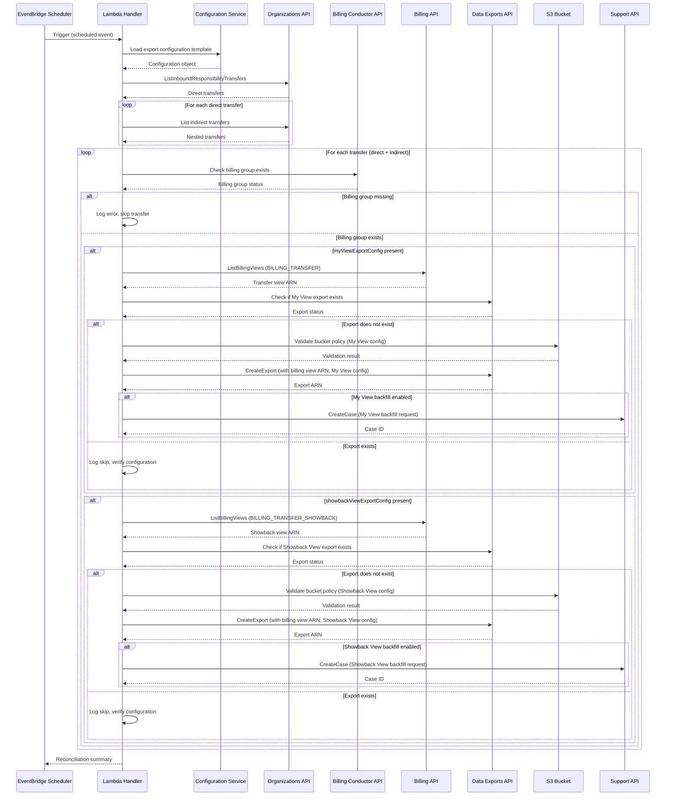

# CUR Automation Design Document

## Overview

The CUR (Cost and Usage Report) Automation system automatically creates and manages AWS Cost and Usage Reports for billing transfer relationships using the Legacy CUR API. This system ensures that bill-transfer accounts have visibility into cost and usage data for each bill-source account through standardized, automatically-created CUR reports.

The system operates on a scheduled basis (similar to the billing group reconciliation stack) because Cost and Usage Reports can only be created after the billing transfer relationship becomes active and billing groups are established. The automation creates CUR reports for both "My View" (BILLING_TRANSFER) and "Showback/Chargeback View" (BILLING_TRANSFER_SHOWBACK) billing perspectives.

**Note**: This system uses the **Legacy CUR API** (`@aws-sdk/client-cost-and-usage-report-service`) with the `BillingViewArn` parameter. AWS Data Exports (CUR 2.0) also supports billing transfer views; this sample uses the Legacy CUR API.

**Key Design Principles:**
- **Idempotent Operations**: Safe to run multiple times without creating duplicates
- **Configuration-Driven**: All export settings defined in a centralized template
- **Flexible View Configuration**: Independent control over My View and Showback View exports
- **Resilient**: Continues processing remaining transfers if one fails
- **Observable**: Comprehensive logging and reconciliation summaries
- **Dependency-Aware**: Validates billing groups exist before creating exports

**Key Design Decisions:**

1. **Use Legacy CUR API**: The system uses the Cost and Usage Report Service API (`PutReportDefinition`) with the `BillingViewArn` parameter.
   - **Rationale**: The Legacy CUR API supports the `BillingViewArn` parameter used for billing transfer reports. AWS Data Exports (CUR 2.0) has since added support for billing transfer views as well; migrating this sample to Data Exports is a reasonable future enhancement.

2. **Separate View Configurations**: The design uses `myViewReportConfig` and `showbackViewReportConfig` as optional, independent sections rather than a single configuration. This allows:
   - Creating only the reports needed (My View only, Showback View only, or both)
   - Different S3 destinations for each view type
   - Different time units and schema elements per view
   - Independent backfill settings per view type
   - **Rationale**: Different stakeholders may need different views with different configurations. Partners may want My View for actual costs but not Showback View, or vice versa.

3. **View-Specific Backfill Control**: Each view configuration has its own backfill settings rather than a global backfill flag. This allows:
   - Requesting historical data for My View but not Showback View
   - Different billing period ranges per view type
   - Different severity codes per view type
   - **Rationale**: Historical data needs may differ between views. My View might need backfill for financial reconciliation, while Showback View might only need current data.

4. **Validation Requires At Least One View**: The configuration validation fails if neither `myViewReportConfig` nor `showbackViewReportConfig` is present.
   - **Rationale**: A configuration with no view configurations would result in no reports being created, which is likely a configuration error rather than intentional.

5. **Independent Processing Per View Type**: The reconciliation service processes My View and Showback View reports independently, with separate error handling and summary tracking.
   - **Rationale**: Failures in one view type should not prevent creation of the other view type. This maximizes the number of successful reports even when partial failures occur.

## Architecture

### High-Level Architecture

```
┌─────────────────────────────────────────────────────────────────┐
│                     EventBridge Scheduler                        │
│                    (Daily at specified time)                     │
└────────────────────────────┬────────────────────────────────────┘
                             │
                             ▼
┌─────────────────────────────────────────────────────────────────┐
│                    Lambda Function Handler                       │
│                  (CUR Reconciliation Service)                    │
└────────────────────────────┬────────────────────────────────────┘
                             │
                             ▼
┌─────────────────────────────────────────────────────────────────┐
│                    Load Configuration Template                   │
│                      (JSON from S3 or local)                     │
└────────────────────────────┬────────────────────────────────────┘
                             │
                             ▼
┌─────────────────────────────────────────────────────────────────┐
│              List Billing Transfer Relationships                 │
│                    (Organizations API)                           │
│  • Direct inbound transfers                                      │
│  • Indirect (nested) transfers                                   │
└────────────────────────────┬────────────────────────────────────┘
                             │
                             ▼
┌─────────────────────────────────────────────────────────────────┐
│         For Each Billing Transfer Relationship:                  │
│                                                                   │
│  1. Verify Billing Group Exists (Billing Conductor API)          │
│  2. Process My View (if myViewReportConfig present):             │
│     a. Get BILLING_TRANSFER view (Billing API)                   │
│     b. Check if CUR Report exists (CUR Service API)              │
│     c. Validate S3 bucket configuration                          │
│     d. Create CUR Report if needed (PutReportDefinition)         │
│     e. Create Support case for backfill (if enabled)             │
│  3. Process Showback View (if showbackViewReportConfig present): │
│     a. Get BILLING_TRANSFER_SHOWBACK view (Billing API)          │
│     b. Check if CUR Report exists (CUR Service API)              │
│     c. Validate S3 bucket configuration                          │
│     d. Create CUR Report if needed (PutReportDefinition)         │
│     e. Create Support case for backfill (if enabled)             │
└────────────────────────────┬────────────────────────────────────┘
                             │
                             ▼
┌─────────────────────────────────────────────────────────────────┐
│                  Return Reconciliation Summary                   │
│  • Total transfers processed                                     │
│  • My View reports created/existing/failed                       │
│  • Showback View reports created/existing/failed                 │
│  • Support cases created/failed                                  │
│  • Failed operations with details                                │
└─────────────────────────────────────────────────────────────────┘
```

### Component Interaction Flow



## Components and Interfaces

### 1. Lambda Handler

**Responsibility**: Orchestrates the CUR reconciliation workflow

**Dependencies**: Uses shared utilities from `lib/lambda/common`:
- `logger` singleton from `../common/utils/logger` (AWS Lambda Powertools)
- `retryWithBackoff` from `../common/utils/retry` for API retry logic
- `listDirectBillingTransfers`, `listIndirectBillingTransfers` from `../common/services/organizations-service`
- `findBillingGroupByAccount` from `../common/services/billing-conductor-service`
- `listBillingViews` from `../common/services/billing-service`

**Interface**:
```typescript
export interface CURReconciliationEvent {
  source: 'scheduler';
  action: 'reconcile-all';
}

export interface CURReconciliationResult {
  summary: ReconciliationSummary;
  timestamp: string;
}

export const handler = async (
  event: CURReconciliationEvent,
  context: Context
): Promise<CURReconciliationResult>;
```

### 2. Configuration Service

**Responsibility**: Loads and validates report configuration template

**Interface**:
```typescript
export interface ViewReportConfig {
  enabled: boolean;  // Master enable/disable flag for this view type
  timeUnit: 'HOURLY' | 'DAILY' | 'MONTHLY';
  format: 'textORcsv' | 'Parquet';
  compression: 'ZIP' | 'GZIP' | 'Parquet';
  additionalSchemaElements: Array<'RESOURCES' | 'SPLIT_COST_ALLOCATION_DATA' | 'MANUAL_DISCOUNT_COMPATIBILITY'>;
  s3Bucket: string;
  s3Prefix: string;
  s3Region: string;
  refreshClosedReports: boolean;
  reportVersioning: 'CREATE_NEW_REPORT' | 'OVERWRITE_REPORT';
  tags?: Record<string, string>;
  backfill?: {
    enabled: boolean;
    billingPeriodRange: {
      start: string; // YYYY-MM format
      end: string;   // YYYY-MM format
    };
    severityCode: 'low' | 'normal' | 'high' | 'urgent' | 'critical';
  };
}

export interface ReportConfigurationTemplate {
  version: string;
  myViewReportConfig?: ViewReportConfig;      // Optional: Configuration for BILLING_TRANSFER view
  showbackViewReportConfig?: ViewReportConfig; // Optional: Configuration for BILLING_TRANSFER_SHOWBACK view
}

export class ConfigurationService {
  async loadConfiguration(source: string): Promise<ReportConfigurationTemplate>;
  validateConfiguration(config: ReportConfigurationTemplate): void;
  hasMyViewConfig(config: ReportConfigurationTemplate): boolean;
  hasShowbackViewConfig(config: ReportConfigurationTemplate): boolean;
  isMyViewEnabled(config: ReportConfigurationTemplate): boolean;
  isShowbackViewEnabled(config: ReportConfigurationTemplate): boolean;
}
```

### 3. Billing Transfer Service

**Responsibility**: Manages billing transfer relationship discovery

**Note**: This service is a thin wrapper around the shared Organizations service from `lib/lambda/common/services/organizations-service`. It adapts the shared service's interface to the CUR automation domain model.

**Shared Dependencies**:
- `listDirectBillingTransfers()` from `../common/services/organizations-service`
- `listIndirectBillingTransfers(transferId)` from `../common/services/organizations-service`

**Interface**:
```typescript
export interface BillingTransferRelationship {
  transferId: string;
  transferArn: string;
  billSourceAccountId: string;
  billTransferAccountId: string;
  status: string;
  transferChain: string[];
}

export class BillingTransferService {
  async listAllInboundTransfers(): Promise<BillingTransferRelationship[]>;
  async listIndirectTransfers(directTransferId: string): Promise<BillingTransferRelationship[]>;
}
```

### 4. Billing Group Validation Service

**Responsibility**: Validates billing groups exist before export creation

**Shared Dependencies**:
- `findBillingGroupByAccount(accountId)` from `../common/services/billing-conductor-service`

**Interface**:
```typescript
export interface BillingGroupValidationResult {
  exists: boolean;
  billingGroupArn?: string;
  status?: 'ACTIVE' | 'PRIMARY_ACCOUNT_MISSING';
  errorMessage?: string;
}

export class BillingGroupValidationService {
  async validateBillingGroupExists(
    billSourceAccountId: string
  ): Promise<BillingGroupValidationResult>;
}
```

### 5. Billing View Service

**Responsibility**: Retrieves billing view ARNs for transfers

**Interface**:
```typescript
export interface BillingView {
  arn: string;
  name: string;
  billingViewType: 'BILLING_TRANSFER' | 'BILLING_TRANSFER_SHOWBACK';
  sourceAccountId: string;
}

export class BillingViewService {
  async getBillingViewForTransfer(
    billSourceAccountId: string,
    viewType: 'BILLING_TRANSFER' | 'BILLING_TRANSFER_SHOWBACK'
  ): Promise<BillingView | undefined>;
  
  async getBillingViewsForTransfer(
    billSourceAccountId: string
  ): Promise<BillingView[]>;
}
```

### 6. CUR Report Service

**Responsibility**: Creates and manages CUR reports using the Legacy CUR API

**Interface**:
```typescript
export interface CURReportCreationRequest {
  reportName: string;
  billingViewArn: string;
  configuration: ViewReportConfig;  // View-specific configuration
  tags?: Record<string, string>;
}

export interface CURReportCreationResult {
  reportName: string;
  created: boolean;
  alreadyExisted: boolean;
  errorMessage?: string;
}

export class CURReportService {
  async checkReportExists(reportName: string): Promise<boolean>;
  async createReport(request: CURReportCreationRequest): Promise<CURReportCreationResult>;
  async validateReportConfiguration(
    reportName: string,
    expectedBillingViewArn: string
  ): Promise<boolean>;
}
```

**Note**: This service uses the Legacy CUR API (`@aws-sdk/client-cost-and-usage-report-service`) with the `PutReportDefinition` operation. AWS Data Exports (CUR 2.0) also supports billing transfer views.

### 7. S3 Validation Service

**Responsibility**: Validates S3 bucket configuration for CUR delivery

**Interface**:
```typescript
export interface S3ValidationResult {
  bucketExists: boolean;
  hasBucketPolicy: boolean;
  policyIsValid: boolean;
  errorMessage?: string;
  remediationSteps?: string[];
}

export class S3ValidationService {
  async validateBucket(bucketName: string, region: string): Promise<S3ValidationResult>;
}
```

**Note**: S3 bucket policy must allow the `billingreports.amazonaws.com` service principal for Legacy CUR API delivery.

### 8. Support Case Service

**Responsibility**: Creates AWS Support cases for historical data backfill

**Interface**:
```typescript
export interface BackfillRequest {
  exportName: string;
  billingViewArn: string;
  billingPeriodRange: {
    start: string;
    end: string;
  };
  severityCode: string;
}

export interface SupportCaseResult {
  caseId: string;
  created: boolean;
  errorMessage?: string;
}

export class SupportCaseService {
  async createBackfillCase(request: BackfillRequest): Promise<SupportCaseResult>;
}
```

### 9. Reconciliation Service

**Responsibility**: Orchestrates the full reconciliation workflow

**Interface**:
```typescript
export interface ReconciliationSummary {
  totalTransfersProcessed: number;
  myViewReportsCreated: number;
  myViewReportsAlreadyExisted: number;
  myViewReportsFailed: number;
  showbackViewReportsCreated: number;
  showbackViewReportsAlreadyExisted: number;
  showbackViewReportsFailed: number;
  failedTransfers: Array<{
    transferId: string;
    billSourceAccountId: string;
    viewType: 'MY_VIEW' | 'SHOWBACK_VIEW';
    errorMessage: string;
  }>;
  supportCasesCreated: number;
  supportCasesFailed: number;
}

export class ReconciliationService {
  async reconcileAllTransfers(
    config: ReportConfigurationTemplate
  ): Promise<ReconciliationSummary>;
  
  private async processTransferForViewType(
    transfer: BillingTransferRelationship,
    viewType: 'BILLING_TRANSFER' | 'BILLING_TRANSFER_SHOWBACK',
    viewConfig: ViewReportConfig
  ): Promise<void>;
}
```

## Data Models

### Report Configuration Template (JSON)

The configuration template supports separate configurations for My View and Showback View reports. At least one view configuration must be present.

```json
{
  "version": "1.0",
  "myViewReportConfig": {
    "enabled": true,
    "timeUnit": "DAILY",
    "format": "Parquet",
    "compression": "Parquet",
    "additionalSchemaElements": ["RESOURCES"],
    "s3Bucket": "my-billing-transfer-cur-bucket",
    "s3Prefix": "my-view-reports",
    "s3Region": "us-east-1",
    "refreshClosedReports": true,
    "reportVersioning": "OVERWRITE_REPORT",
    "tags": {
      "ViewType": "MyView",
      "CreatedBy": "CURReconciliation"
    },
    "backfill": {
      "enabled": true,
      "billingPeriodRange": {
        "start": "2024-01",
        "end": "2024-12"
      },
      "severityCode": "normal"
    }
  },
  "showbackViewReportConfig": {
    "enabled": false,
    "timeUnit": "DAILY",
    "format": "Parquet",
    "compression": "Parquet",
    "additionalSchemaElements": [],
    "s3Bucket": "my-billing-transfer-cur-bucket",
    "s3Prefix": "showback-view-reports",
    "s3Region": "us-east-1",
    "refreshClosedReports": true,
    "reportVersioning": "OVERWRITE_REPORT",
    "tags": {
      "ViewType": "ShowbackView",
      "CreatedBy": "CURReconciliation"
    },
    "backfill": {
      "enabled": false
    }
  }
}
```

**Configuration Flexibility:**
- **Both views enabled**: Set `enabled: true` in both `myViewReportConfig` and `showbackViewReportConfig`
- **My View only**: Set `myViewReportConfig.enabled: true` and `showbackViewReportConfig.enabled: false` (or omit showbackViewReportConfig)
- **Showback View only**: Set `showbackViewReportConfig.enabled: true` and `myViewReportConfig.enabled: false` (or omit myViewReportConfig)
- **Both disabled**: Set `enabled: false` in both configs (Lambda runs but skips all CUR creation)
- **Different settings**: Each view can have different S3 buckets, prefixes, time units, schema elements, and backfill settings

**Enable/Disable Behavior:**
- If `myViewReportConfig` is present with `enabled: false`, My View reports are skipped (logged as disabled)
- If `showbackViewReportConfig` is present with `enabled: false`, Showback View reports are skipped (logged as disabled)
- If a view config is omitted entirely, that view type is skipped (not logged as disabled)
- At least one view config must be present in the template (validation requirement)
- The `enabled` flag provides a master on/off switch for each view type without removing the configuration

**Important Notes:**
- `additionalSchemaElements` for Showback View should NOT include `SPLIT_COST_ALLOCATION_DATA` (AWS requirement)
- `format` and `compression` must match: both `Parquet` or both `textORcsv` with `ZIP`/`GZIP`
- `timeUnit` determines report granularity: `HOURLY`, `DAILY`, or `MONTHLY`

### Billing Transfer Relationship

```typescript
interface BillingTransferRelationship {
  transferId: string;              // e.g., "rt-abc123"
  transferArn: string;             // Full ARN from Organizations
  billSourceAccountId: string;     // Customer account (source)
  billTransferAccountId: string;   // Partner account (target)
  status: 'ACCEPTED';
  transferChain: string[];         // Chain of transfer IDs
  startTimestamp: number;          // Unix timestamp
}
```

### Billing View

```typescript
interface BillingView {
  arn: string;                     // e.g., "arn:aws:billing::123456789012:billingview/billing-transfer-uuid"
  name: string;                    // Human-readable name
  billingViewType: 'BILLING_TRANSFER' | 'BILLING_TRANSFER_SHOWBACK';
  sourceAccountId: string;         // Bill-source account ID
}
```

### Report Definition (Legacy CUR API)

```typescript
interface ReportDefinition {
  ReportName: string;
  TimeUnit: 'HOURLY' | 'DAILY' | 'MONTHLY';
  Format: 'textORcsv' | 'Parquet';
  Compression: 'ZIP' | 'GZIP' | 'Parquet';
  AdditionalSchemaElements: Array<'RESOURCES' | 'SPLIT_COST_ALLOCATION_DATA' | 'MANUAL_DISCOUNT_COMPATIBILITY'>;
  S3Bucket: string;
  S3Prefix: string;
  S3Region: string;
  BillingViewArn: string;  // Links report to a billing view
  RefreshClosedReports: boolean;
  ReportVersioning: 'CREATE_NEW_REPORT' | 'OVERWRITE_REPORT';
  ReportStatus?: {
    lastDelivery: string;
    lastStatus: string;
  };
}
```

**Note**: This uses the Legacy CUR API (`PutReportDefinition` from `@aws-sdk/client-cost-and-usage-report-service`). AWS Data Exports (CUR 2.0) also supports billing transfer views.

### Reconciliation Summary

```typescript
interface ReconciliationSummary {
  totalTransfersProcessed: number;
  myViewReportsCreated: number;
  myViewReportsAlreadyExisted: number;
  myViewReportsFailed: number;
  showbackViewReportsCreated: number;
  showbackViewReportsAlreadyExisted: number;
  showbackViewReportsFailed: number;
  failedTransfers: Array<{
    transferId: string;
    billSourceAccountId: string;
    viewType: 'MY_VIEW' | 'SHOWBACK_VIEW';
    errorMessage: string;
  }>;
  supportCasesCreated: number;
  supportCasesFailed: number;
}
```


## Correctness Properties

*A property is a characteristic or behavior that should hold true across all valid executions of a system—essentially, a formal statement about what the system should do. Properties serve as the bridge between human-readable specifications and machine-verifiable correctness guarantees.*

### Property 1: All billing transfers are discovered

*For any* set of billing transfer relationships (direct and indirect), when the system lists transfers, all transfers should appear in the result set.
**Validates: Requirements 1.1, 3.1, 3.2**

### Property 2: Billing view ARN retrieval is consistent

*For any* billing transfer relationship and view type, when the system retrieves a billing view, the returned ARN should correspond to the correct bill-source account and requested view type (BILLING_TRANSFER or BILLING_TRANSFER_SHOWBACK).
**Validates: Requirements 1.2, 4.1, 4.2**

### Property 3: Report existence check is accurate

*For any* billing view ARN, when the system checks if a report exists using the Legacy CUR API DescribeReportDefinitions operation, the result should accurately reflect whether a report with the expected name exists.
**Validates: Requirements 1.3, 5.1**

### Property 4: Reports are created when missing

*For any* billing view without an existing report, when the system processes that view and the corresponding view configuration is present, a new CUR report should be created using the Legacy CUR API PutReportDefinition operation.
**Validates: Requirements 1.4, 4.5, 4.6**

### Property 5: Billing view ARN is included in report definition

*For any* created CUR report using the Legacy CUR API, the ReportDefinition should contain the BillingViewArn field with the correct billing view ARN.
**Validates: Requirements 1.5, 4.9**

### Property 6: View-specific configuration is applied to reports

*For any* CUR report created, all configuration settings from the view-specific configuration (time unit, format, compression, additional schema elements, S3 settings, report versioning) should be present in the created report.
**Validates: Requirements 1.6, 2.6, 2.7, 2.10, 2.11, 2.12**

### Property 7: Configuration template loads successfully

*For any* valid configuration template file with at least one view configuration, when the system initializes, the configuration should load into memory without errors.
**Validates: Requirements 2.1, 10.4**

### Property 8: Configuration validation detects missing view configurations

*For any* configuration template with neither myViewExportConfig nor showbackViewExportConfig present, when the system validates the configuration, validation should fail with a clear error message.
**Validates: Requirements 2.2, 2.5, 10.3**

### Property 9: My View configuration validation

*For any* configuration template with myViewExportConfig present, when the system validates the configuration, all required fields for My View exports should be validated.
**Validates: Requirements 2.3**

### Property 10: Showback View configuration validation

*For any* configuration template with showbackViewExportConfig present, when the system validates the configuration, all required fields for Showback View exports should be validated.
**Validates: Requirements 2.4**

### Property 11: Split cost allocation is excluded for showback views

*For any* CUR report created for a BILLING_TRANSFER_SHOWBACK view, the AdditionalSchemaElements should NOT include SPLIT_COST_ALLOCATION_DATA.
**Validates: Requirements 2.13**

### Property 12: Transfer chains are fully processed

*For any* direct billing transfer with indirect (nested) transfers, when the system processes transfers, reports should be created for both the direct transfer and all indirect transfers.
**Validates: Requirements 3.3, 3.4**

### Property 13: My View reports created when configured

*For any* billing transfer relationship, when myViewReportConfig is present in configuration and BILLING_TRANSFER view is found, a CUR report should be created for My View.
**Validates: Requirements 4.3, 4.5, 13.1**

### Property 14: Showback View reports created when configured

*For any* billing transfer relationship, when showbackViewReportConfig is present in configuration and BILLING_TRANSFER_SHOWBACK view is found, a CUR report should be created for Showback View.
**Validates: Requirements 4.4, 4.6, 13.2**

### Property 15: My View reports skipped when not configured

*For any* billing transfer relationship, when myViewReportConfig is not present in configuration, no My View reports should be created.
**Validates: Requirements 4.7, 13.1**

### Property 16: Showback View reports skipped when not configured

*For any* billing transfer relationship, when showbackViewReportConfig is not present in configuration, no Showback View reports should be created.
**Validates: Requirements 4.8, 13.2**

### Property 17: Both view types created when both configured

*For any* billing transfer relationship, when both myViewReportConfig and showbackViewReportConfig are present, reports should be created for both My View and Showback View.
**Validates: Requirements 13.3**

### Property 18: View-specific S3 buckets are used

*For any* data export created, when myViewExportConfig and showbackViewExportConfig have different S3 buckets, each export should be delivered to its configured bucket.
**Validates: Requirements 13.4**

### Property 19: View-specific S3 prefixes are used

*For any* data export created, when myViewExportConfig and showbackViewExportConfig have different S3 prefixes, each export should use the appropriate prefix.
**Validates: Requirements 13.5**

### Property 20: View-specific query statements are applied

*For any* data export created, when myViewExportConfig and showbackViewExportConfig have different query statements, the appropriate query should be applied to each export.
**Validates: Requirements 13.6**

### Property 21: View-specific table configurations are applied

*For any* data export created, when myViewExportConfig and showbackViewExportConfig have different table configurations, the appropriate configurations should be applied to each export.
**Validates: Requirements 13.7**

### Property 22: Export naming follows convention

*For any* created data export, the export name should contain the bill-source account ID and the billing view type identifier.
**Validates: Requirements 4.10**

### Property 23: Idempotency prevents duplicate reports

*For any* billing view, when the system runs multiple times, only one CUR report should exist (no duplicates created).
**Validates: Requirements 5.2, 5.4**

### Property 24: Existing report configuration is validated

*For any* existing CUR report, when the system checks for its existence, the billing view ARN in the report's ReportDefinition BillingViewArn field should be verified against the expected ARN.
**Validates: Requirements 5.3**

### Property 25: Retry safety is maintained

*For any* CUR report creation that fails, when the system retries, no duplicate reports or corrupted state should result from the retry.
**Validates: Requirements 5.5**

### Property 27: S3 bucket existence is verified

*For any* S3 bucket specified in the view configuration, when the system validates the bucket, it should correctly determine whether the bucket exists.
**Validates: Requirements 6.1**

### Property 28: S3 bucket policy is validated

*For any* S3 bucket, when the system validates the bucket policy, it should correctly determine whether the policy allows Legacy CUR delivery from the billingreports.amazonaws.com service principal.
**Validates: Requirements 6.2**

### Property 29: S3 validation errors include remediation

*For any* S3 bucket validation failure, the error message should contain specific remediation steps.
**Validates: Requirements 6.3, 6.4**

### Property 30: Transfer count logging is accurate

*For any* execution, when the system lists billing transfers, the logged count should equal the actual number of transfers found.
**Validates: Requirements 7.2**

### Property 31: Billing view details are logged

*For any* billing view retrieved, the system should log both the billing view ARN and the view type.
**Validates: Requirements 7.3**

### Property 32: Report creation details are logged

*For any* CUR report created, the system should log the report name, billing view ARN, and configuration settings.
**Validates: Requirements 7.4**

### Property 33: Skipped operations are logged

*For any* CUR report that already exists, the system should log that creation was skipped.
**Validates: Requirements 7.5**

### Property 34: Errors include context

*For any* error that occurs, the logged error message should include context such as account ID and the operation being performed.
**Validates: Requirements 7.6**

### Property 35: Summary includes all view-specific counts

*For any* execution, the summary should include separate counts for My View and Showback View reports (created, skipped, failed).
**Validates: Requirements 7.7, 9.2, 9.3, 9.4, 9.5**

### Property 36: Throttling triggers exponential backoff

*For any* API call that fails with a throttling error, the system should retry with exponentially increasing delays.
**Validates: Requirements 8.1**

### Property 37: Transient errors trigger limited retries

*For any* API call that fails with a transient error, the system should retry up to exactly three times.
**Validates: Requirements 8.2**

### Property 38: Failures are isolated

*For any* set of billing transfers being processed, when one transfer fails, the remaining transfers should still be processed.
**Validates: Requirements 8.3, 8.4**

### Property 39: Exhausted retries are marked as failed

*For any* operation where all retries are exhausted, the system should log the final error and mark the transfer as failed in the summary.
**Validates: Requirements 8.5**

### Property 40: Summary object is returned

*For any* execution, when the system completes, a summary object should be returned containing all required fields.
**Validates: Requirements 9.1**

### Property 41: Failed transfers include view type and error details

*For any* failed transfer, the summary should include the transfer ID, bill-source account ID, view type, and error message.
**Validates: Requirements 9.6**

### Property 42: Configuration is valid JSON

*For any* configuration template stored, the content should be parseable as valid JSON.
**Validates: Requirements 10.1**

### Property 43: Configuration validates against schema

*For any* configuration template, when parsed, it should be validated against a JSON schema.
**Validates: Requirements 10.2**

### Property 44: Scheduled events trigger workflow

*For any* scheduled event received by the Lambda function, the full CUR reconciliation workflow should execute.
**Validates: Requirements 11.3, 11.4**

### Property 45: Reports are tagged

*For any* created CUR report, resource tags should be applied to the report.
**Validates: Requirements 12.1**

### Property 46: Automation tag is present

*For any* created CUR report, the tags should include a tag identifying the automation system.
**Validates: Requirements 12.2**

### Property 47: Account ID tag is present

*For any* created CUR report, the tags should include a tag with the bill-source account ID.
**Validates: Requirements 12.3**

### Property 48: Timestamp tag is present

*For any* created CUR report, the tags should include a tag with the creation timestamp.
**Validates: Requirements 12.4**

### Property 49: View-specific tags are merged

*For any* view configuration with tags, when creating a CUR report, the view-specific tags should be merged with automation tags.
**Validates: Requirements 12.5**

### Property 50: My View backfill flag is checked

*For any* myViewReportConfig, when processing My View reports, the system should check whether backfill is enabled for My View.
**Validates: Requirements 14.1**

### Property 51: Showback View backfill flag is checked

*For any* showbackViewReportConfig, when processing Showback View reports, the system should check whether backfill is enabled for Showback View.
**Validates: Requirements 14.2**

### Property 52: Support cases created for My View when backfill enabled

*For any* new My View CUR report created when backfill is enabled in myViewReportConfig, a support case should be created using the Support API CreateCase operation.
**Validates: Requirements 14.3**

### Property 53: Support cases created for Showback View when backfill enabled

*For any* new Showback View CUR report created when backfill is enabled in showbackViewReportConfig, a support case should be created using the Support API CreateCase operation.
**Validates: Requirements 14.3**

### Property 54: Support case uses correct codes

*For any* support case created, the service code and category code should be appropriate for Legacy CUR reports.
**Validates: Requirements 14.4**

### Property 55: Support case subject includes report details

*For any* support case created, the subject should include the report name and indicate it's a backfill request.
**Validates: Requirements 14.5**

### Property 56: Support case body includes required information

*For any* support case created, the communication body should include the report name, billing view ARN, and requested billing period range.
**Validates: Requirements 14.6**

### Property 57: Support case severity matches view configuration

*For any* support case created, the severity code should match the value specified in the view-specific configuration.
**Validates: Requirements 14.7**

### Property 58: Support case issue type is customer-service

*For any* support case created, the issue type should be set to customer-service.
**Validates: Requirements 14.8**

### Property 59: Support case ID is logged

*For any* successfully created support case, the case ID should be logged for tracking.
**Validates: Requirements 14.9**

### Property 60: Support case failures don't block processing

*For any* support case creation failure, the system should log the error and continue processing other reports.
**Validates: Requirements 14.10**

### Property 61: My View backfill disabled prevents case creation

*For any* myViewReportConfig with backfill disabled, no support cases should be created for My View reports.
**Validates: Requirements 14.11**

### Property 62: Showback View backfill disabled prevents case creation

*For any* showbackViewReportConfig with backfill disabled, no support cases should be created for Showback View reports.
**Validates: Requirements 14.11**

### Property 63: Independent backfill handling for view types

*For any* configuration where myViewReportConfig has backfill enabled and showbackViewReportConfig has backfill disabled, support cases should be created only for My View reports.
**Validates: Requirements 14.12, 13.8**

## Error Handling

### Error Categories

1. **Configuration Errors**
   - Invalid JSON format
   - Missing required fields
   - Invalid field values
   - **Handling**: Fail fast with clear validation error message

2. **AWS API Errors**
   - Throttling (TooManyRequestsException)
   - Transient errors (ServiceUnavailableException)
   - Resource not found (ResourceNotFoundException)
   - Validation errors (ValidationException)
   - **Handling**: Retry with exponential backoff (up to 3 attempts)

3. **Billing Group Validation Errors**
   - Billing group doesn't exist
   - Billing group not in ACTIVE status
   - **Handling**: Log error, skip transfer, continue with remaining transfers

4. **S3 Validation Errors**
   - Bucket doesn't exist
   - Missing or invalid bucket policy
   - **Handling**: Log detailed error with remediation steps, fail export creation for that transfer

5. **CUR Report Creation Errors**
   - Report already exists (idempotency)
   - Invalid billing view ARN
   - No billing group assigned to billing view
   - **Handling**: Log appropriately, continue with remaining reports

6. **Support Case Creation Errors**
   - Support API unavailable
   - Invalid case parameters
   - **Handling**: Log error, continue processing (support case is optional)

### Retry Strategy

```typescript
interface RetryConfig {
  maxAttempts: 3;
  baseDelay: 1000; // milliseconds
  maxDelay: 30000; // milliseconds
  backoffMultiplier: 2;
  retryableErrors: [
    'ThrottlingException',
    'TooManyRequestsException',
    'ServiceUnavailableException',
    'InternalServerError'
  ];
}
```

**Exponential Backoff Formula:**
```
delay = min(baseDelay * (backoffMultiplier ^ attemptNumber), maxDelay)
```

**Example:**
- Attempt 1: 1000ms
- Attempt 2: 2000ms
- Attempt 3: 4000ms

### Error Isolation

The system uses a "continue on error" approach:
- Errors processing one transfer don't affect other transfers
- Errors creating one report don't affect other reports for the same transfer
- Support case failures don't affect report creation
- All errors are logged with full context
- Failed operations are tracked in the reconciliation summary

### Logging Strategy

**Uses Shared Logger from lambda-core:**

All logging uses the unified `Logger` class from `lib/lambda/common/utils/logger.ts` as defined in the lambda-core spec.

```typescript
import { Logger } from '../common/utils/logger';

const logger = new Logger(process.env.LOG_LEVEL || 'INFO');

// Usage examples
logger.info('Processing billing transfer', { 
  transferId: 'rt-abc123',
  billSourceAccountId: '123456789012' 
});

logger.warn('CUR report already exists', { 
  reportName: 'billing-transfer-123456789012',
  billingViewArn: 'arn:aws:billing::...' 
});

logger.error('Failed to create CUR report', error, { 
  billSourceAccountId: '123456789012',
  operation: 'createReport' 
});
```

**Structured Logging Format** (from lambda-core):
```typescript
interface LogEntry {
  timestamp: string;        // ISO 8601
  level: 'INFO' | 'WARN' | 'ERROR' | 'DEBUG';
  message: string;
  context?: {
    transferId?: string;
    billSourceAccountId?: string;
    billingViewArn?: string;
    reportName?: string;
    operation?: string;
    [key: string]: any;
  };
  error?: {
    message: string;
    stack: string;
    code?: string;
  };
}
```

**Log Levels:**
- **INFO**: Normal operations (start, progress, completion)
- **WARN**: Recoverable issues (report already exists, retrying)
- **ERROR**: Failures (validation errors, exhausted retries)
- **DEBUG**: Detailed debugging information (configurable via LOG_LEVEL env var)

## Testing Strategy

### Unit Testing

Unit tests verify specific components and edge cases:

1. **Configuration Service**
   - Valid configuration loading
   - Invalid JSON handling
   - Missing required fields
   - Schema validation

2. **Billing Transfer Service**
   - Direct transfer listing
   - Indirect transfer discovery
   - Pagination handling
   - Empty result sets

3. **Billing Group Validation Service**
   - Billing group existence checks
   - Status validation
   - Error handling

4. **Billing View Service**
   - View type filtering
   - ARN extraction
   - Multiple views per transfer

5. **Data Export Service**
   - Export existence checks
   - Export creation
   - Configuration application
   - Idempotency logic

6. **S3 Validation Service**
   - Bucket existence checks
   - Policy validation
   - Error message formatting

7. **Support Case Service**
   - Case creation
   - Parameter formatting
   - Error handling

8. **Reconciliation Service**
   - Summary generation
   - Error aggregation
   - Workflow orchestration
   - View-specific processing

### Property-Based Testing

Property-based tests verify universal properties across many inputs using a property-based testing library (fast-check for TypeScript):

**Configuration:**
- Minimum 100 iterations per property test
- Random data generation for all inputs
- Shrinking to find minimal failing cases

**Key Properties to Test:**
- Configuration validation (Properties 7, 8, 9, 10, 42, 43)
- Report creation and idempotency (Properties 4, 23, 24)
- Billing view ARN handling (Properties 2, 5)
- Template configuration application (Property 6)
- Transfer chain processing (Property 12)
- View-specific processing (Properties 13, 14, 15, 16, 17)
- Error isolation (Property 38)
- Summary generation (Properties 35, 40, 41)
- Tagging (Properties 45-49)
- Support case creation (Properties 50-63)

**Test Data Generators:**
- Random billing transfer relationships
- Random billing view ARNs
- Random configuration templates
- Random S3 bucket configurations
- Random API error responses

### Integration Testing

Integration tests verify end-to-end workflows with actual AWS services (in test account):

1. **Full Reconciliation Workflow**
   - Create test billing transfers
   - Create test billing groups
   - Run reconciliation
   - Verify CUR reports created
   - Verify summary accuracy

2. **Idempotency Testing**
   - Run reconciliation multiple times
   - Verify no duplicate reports
   - Verify consistent results

3. **Error Handling**
   - Simulate missing billing groups
   - Simulate invalid S3 buckets
   - Verify error isolation
   - Verify summary includes failures

4. **Support Case Integration**
   - Enable backfill in configuration
   - Create new reports
   - Verify support cases created
   - Verify case parameters

### Manual Testing

Manual testing checklist:

1. Deploy CDK stack to test account
2. Create test billing transfer relationships
3. Create billing groups for transfers
4. Trigger Lambda manually or wait for schedule
5. Verify CloudWatch logs
6. Check Cost and Usage Reports console for created reports
7. Verify S3 bucket contains CUR data
8. Check support cases (if backfill enabled)
9. Run reconciliation again to verify idempotency
10. Review reconciliation summary

## Deployment Architecture

### CDK Stack Structure

```typescript
export class CURReconciliationStack extends Stack {
  constructor(scope: Construct, id: string, props?: StackProps) {
    super(scope, id, props);

    // S3 bucket for configuration template
    const configBucket = new s3.Bucket(this, 'ConfigBucket', {
      encryption: s3.BucketEncryption.S3_MANAGED,
      blockPublicAccess: s3.BlockPublicAccess.BLOCK_ALL,
      versioned: true,
    });

    // S3 bucket for CUR report delivery (managed bucket)
    const curDestinationBucket = new s3.Bucket(this, 'CURDestinationBucket', {
      bucketName: `cur-reports-${this.account}-${this.region}`,
      encryption: s3.BucketEncryption.S3_MANAGED,
      blockPublicAccess: s3.BlockPublicAccess.BLOCK_ALL,
      versioned: false,
      removalPolicy: cdk.RemovalPolicy.RETAIN,
      lifecycleRules: [
        {
          transitions: [
            {
              storageClass: s3.StorageClass.INTELLIGENT_TIERING,
              transitionAfter: cdk.Duration.days(30),
            },
          ],
        },
      ],
    });

    // Add bucket policy for Legacy CUR API
    curDestinationBucket.addToResourcePolicy(
      new iam.PolicyStatement({
        sid: 'AllowLegacyCURToWriteToBucket',
        effect: iam.Effect.ALLOW,
        principals: [new iam.ServicePrincipal('billingreports.amazonaws.com')],
        actions: ['s3:PutObject', 's3:GetBucketPolicy'],
        resources: [
          curDestinationBucket.bucketArn,
          `${curDestinationBucket.bucketArn}/*`,
        ],
        conditions: {
          StringEquals: {
            'aws:SourceAccount': this.account,
            'aws:SourceArn': `arn:aws:cur:us-east-1:${this.account}:definition/*`,
          },
        },
      })
    );

    // Lambda function
    const handler = new nodejs.NodejsFunction(this, 'Handler', {
      runtime: lambda.Runtime.NODEJS_20_X,
      handler: 'handler',
      entry: 'lib/lambda/cur-reconciliation/index.ts',
      architecture: lambda.Architecture.ARM_64,
      timeout: Duration.minutes(15), // Longer timeout for processing many transfers
      memorySize: 512,
      tracing: lambda.Tracing.ACTIVE,
      environment: {
        CONFIG_BUCKET: configBucket.bucketName,
        CONFIG_KEY: 'export-configuration-template.json',
      },
      bundling: {
        minify: true,
        sourceMap: true,
        target: 'es2022',
        format: OutputFormat.ESM,
        mainFields: ['module', 'main'],
        banner: "import { createRequire } from 'module';const require = createRequire(import.meta.url);",
        externalModules: [], // Bundle all dependencies
      },
    });

    // Grant permissions
    configBucket.grantRead(handler);
    
    handler.addToRolePolicy(new iam.PolicyStatement({
      actions: [
        'organizations:ListInboundResponsibilityTransfers',
        'organizations:DescribeResponsibilityTransfer',
      ],
      resources: ['*'],
    }));

    handler.addToRolePolicy(new iam.PolicyStatement({
      actions: [
        'billingconductor:ListBillingGroups',
      ],
      resources: ['*'],
    }));

    handler.addToRolePolicy(new iam.PolicyStatement({
      actions: [
        'billing:ListBillingViews',
        'billing:GetBillingView',
      ],
      resources: ['*'],
    }));

    handler.addToRolePolicy(new iam.PolicyStatement({
      actions: [
        'cur:PutReportDefinition',
        'cur:DescribeReportDefinitions',
        'cur:ModifyReportDefinition',
      ],
      resources: ['*'],
    }));

    handler.addToRolePolicy(new iam.PolicyStatement({
      actions: [
        's3:GetBucketPolicy',
        's3:GetBucketLocation',
      ],
      resources: ['arn:aws:s3:::*'],
    }));

    handler.addToRolePolicy(new iam.PolicyStatement({
      actions: [
        'support:CreateCase',
      ],
      resources: ['*'],
    }));

    // EventBridge Scheduler
    const schedule = new scheduler.Schedule(this, 'ReconciliationSchedule', {
      scheduleName: 'CURReconciliation',
      schedule: scheduler.ScheduleExpression.expression('cron(0 0 * * ? *)'), // Daily at midnight UTC
      target: new schedulerTargets.LambdaInvoke(handler, {
        input: scheduler.ScheduleTargetInput.fromObject({
          source: 'scheduler',
          action: 'reconcile-all',
        }),
      }),
    });

    // Dead Letter Queue
    const dlq = new sqs.Queue(this, 'DLQ', {
      retentionPeriod: Duration.days(14),
    });

    handler.addEventSource(new lambdaEventSources.SqsEventSource(dlq, {
      batchSize: 1,
    }));

    // CloudWatch Alarms
    const errorAlarm = new cloudwatch.Alarm(this, 'ErrorAlarm', {
      metric: handler.metricErrors(),
      threshold: 1,
      evaluationPeriods: 1,
      alarmDescription: 'CUR automation Lambda function errors',
    });

    const dlqAlarm = new cloudwatch.Alarm(this, 'DLQAlarm', {
      metric: dlq.metricApproximateNumberOfMessagesVisible(),
      threshold: 1,
      evaluationPeriods: 1,
      alarmDescription: 'Messages in CUR automation DLQ',
    });
  }
}
```

### Configuration Management

**Configuration Template Location:**
- Stored in S3 bucket (versioned)
- Lambda reads from S3 on each execution
- Allows configuration updates without code deployment

**Managed S3 Bucket:**
- CDK stack creates a managed bucket: `cur-reports-{ACCOUNT_ID}-{REGION}`
- Bucket policy automatically configured for Legacy CUR API (`billingreports.amazonaws.com`)
- Lifecycle policy transitions reports to Intelligent-Tiering after 30 days
- Bucket retained on stack deletion (data is safe)
- Administrators can use managed bucket or specify their own

**Alternative:** Environment variables for simple settings
- Schedule expression
- S3 bucket name for CUR exports
- Enable/disable backfill

### Monitoring and Observability

**CloudWatch Metrics:**
- Lambda invocations
- Lambda errors
- Lambda duration
- DLQ message count

**CloudWatch Logs:**
- Structured JSON logs
- Log group: `/aws/lambda/cur-reconciliation`
- Retention: 30 days (configurable)

**CloudWatch Logs Insights Queries:**

```sql
-- Count reports created per execution
fields @timestamp, summary.myViewReportsCreated, summary.showbackViewReportsCreated
| filter @message like /Reconciliation complete/
| sort @timestamp desc

-- Find failed transfers
fields @timestamp, context.transferId, context.errorMessage
| filter level = "ERROR"
| sort @timestamp desc

-- Track processing time
fields @timestamp, @duration
| filter @type = "REPORT"
| stats avg(@duration), max(@duration), min(@duration)
```

**X-Ray Tracing:**
- Enabled for distributed tracing
- Track API call latencies
- Identify bottlenecks

## Security Considerations

### IAM Permissions

**Principle of Least Privilege:**
- Grant only required permissions
- Use resource-level permissions where supported
- Document why wildcards are necessary

**Required Permissions:**
- Organizations: List and describe billing transfers
- Billing Conductor: List billing groups
- Billing: List and get billing views
- Cost and Usage Report Service: Create, list, and modify report definitions (Legacy CUR API)
- S3: Get bucket policy and location (for validation)
- Support: Create cases (for backfill)

### Data Protection

**Configuration Template:**
- Stored in encrypted S3 bucket
- Versioned for audit trail
- Access controlled via IAM

**Logs:**
- No sensitive data in logs
- Account IDs are not considered sensitive
- ARNs are logged for troubleshooting

### Compliance

**CDK Nag:**
- Apply AwsSolutionsChecks
- Suppress rules with justification
- Document all suppressions

**Common Suppressions:**
- AwsSolutions-IAM5: Wildcard permissions (APIs don't support resource-level)
- AwsSolutions-IAM4: AWS managed policies (Lambda basic execution role)

## Performance Considerations

### Scalability

**Processing Time:**
- Approximately 2-5 seconds per billing transfer
- 100 transfers = 3-8 minutes
- Lambda timeout: 15 minutes (supports ~150-200 transfers)

**Optimization Strategies:**
- Batch API calls where possible
- Parallel processing of independent transfers (future enhancement)
- Cache billing group lookups

### Cost Optimization

**Lambda:**
- ARM64 architecture (20% cost savings)
- Right-sized memory (512 MB)
- Efficient bundling (minimize cold starts)

**API Calls:**
- Minimize redundant calls
- Use pagination efficiently
- Cache results within execution

**S3:**
- Lifecycle policies for old configuration versions
- Intelligent-Tiering for CUR export bucket

## Future Enhancements

1. **Parallel Processing**: Process multiple transfers concurrently
2. **Incremental Updates**: Track processed transfers to avoid re-processing
3. **Custom Metrics**: Publish custom CloudWatch metrics for business KPIs
4. **SNS Notifications**: Alert on failures or completion
5. **Configuration Validation**: Pre-deployment validation of configuration templates
6. **Report Monitoring**: Track CUR report delivery status and data freshness
7. **Cost Analysis**: Analyze CUR data to provide cost insights
8. **Multi-Region Support**: Support billing transfers across regions
9. **Automated Remediation**: Auto-fix common issues (e.g., bucket policies)
10. **Dashboard**: CloudWatch dashboard for operational visibility

## References

- [AWS Cost and Usage Reports Documentation](https://docs.aws.amazon.com/cur/latest/userguide/what-is-cur.html)
- [Legacy CUR API Reference](https://docs.aws.amazon.com/aws-cost-management/latest/APIReference/API_Operations_AWS_Cost_and_Usage_Report_Service.html)
- [Billing Transfer Best Practices](https://docs.aws.amazon.com/awsaccountbilling/latest/aboutv2/orgs_transfer_billing-best-practices.html)
- [AWS Organizations API Reference](https://docs.aws.amazon.com/organizations/latest/APIReference/Welcome.html)
- [AWS Billing Conductor Documentation](https://docs.aws.amazon.com/billingconductor/latest/userguide/what-is-billingconductor.html)
- [AWS Billing API Reference](https://docs.aws.amazon.com/aws-cost-management/latest/APIReference/API_Operations_AWS_Billing.html)
- [AWS Support API Reference](https://docs.aws.amazon.com/awssupport/latest/APIReference/Welcome.html)
