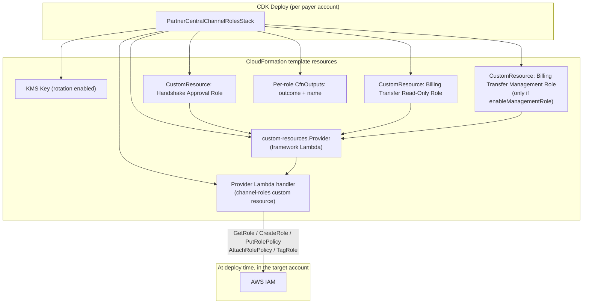
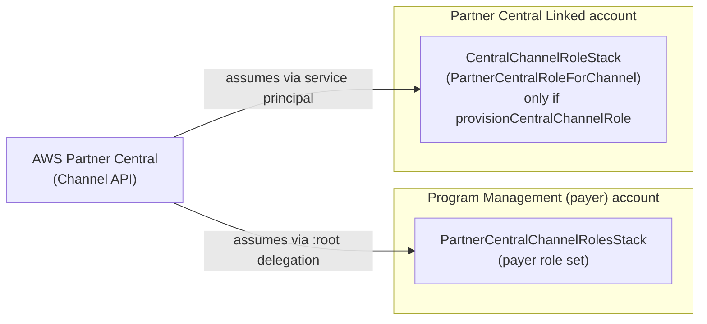
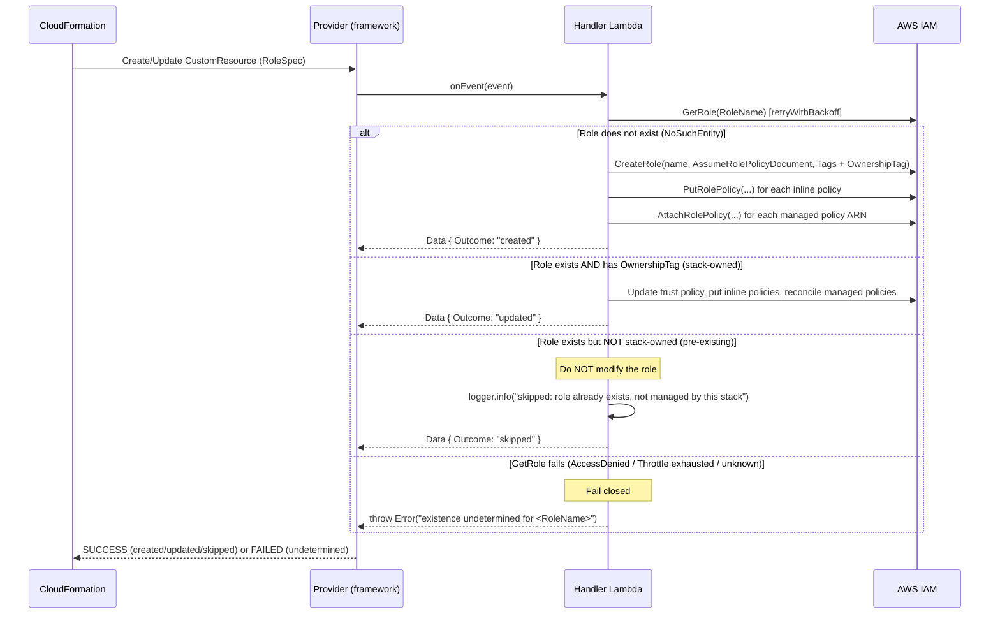

# Design Document

## Overview

This feature adds a new AWS CDK (TypeScript) stack, `PartnerCentralChannelRolesStack`, that provisions the IAM roles required by AWS Partner Central's "Access for the Channel API" into each program management (Bill-Transfer / payer) account of the billing transfer automation solution. The stack follows the existing project conventions established by `BillingGroupEventHandlerStack`, `CURReconciliationStack`, and `BillingTransferTerminationStack`: props-based configuration (no hard-coded account or region values), KMS-encrypted Lambda artifacts, least-privilege IAM, documented cdk-nag/Checkov suppressions, and CloudFormation outputs.

The defining constraint of this feature is **idempotent, skip-if-exists provisioning** of *named* IAM roles. AWS Partner Central requires roles with exact, fixed names (for example, `PartnerCentralChannelHandshakeApprovalManagement`). When CloudFormation attempts to create a named IAM role that already exists out-of-band, the stack update fails with `EntityAlreadyExists`. A native `iam.Role` / `CfnRole` resource cannot "skip" an existing role — CloudFormation owns the full create/update/delete lifecycle and has no conditional-skip semantic for a named resource it does not already track. Requirements 6 and 8 explicitly require that a pre-existing same-named role be left untouched while the remaining roles are still created and the deployment still succeeds.

To meet that constraint, the design provisions each channel role through a **custom resource backed by a provider Lambda** (the CDK `custom-resources.Provider` framework). The Lambda performs a per-role existence check (`iam:GetRole`) and then creates, updates, or skips the role accordingly, failing closed when existence cannot be determined. The role definitions themselves (trust policy, managed policy ARNs, inline permission policies, tags) are computed in TypeScript inside the stack and passed to the custom resource as declarative properties, keeping the "what" in CDK and the "how / idempotency" in the handler.

Key inputs (all via the stack props interface, no hard-coded values):

- `partnerCentralLinkedAccountId` — **required** 12-digit account id of the Partner Central Linked Account. No default.
- `programManagementAccountId` / `region` — the target payer account and region, supplied through the standard CDK `env`.
- `enableManagementRole` — boolean gating the optional `PartnerCentralChannelBillingTransferManagement` role.
- `provisionCentralChannelRole` — boolean gating the optional `PartnerCentralRoleForChannel` role, which lives in the **linked** account (not the payer account) and is therefore deployed as a separate stack instance targeting that account.

> Throughout this document, every illustrative ARN or policy JSON uses the placeholder `<PartnerCentralLinkedAccountId>` (and `<ProgramManagementAccountId>`). No literal 12-digit account numbers appear anywhere in the design or the code; the values are resolved at deploy time from props and CDK environment context.

### Research Notes / Key Findings

- **Named IAM roles and CloudFormation.** Creating an `AWS::IAM::Role` with an explicit `RoleName` fails with `EntityAlreadyExists` if a role of that name is already present and not tracked by the stack. CloudFormation offers no "create if not exists" for named resources. This is the root reason a custom resource is required rather than a plain `iam.Role`.
- **`iam:GetRole` returns tags.** The `GetRole` response includes the role's `Tags`, so ownership can be determined from a marker tag in a single call without a second `ListRoleTags` request. This makes the decision logic stateless and idempotent (every invocation re-derives ownership from the live role).
- **Service-principal trust vs. account-root trust (security subtlety).** When a Lambda *function* assumes a role, the calling principal is the function's **execution role** (an IAM principal in the linked account), not the `lambda.amazonaws.com` service principal. The `arn:aws:iam::<PartnerCentralLinkedAccountId>:root` trust already delegates to every IAM principal in the linked account (including Lambda execution roles and federated console users), subject to those principals having `sts:AssumeRole` in their own identity policies. The separate `lambda.amazonaws.com` service-principal trust (Requirement 4.2/4.3) is therefore additive and is scoped with an `aws:SourceAccount` condition. This nuance and its tradeoffs are documented in [Security Model and IAM](#security-model-and-iam).
- **Project PBT tooling.** The repository already uses [`fast-check`](https://github.com/dubzzz/fast-check) for property-based tests (see `test/billing-group-event-handler/property/*.test.ts`) and `aws-cdk-lib/assertions` `Template`/`Match` for stack template tests. The new tests reuse both, and PBT applies cleanly to the pure policy-document and decision logic.
- **No existing custom resource in the repo.** This is the first custom resource; the design introduces a reusable construct and a handler that reuses `lib/lambda/common/utils` (`logger`, `retryWithBackoff`, `toError`, `getErrorCode`).

## Architecture

The stack is deployed once per program management (payer) account. For each role it manages, it instantiates one custom resource. All custom resources share a single provider Lambda (the handler). The handler resolves each role's desired state against the live account and records the outcome (`created` / `updated` / `skipped`) in a per-role CloudFormation output.



The optional **Central Channel Role** (`PartnerCentralRoleForChannel`) is provisioned by a separate instance of the same construct pattern, deployed to the **linked** account rather than a payer account, because its target account and trust model differ:



### Multi-Account Deployment

Role names are fixed string literals and are **independent of account id and region**, so the synthesized stack is identical across every payer account except for the account-scoped ARNs the handler's own execution role is constrained to. Deployment reuses the existing fleet tooling:

- The solution is deployed as a self-mutating CDK Pipeline (`PipelineStack`). The pipeline (or `scripts/deploy-all-profiles.sh`, which iterates `scripts/payer-profiles.txt`) deploys the stacks into each payer account. `bin/app.ts` binds `env.account` from `CDK_DEFAULT_ACCOUNT` at synth time, so each account synthesizes its own assembly — consistent with the existing deploy flow.
- The `partnerCentralLinkedAccountId` and `enableManagementRole` inputs are supplied per deployment (CDK context or props wiring in `bin/app.ts`). No account list is hard-coded anywhere; the payer account set lives only in the git-ignored `scripts/payer-profiles.txt`.
- The Central Channel Role stack is deployed only to the linked account, and only when `provisionCentralChannelRole` is true.

## Components and Interfaces

### 1. `PartnerCentralChannelRolesStack` (lib/stacks/partner-central-channel-roles-stack.ts)

A `cdk.Stack` subclass that:

1. Validates props (linked account id is a 12-digit string; `enableManagementRole` is a strict boolean) and throws a descriptive `Error` on invalid input, matching the validation style in `BillingGroupEventHandlerStack`.
2. Creates a KMS key (rotation enabled) for the provider Lambda's environment encryption, matching the project KMS convention.
3. Builds the declarative **role specifications** (see [Data Models](#data-models)) for each role to provision, using `buildTrustPolicy(...)` and the per-role permission-policy builders.
4. Creates the provider Lambda handler and a single `custom-resources.Provider`.
5. Instantiates one `IdempotentRole` construct per role spec, wiring each to the shared provider.
6. Constrains the handler's execution role to the **specific role-name ARNs** it manages (Requirement 7.3).
7. Emits a per-role `CfnOutput` exposing the provisioning outcome (`created` / `updated` / `skipped`) and role name (Requirement 6.8).
8. Applies the standard project tags and documented cdk-nag suppressions.

```typescript
export interface PartnerCentralChannelRolesStackProps extends cdk.StackProps {
  /**
   * REQUIRED. 12-digit account id of the Partner Central Linked Account.
   * No default. Validated as exactly 12 numeric digits.
   */
  readonly partnerCentralLinkedAccountId: string;

  /**
   * When true, provision the optional PartnerCentralChannelBillingTransferManagement role.
   * Must be an explicit boolean (true | false); any other value is a deployment error.
   * @default false
   */
  readonly enableManagementRole?: boolean;
}
```

Note: the program management account id and region are not separate props — they are supplied through the standard CDK `env` (`props.env.account` / `props.env.region`) exactly as the other stacks do, and are validated for shape.

### 2. `CentralChannelRoleStack` (lib/stacks/central-channel-role-stack.ts)

A thin `cdk.Stack` subclass deployed only to the **linked** account, gated externally by `provisionCentralChannelRole`. It reuses the same `IdempotentRole` construct and provider handler, providing a single role spec for `PartnerCentralRoleForChannel`:

- Trust: service principal `partnercentral-account-management.amazonaws.com`, `sts:AssumeRole`, constrained by `aws:SourceAccount = <PartnerCentralLinkedAccountId>` (Requirement 5.2/5.3).
- Managed policy: `AWSPartnerCentralChannelManagement` (Requirement 5.4).

```typescript
export interface CentralChannelRoleStackProps extends cdk.StackProps {
  /** REQUIRED. 12-digit linked account id; the role is created in this account. */
  readonly partnerCentralLinkedAccountId: string;
}
```

The two stacks are kept separate (rather than one stack with a mode flag) because the target account differs (payer vs. linked) and `bin/app.ts` binds `env.account` per synth; mixing both role sets into one stack would couple two different deployment targets.

### 3. `IdempotentRole` construct (lib/constructs/idempotent-role.ts)

A reusable L3 construct that wraps a single `CustomResource` bound to the shared provider. It accepts a `RoleSpec` and the provider's service token, and exposes the provisioning outcome for output wiring.

```typescript
export interface IdempotentRoleProps {
  readonly serviceToken: string;     // provider.serviceToken
  readonly spec: RoleSpec;           // declarative desired state (see Data Models)
}

export class IdempotentRole extends Construct {
  /** 'created' | 'updated' | 'skipped' — read from custom resource response data. */
  public readonly outcome: string;
  public readonly roleName: string;
  // ...
}
```

Design choice — **one custom resource per role** (not one resource for all roles): this makes the skip-if-exists decision and its recorded output strictly per-role (Requirements 6.7, 6.8), and isolates a failure on one role from the provisioning of the others.

### 4. Provider Lambda handler (lib/lambda/partner-central-channel-roles/index.ts)

A Node.js 22 / ARM64 `NodejsFunction` configured per the project standard (KMS env encryption, X-Ray tracing, reserved concurrency, `externalModules: []` so the IAM SDK client is bundled). It reuses `lib/lambda/common/utils`:

- `logger` (Powertools singleton) for structured logs, including the explicit "skipped because it already existed" log (Requirement 6.8).
- `retryWithBackoff` for all IAM calls (throttling/transient resilience).
- `toError` / `getErrorCode` for error classification and fail-closed handling.

Handler responsibilities, per CloudFormation lifecycle event:

| Event | Behavior |
| --- | --- |
| `Create` / `Update` | `GetRole(name)` → branch on existence + ownership tag (see [Existence-Check Flow](#existence-check-and-provisioning-flow)). Create-and-tag if absent; update in place if stack-owned; **skip without modification** if present but not stack-owned. |
| `Delete` | `GetRole(name)` → delete only if the role carries this solution's ownership tag; otherwise leave it untouched (never delete a role the stack did not create). |

The handler returns `PhysicalResourceId = roleName` and `Data = { Outcome, Reason, RoleName, RoleArn }`. It **throws** (failing the custom resource, and thus the deploy) only when existence/ownership cannot be determined or a create/attach step fails — never to report a legitimate skip.

### 5. Trust-policy and permission-policy builders (lib/stacks/channel-role-specs.ts)

Pure functions, exercised directly by property-based tests, that produce the declarative `RoleSpec`s from the inputs:

- `buildPayerTrustPolicy(linkedAccountId): PolicyDocumentJson` — the two-statement payer trust policy (root principal + scoped Lambda service principal).
- `buildCentralTrustPolicy(linkedAccountId): PolicyDocumentJson` — the central-role service-principal trust.
- `buildReadOnlyPolicy(): PolicyDocumentJson` — the `BillingTransferReadOnly` statement (exactly four actions).
- `buildManagementPolicy(): PolicyDocumentJson` — the `BillingTransferManagement` statement (the enumerated action set).
- `buildRoleSpecs(props): RoleSpec[]` — assembles the full set based on `enableManagementRole`.

Keeping these as pure functions (returning plain JSON) is what makes the correctness properties testable without synthesizing or deploying.

## Data Models

All examples use placeholders only; no literal account ids.

### Stack props

See `PartnerCentralChannelRolesStackProps` and `CentralChannelRoleStackProps` above.

### `RoleSpec` (shared between stack and handler)

```typescript
interface PolicyStatementJson {
  Sid?: string;
  Effect: 'Allow' | 'Deny';
  Principal?: Record<string, string | string[]>;
  Action: string | string[];
  Resource?: string | string[];
  Condition?: Record<string, Record<string, string | string[]>>;
}

interface PolicyDocumentJson {
  Version: '2012-10-17';
  Statement: PolicyStatementJson[];
}

interface InlinePolicySpec {
  PolicyName: string;             // e.g. 'BillingTransferReadOnlyPolicy'
  PolicyDocument: PolicyDocumentJson;
}

interface RoleSpec {
  RoleName: string;               // exact name, no prefix/suffix/path
  AssumeRolePolicyDocument: PolicyDocumentJson;
  ManagedPolicyArns: string[];    // e.g. arn:aws:iam::aws:policy/AWSPartnerCentral...
  InlinePolicies: InlinePolicySpec[];
  Tags: { Key: string; Value: string }[];
  OwnershipTag: { Key: string; Value: string }; // marker that designates stack ownership
}
```

### Example: payer trust policy (Handshake / Read-Only / Management roles)

```json
{
  "Version": "2012-10-17",
  "Statement": [
    {
      "Sid": "PartnerCentralAndLinkedAccountPrincipals",
      "Effect": "Allow",
      "Principal": { "AWS": "arn:aws:iam::<PartnerCentralLinkedAccountId>:root" },
      "Action": "sts:AssumeRole"
    },
    {
      "Sid": "LinkedAccountLambdaServicePrincipal",
      "Effect": "Allow",
      "Principal": { "Service": "lambda.amazonaws.com" },
      "Action": "sts:AssumeRole",
      "Condition": {
        "StringEquals": { "aws:SourceAccount": "<PartnerCentralLinkedAccountId>" }
      }
    }
  ]
}
```

### Example: read-only permission policy (`PartnerCentralChannelBillingTransferReadOnly`)

```json
{
  "Version": "2012-10-17",
  "Statement": [
    {
      "Sid": "BillingTransferReadOnly",
      "Effect": "Allow",
      "Action": [
        "organizations:DescribeResponsibilityTransfer",
        "organizations:ListHandshakesForOrganization",
        "organizations:ListInboundResponsibilityTransfers",
        "organizations:ListOutboundResponsibilityTransfers"
      ],
      "Resource": "*"
    }
  ]
}
```

### Example: management permission policy (`PartnerCentralChannelBillingTransferManagement`)

```json
{
  "Version": "2012-10-17",
  "Statement": [
    {
      "Sid": "BillingTransferManagement",
      "Effect": "Allow",
      "Action": [
        "billingconductor:CreateBillingGroup",
        "billingconductor:ListPricingPlans",
        "organizations:AcceptHandshake",
        "organizations:CancelHandshake",
        "organizations:DeclineHandshake",
        "organizations:DescribeResponsibilityTransfer",
        "organizations:InviteOrganizationToTransferResponsibility",
        "organizations:ListHandshakesForAccount",
        "organizations:ListHandshakesForOrganization",
        "organizations:ListInboundResponsibilityTransfers",
        "organizations:ListOutboundResponsibilityTransfers",
        "organizations:TerminateResponsibilityTransfer",
        "organizations:UpdateResponsibilityTransfer"
      ],
      "Resource": "*"
    }
  ]
}
```

### Custom resource event properties (stack → handler)

```jsonc
{
  "RequestType": "Create | Update | Delete",
  "ResourceProperties": {
    "RoleName": "PartnerCentralChannelBillingTransferReadOnly",
    "AssumeRolePolicyDocument": "<stringified PolicyDocumentJson>",
    "ManagedPolicyArns": [],
    "InlinePolicies": [
      { "PolicyName": "BillingTransferReadOnlyPolicy", "PolicyDocument": "<stringified>" }
    ],
    "Tags": [{ "Key": "Project", "Value": "SampleAutomationsForBillingTransfer" }],
    "OwnershipTag": { "Key": "ManagedBy", "Value": "partner-central-channel-roles" }
  }
}
```

### Custom resource response data (handler → CloudFormation → outputs)

```jsonc
{
  "PhysicalResourceId": "PartnerCentralChannelBillingTransferReadOnly",
  "Data": {
    "RoleName": "PartnerCentralChannelBillingTransferReadOnly",
    "RoleArn": "arn:aws:iam::<ProgramManagementAccountId>:role/PartnerCentralChannelBillingTransferReadOnly",
    "Outcome": "created | updated | skipped",
    "Reason": "human-readable explanation, e.g. 'Role already existed and is not managed by this stack; left unchanged.'"
  }
}
```

## Existence-Check and Provisioning Flow

Ownership is determined by a **marker tag** (`OwnershipTag`, e.g. `ManagedBy=partner-central-channel-roles`) applied to every role the stack creates. Because `iam:GetRole` returns the role's tags, ownership is re-derived from the live role on every invocation, making the decision stateless and idempotent.



Notes:

- **Managed-policy attach failure** (Requirement 1.5): if `AttachRolePolicy` for the managed policy fails (for example, the policy ARN cannot be resolved), the handler throws so the deploy fails with a clear message; it does not leave a role without its required managed policy. On the `Create` path the handler best-effort rolls back the partially created role (delete inline policies + role) so a retry starts clean.
- **Skip is non-destructive** (Requirements 6.6, 6.9, 8.3): the skip branch performs zero mutating IAM calls. Drift reconciliation of a skipped role is explicitly out of scope.
- **Stack-owned roles keep updating** (Requirement 8.3): because ownership is tag-based and re-checked each run, roles this stack created are recognized and updated on redeploy.
- **Per-role isolation** (Requirement 6.7): each role is its own custom resource; one role's outcome (including a thrown failure) does not block the others' create attempts within the same deploy, and CloudFormation reports each independently.

### Design alternatives considered

- **`AwsCustomResource`** (declarative SDK calls): rejected as the primary mechanism. It maps cleanly to a single SDK call per lifecycle phase, but the required logic is conditional and multi-step (GetRole → branch → CreateRole + N×PutRolePolicy + M×AttachRolePolicy, with fail-closed and best-effort rollback). Expressing branching, ownership detection, and fail-closed semantics in `AwsCustomResource` is awkward and brittle. **Recommended: a Lambda-backed `Provider` custom resource** for full control, structured logging, retries, and testable decision logic.
- **Pre-deploy existence check feeding a `CfnCondition`**: rejected. The check must run *in the target account at deploy time*; feeding a reliable per-account result into a synth-time CloudFormation condition is racy (the role could appear/disappear between check and deploy) and complicates the account-agnostic pipeline synth. The in-deploy custom resource avoids the race.

## Correctness Properties

*A property is a characteristic or behavior that should hold true across all valid executions of a system — essentially, a formal statement about what the system should do. Properties serve as the bridge between human-readable specifications and machine-verifiable correctness guarantees.*

The policy-document builders (`buildPayerTrustPolicy`, `buildCentralTrustPolicy`, `buildReadOnlyPolicy`, `buildManagementPolicy`, `buildRoleSpecs`), the account-id validator, and the handler's existence-check decision function are **pure functions** with large input spaces (any 12-digit account id, any pre-existing role state, any CloudFormation request type). They are ideal for property-based testing with `fast-check`. The properties below were derived from the prework analysis, with redundant criteria consolidated.

### Property 1: Role-set composition is correct, fixed-named, and account/region independent

*For any* valid linked account id and *for any* two distinct `(programManagementAccountId, region)` inputs, `buildRoleSpecs` produces role specs whose `RoleName` values are exactly `PartnerCentralChannelHandshakeApprovalManagement`, `PartnerCentralChannelBillingTransferReadOnly`, and (only when `enableManagementRole` is true) `PartnerCentralChannelBillingTransferManagement` — with no prefix, suffix, or path — and the set of role names is identical across the two account/region inputs. The handshake spec attaches exactly the `AWSPartnerCentralChannelHandshakeApprovalManagement` managed policy and no inline policy; the management spec is present if and only if `enableManagementRole` is true.

**Validates: Requirements 1.1, 1.2, 2.1, 3.1, 3.6, 6.4, 6.5**

### Property 2: Payer-role trust policies trust only the configured linked account

*For any* valid linked account id and *for any* payer role produced by `buildRoleSpecs` (Handshake, Read-Only, and Management when enabled), the trust policy's trusted principals are exactly the set { `arn:aws:iam::<linkedAccountId>:root` granted `sts:AssumeRole`, and the `lambda.amazonaws.com` service principal granted `sts:AssumeRole` with a `StringEquals` `aws:SourceAccount` condition equal to `<linkedAccountId>` }. No statement uses a wildcard (`*`) principal, the `:root` grant is always retained alongside the Lambda grant, and no account number, principal, or service other than the configured linked account appears anywhere in the trust policy.

**Validates: Requirements 1.3, 1.4, 2.2, 3.2, 4.1, 4.2, 4.3, 4.4, 4.5, 4.6**

### Property 3: Read-only permission policy grants exactly the four read actions

*For any* invocation of `buildReadOnlyPolicy`, the policy contains a single statement with `Sid` `BillingTransferReadOnly`, `Effect` `Allow`, `Resource` `*`, and an action set exactly equal to { `organizations:DescribeResponsibilityTransfer`, `organizations:ListHandshakesForOrganization`, `organizations:ListInboundResponsibilityTransfers`, `organizations:ListOutboundResponsibilityTransfers` } — containing no `billingconductor:` action and no mutating `organizations:` action.

**Validates: Requirements 2.3, 2.4, 2.5, 7.2**

### Property 4: Management permission policy grants exactly the enumerated action set

*For any* invocation of `buildManagementPolicy`, the policy contains a single statement with `Sid` `BillingTransferManagement`, `Effect` `Allow`, `Resource` `*`, and an action set exactly equal to the thirteen enumerated `billingconductor:`/`organizations:` actions, with no additional action present.

**Validates: Requirements 3.3, 3.4, 3.5, 7.2**

### Property 5: Account-id validation accepts exactly 12-digit numeric strings

*For any* string input, the account-id validator accepts it if and only if it consists of exactly 12 numeric digits; for every rejected input (including `undefined`, empty, non-numeric, or wrong-length values) the stack raises an error that identifies the offending input and constructs no IAM role resources.

**Validates: Requirements 6.2, 6.10, 6.11**

### Property 6: Per-role provisioning decision is create / update / skip by ownership

*For any* CloudFormation request type (`Create`/`Update`) and *for any* live state of the target role — absent, present-with-ownership-tag, or present-without-ownership-tag — the handler's decision function: (a) chooses **create** (and tags with the ownership marker) when the role is absent; (b) chooses **update** when the role is present and carries this stack's ownership tag; (c) chooses **skip**, issuing zero mutating IAM calls, when the role is present but lacks the ownership tag; and in every case the returned response data records the per-role `RoleName` and an `Outcome` of `created`/`updated`/`skipped`, with skips additionally emitting a log entry stating the role was skipped because it already existed. The decision is evaluated independently per role.

**Validates: Requirements 6.6, 6.7, 6.8, 8.1, 8.3, 8.4**

### Property 7: Indeterminate existence fails closed

*For any* error returned by `GetRole` that is not a definitive "does not exist" (`NoSuchEntity`) result — for example `AccessDenied`, throttling after retries are exhausted, or any other API error — the handler throws an error that names the affected role and issues no `CreateRole` call for that role.

**Validates: Requirements 8.2**

### Property 8: Central-role trust is scoped to the Partner Central service principal and linked account

*For any* valid linked account id, `buildCentralTrustPolicy` produces a trust policy whose only grant is to the `partnercentral-account-management.amazonaws.com` service principal for `sts:AssumeRole`, constrained by a `StringEquals` `aws:SourceAccount` condition equal to `<linkedAccountId>`, and the central role spec attaches the `AWSPartnerCentralChannelManagement` managed policy.

**Validates: Requirements 5.2, 5.3, 5.4**

### Property 9: Handler execution role is constrained to the managed role-name ARNs

*For any* generated stack, every statement in the handler's execution-role policy that grants a mutating or read IAM action on roles (`iam:GetRole`, `iam:CreateRole`, `iam:PutRolePolicy`, `iam:DeleteRolePolicy`, `iam:AttachRolePolicy`, `iam:TagRole`) sets its `Resource` to only the specific managed role-name ARNs (`arn:aws:iam::<account>:role/PartnerCentralChannel*` for the exact names this stack manages) and never `*`.

**Validates: Requirements 7.3**

## Error Handling

The stack distinguishes **synth-time validation errors** (fail fast, before any resource is created) from **deploy-time provisioning errors** (surfaced by the custom resource failing the stack operation).

### Synth-time (props validation)

- **Invalid or missing linked account id** (Requirements 6.2, 6.11): the constructor validates `partnerCentralLinkedAccountId` against `/^\d{12}$/` and throws `Error("partnerCentralLinkedAccountId must be a 12-digit AWS account id")`. No constructs are created.
- **Invalid account id / region** (Requirement 6.10): `props.env.account` is validated as 12 digits and `props.env.region` against the AWS region shape; an invalid value throws before any role construct is created.
- **Invalid management capability** (Requirement 6.3): if a management-capability value sourced from CDK context is present but not a strict boolean, the constructor throws `Error("enableManagementRole must be a boolean (true|false)")` and creates no roles.

This "validate then build" ordering guarantees the "SHALL NOT create any IAM roles" clauses: a throw in the constructor prevents the custom resources from being added to the template at all.

### Deploy-time (handler)

- **Indeterminate existence** (Requirement 8.2): any non-`NoSuchEntity` error from `GetRole` (after `retryWithBackoff`) causes the handler to throw, failing that role's custom resource with a message naming the role. Fail closed — never create on uncertainty.
- **Managed-policy attach failure** (Requirement 1.5): a failed `AttachRolePolicy` on the create path triggers best-effort rollback (delete inline policies and the partially created role) and a thrown error, so no role is left without its required managed policy.
- **Transient IAM errors**: wrapped in `retryWithBackoff` with the project's default backoff; retryable codes (throttling, timeouts) are retried, non-retryable codes surface immediately, consistent with `lib/lambda/common/utils/errors.ts`.
- **Per-role isolation** (Requirement 6.7): each role is a separate custom resource, so a failure or skip on one does not prevent CloudFormation from processing the others.
- **Delete safety**: on stack delete, the handler deletes a role only if it carries this stack's ownership tag; foreign or pre-existing roles are never deleted.

## Security Model and IAM

### Trust model for payer-account roles

Each payer-account channel role trusts two principals, and only those:

1. **`arn:aws:iam::<PartnerCentralLinkedAccountId>:root`** for `sts:AssumeRole`. Trusting the account root *delegates* assume-role authority to the linked account's own IAM administrator: any IAM principal or federated console user in that account can assume the role **only if** their identity policy also grants `sts:AssumeRole` on it. This is the documented Partner Central trust and simultaneously satisfies the "console users and IAM principals in the central account" requirement (Requirement 4.1).
2. **`lambda.amazonaws.com`** service principal for `sts:AssumeRole`, constrained by `aws:SourceAccount = <PartnerCentralLinkedAccountId>` (Requirements 4.2, 4.3).

**Design tradeoff (called out explicitly).** When a Lambda function assumes a cross-account role, the *calling* principal is the function's execution role — an IAM principal already covered by the `:root` delegation in (1). The dedicated `lambda.amazonaws.com` service-principal statement is the mechanism the requirements call for to express Lambda trust directly, and `aws:SourceAccount` is the available lever to restrict that service-principal grant to the linked account. This is **necessarily broader** than naming specific Lambda execution-role ARNs: it admits any Lambda-service activity attributable to the linked account rather than an enumerated allow-list of function roles.

- *Recommended (this design):* `:root` delegation + `lambda.amazonaws.com` with `aws:SourceAccount`, per the requirements. The linked account's IAM administrator remains the effective gatekeeper for which principals can actually assume the roles.
- *Tighter alternative (offered):* drop the service-principal statement and instead trust specific execution-role ARNs (`arn:aws:iam::<linkedAccountId>:role/<exact-exec-role>`). This is least-privilege but requires the execution-role names up front and ongoing maintenance as automation evolves; it is documented here as the alternative if the operator wants to remove reliance on `aws:SourceAccount` scoping.

No payer trust policy contains a wildcard principal or any account/principal/service other than the configured linked account (Requirements 1.4, 4.6) — enforced by Property 2.

### Permission policies (least privilege)

- Read-Only and Management roles carry exactly the enumerated action sets (Properties 3, 4). The Handshake role carries only the AWS managed policy.
- The granted `organizations:` and `billingconductor:` list/describe actions **do not support resource-level permissions**, so their statements use `Resource: "*"` (Requirements 2.4, 3.4, 7.4) with documented suppressions.

### Handler execution-role least privilege (Requirement 7.3)

`iam:GetRole`, `iam:CreateRole`, `iam:PutRolePolicy`, `iam:DeleteRolePolicy`, `iam:AttachRolePolicy`, and `iam:TagRole` **do** support resource-level scoping, so the handler's execution role constrains them to the exact managed role-name ARNs (e.g. `arn:aws:iam::<account>:role/PartnerCentralChannelHandshakeApprovalManagement`, `.../PartnerCentralChannelBillingTransferReadOnly`, and conditionally `.../PartnerCentralChannelBillingTransferManagement`), never `*` (Property 9). `iam:AttachRolePolicy` is paired with a condition limiting attachable policies to the specific AWS managed channel policy ARNs. `iam:PassRole` is **not** required: the handler attaches a *managed policy* and inline policies to the channel roles but does not pass any role to a service, so `PassRole` is deliberately omitted.

## cdk-nag / Checkov Suppression Plan

Suppressions follow the established style (`NagSuppressions.addResourceSuppressions` with documented `reason`, scoped to the resource and `appliesTo`), mirroring `CURReconciliationStack.addCdkNagSuppressions()`.

| Finding | Resource | Justification |
| --- | --- | --- |
| `AwsSolutions-IAM4` | Provider/handler Lambda role | `AWSLambdaBasicExecutionRole` provides standard CloudWatch Logs permissions for Lambda execution. |
| `AwsSolutions-IAM5` (`Resource::*`) | **Channel roles' permission policies** | `organizations:` and `billingconductor:` list/describe actions in the Read-Only and Management policies do not support resource-level permissions; `*` is required (Requirement 7.4). |
| `AwsSolutions-L1` | Handler Lambda | Node.js 22.x is the latest LTS supported by Lambda. |
| `AwsSolutions-IAM5` (CDK Provider framework) | `custom-resources.Provider` onEvent/isComplete wiring | The CDK Provider framework synthesizes a framework role with `lambda:InvokeFunction` scoped to the handler; any residual wildcard is from the managed framework and is suppressed with that justification. |

Checkov (`framework: cloudformation`, scans `cdk.out`): the project already skips `CKV_AWS_117` (Lambda VPC — handler only calls the IAM public API) and `CKV_AWS_111` globally in `.checkov.yaml`. The IAM `*`-resource statements on the channel roles map to `CKV_AWS_111`/`CKV_AWS_109`-style findings; these are covered by the existing `CKV_AWS_111` skip and the documented justification above (list/describe actions lack resource-level support). Any new Checkov finding is resolved or added to `.checkov.yaml` with a justification comment, satisfying Requirement 7.6. No literal account ids appear in suppressions.

## Testing Strategy

A dual approach consistent with the repository (`fast-check` for properties under `test/<feature>/property/`, and `aws-cdk-lib/assertions` `Template`/`Match` for stack template tests).

### Property-based tests (fast-check, ≥100 iterations each)

PBT is appropriate here because the policy builders, validator, and the existence-check decision function are pure with large input spaces. Each property test is tagged with a comment referencing its design property in the form **Feature: partner-central-channel-roles, Property {n}: {property text}** and configured for a minimum of 100 runs.

- Properties 1–5 and 8: exercised against the pure builders/validator in `lib/stacks/channel-role-specs.ts`, generating 12-digit account ids, account/region pairs, and the `enableManagementRole` boolean.
- Properties 6 and 7: exercised against the handler decision logic with a mocked IAM client (`aws-sdk-client-mock`, already used in the repo). Generators produce: request type (`Create`/`Update`), role existence, presence/absence of the ownership tag, and (for Property 7) a set of `GetRole` error codes. Assertions verify the chosen action, that **skip issues zero mutating calls**, and that indeterminate errors throw without a `CreateRole`.
- Property 9: asserted against the synthesized template (`Template.fromStack`) by inspecting the handler execution-role policy statements and confirming the IAM role-management actions are scoped to the managed role-name ARNs and never `*`.

### Example and edge-case unit tests

- **1.5 (managed-policy attach failure):** mocked IAM client where `AttachRolePolicy` rejects; assert the handler throws and performs rollback (delete inline policies + role) so no role persists without its managed policy.
- **6.3 (invalid management capability):** constructing the stack with a non-boolean capability value throws and synthesizes no roles.
- **5.5 / 7.1 (stack structure & central-role gating):** `Template.fromStack` example tests confirm the payer stack synthesizes from props with no hard-coded account/region, that exactly the expected custom resources are present (2 roles by default, 3 when management enabled), and that the central role is present only when `provisionCentralChannelRole` instantiates `CentralChannelRoleStack`.
- **7.4 (suppressions present):** assert the documented cdk-nag suppressions exist with non-empty justification.

### Integration / smoke tests

- **7.5 (cdk-nag) & 7.6 (Checkov):** run as compliance gates via `npm run cdk:synth` (AwsSolutionsChecks aspect) and the Checkov scan over `cdk.out`; pass criterion is zero un-suppressed findings. These are single deterministic checks, not property tests.
- **Deploy-time behavior:** an optional integration test in a sandbox account pre-creates a same-named role out-of-band, deploys the stack, and asserts the role is left unchanged and its custom-resource output reports `skipped` — verifying Requirements 6.6/6.9 end-to-end. (1–2 examples; not PBT.)

### Why not PBT for some criteria

Stack-structure (7.1), suppression presence (7.4), compliance gates (7.5, 7.6), the central-role external gating flag (5.5), and the scoping non-guarantee (6.9) do not vary meaningfully with input or test external/compliance tooling rather than this code's logic; they are covered by example, smoke, and integration tests instead.

## Requirements Traceability

| Requirement | Addressed by |
| --- | --- |
| 1.1, 1.2 | `buildRoleSpecs` handshake spec; Property 1; stack template test |
| 1.3, 1.4 | `buildPayerTrustPolicy`; Property 2 |
| 1.5 | Handler attach-failure rollback; Error Handling; edge-case test |
| 2.1–2.5 | `buildReadOnlyPolicy`; Properties 1, 3 |
| 3.1–3.6 | `buildManagementPolicy`, `buildRoleSpecs` gating; Properties 1, 4 |
| 4.1–4.6 | `buildPayerTrustPolicy`; Security Model; Property 2 |
| 5.1–5.5 | `CentralChannelRoleStack`, `buildCentralTrustPolicy`; Property 8; gating example test |
| 6.1, 6.2 | Stack props interface; validator; Property 5 |
| 6.3 | Boolean validation; Error Handling; edge-case test |
| 6.4, 6.5 | `buildRoleSpecs`; Property 1 |
| 6.6–6.9 | `IdempotentRole` + handler decision; Existence-Check Flow; Property 6 |
| 6.10, 6.11 | Account-id validator; Property 5 |
| 7.1 | Single CDK stack under `lib/stacks`, props-based; example test |
| 7.2 | Exact action sets; Properties 3, 4 |
| 7.3 | Handler execution-role scoping; Property 9 |
| 7.4 | Suppression plan; example test |
| 7.5, 7.6 | cdk-nag aspect + Checkov gate; smoke tests |
| 8.1–8.4 | Handler existence check; Properties 6, 7 |

## Phase Completion

Requirements (`requirements.md`) already exists for this requirements-first workflow. If gaps are identified during design review, I can return to requirements clarification. Otherwise, the next phase is task creation.
