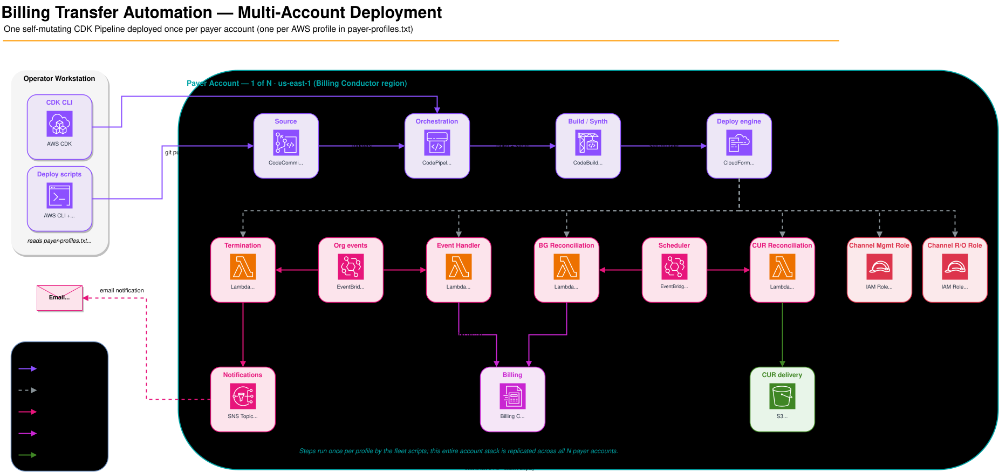

# Sample Automations for Billing Transfer

End-to-end automation for AWS Billing Transfer relationships, built with AWS CDK. When an organization accepts or terminates a billing transfer, this sample reacts to the event and keeps the downstream billing configuration in sync — creating AWS Billing Conductor billing groups, reconciling them on a schedule, generating Cost and Usage Reports (CUR) for each transfer, sending termination notifications, and provisioning the AWS Partner Central channel IAM roles. A self-mutating CDK Pipeline ships the whole thing to one or many bill-transfer (payer) accounts.

> **Note**: This is sample code, for non-production usage. You should work with your security and legal teams to meet your organizational security, regulatory, and compliance requirements before deployment.



*One self-mutating CDK Pipeline is deployed once per payer account. It builds, synthesizes, and deploys the five feature stacks, which then respond to organization billing-transfer events and run scheduled reconciliation at runtime.*

## What it does

- **Reacts to transfer events (real-time)** — CloudTrail delivers `ResponsibilityTransferAccepted` / `ResponsibilityTransferTerminated` events to EventBridge, which invokes the event-handler Lambda to create the matching Billing Conductor billing group.
- **Reconciles billing groups (scheduled)** — a daily job ensures every active transfer has a billing group, catching anything missed by event delivery.
- **Automates Cost and Usage Reports (scheduled)** — creates per-transfer CUR reports using the Legacy CUR API (`PutReportDefinition` with `BillingViewArn`), delivered to a managed S3 bucket. AWS Data Exports (CUR 2.0) also supports billing transfer views; this sample uses the Legacy CUR API.
- **Handles terminations** — logs transfer terminations and publishes notifications via SNS to email (billing groups are retained for historical billing data).
- **Provisions Partner Central channel roles** — idempotently creates the AWS Partner Central "Access for the Channel API" IAM roles in each payer account.
- **Ships via CI/CD** — a self-mutating CDK Pipeline (CodePipeline + CodeBuild) deploys all of the above; deploy once per account, then `git push` to roll out updates.

Cross-cutting: idempotent by design (safe to re-run), least-privilege IAM with CDK Nag compliance, and dead-letter queues plus X-Ray tracing for observability.

## Architecture

The CDK app deploys a **Pipeline stack**, which in turn deploys **five feature stacks** into the target bill-transfer account:

| Stack | Trigger | Responsibility |
|-------|---------|----------------|
| **Billing Group Event Handler** | EventBridge (CloudTrail org events) | Create a billing group the moment a transfer is accepted |
| **Billing Group Reconciliation** | EventBridge Scheduler (daily) | Ensure billing groups stay in sync for all active transfers |
| **CUR Reconciliation** | EventBridge Scheduler (daily) | Create per-transfer Cost and Usage Reports via the Legacy CUR API |
| **Billing Transfer Termination** | EventBridge (CloudTrail org events) | Log terminations and notify via SNS |
| **Partner Central Channel Roles** | Deployed by pipeline | Idempotently provision Partner Central channel IAM roles |
| **Pipeline** | `cdk deploy` once, then `git push` | Self-mutating CI/CD that builds, synthesizes, and deploys the five feature stacks |

**Runtime flow:** CloudTrail → EventBridge (rule or scheduler) → Lambda → Billing Conductor / Legacy CUR API / SNS.

> The diagram above is maintained in [docs/multi-account-deployment.drawio](docs/multi-account-deployment.drawio). After editing, re-export with:
> ```bash
> drawio -x -f svg -o docs/multi-account-deployment.svg docs/multi-account-deployment.drawio
> ```

## Prerequisites

- **Node.js** 22.x (pinned in `.nvmrc`; run `nvm use` to select it)
- **AWS CLI** configured with credentials
- **AWS CDK CLI**: `npm install -g aws-cdk`
- **AWS Billing Conductor** enabled in your account
- **CloudTrail** enabled for Organizations events
- **Deploy to**: Bill-transfer account (management account managing billing for other orgs)

> **Note**: Both the local toolchain and the Lambda functions target Node.js 22 — the local build uses Node 22 (see `.nvmrc`) and the functions run on the `NODEJS_22_X` managed runtime, keeping local and deployed environments aligned.

**Note**: Billing Conductor is only available in `us-east-1` region.

## Getting Started

This sample deploys as a **self-mutating CDK Pipeline**: you deploy the pipeline
stack once into a bill-transfer (payer) account, connect a git remote to the
CodeCommit repo it creates, and `git push` to trigger the pipeline — which then
builds, synthesizes, and deploys the five feature stacks.

> **Prerequisites:** Node.js 22 (`nvm use`), the AWS CDK CLI, and AWS credentials
> for the target payer account. Deploy to `us-east-1` (Billing Conductor is only
> available there).

### 0. Install dependencies

```bash
git clone https://github.com/aws-samples/sample-automations-for-billing-transfer.git
cd sample-automations-for-billing-transfer
npm install
```

### 1. Deploy the pipeline into a payer account

```bash
# Bootstrap CDK in the target account/region (first time per account only)
cdk bootstrap aws://ACCOUNT-ID/us-east-1

# The initial local deploy reads the Partner Central linked-account id from
# .env and seeds it into SSM for subsequent pipeline runs. Copy the example
# and set a real 12-digit account id, or synth will fail fast by design.
cp .env.example .env
# edit .env: set PARTNER_CENTRAL_LINKED_ACCOUNT_ID=<your 12-digit account id>

# Deploy the pipeline stack (creates the CodeCommit repo + CodePipeline)
npm run cdk:deploy SampleAutomationsForBillingTransfer-PipelineStack
```

### 2. Add the CodeCommit repo as a git remote

The pipeline creates a CodeCommit repository named
`sample-automations-for-billing-transfer`. Connect to it with
[git-remote-codecommit](https://docs.aws.amazon.com/codecommit/latest/userguide/setting-up-git-remote-codecommit.html):

```bash
pip install git-remote-codecommit
git remote add codecommit codecommit://sample-automations-for-billing-transfer
```

### 3. Push to trigger the pipeline

```bash
git push codecommit main
```

The push starts the pipeline, which deploys the five feature stacks. Until you
push, the pipeline's first run fails at the Source stage and no feature stacks
are deployed — this is expected.

### Multiple accounts (fleet)

To roll out across many bill-transfer payer accounts, use the `bt` fleet and
git commands (deploy the pipeline to each account, wire up remotes, then
push). See [MULTI_PROFILE_DEPLOYMENT.md](MULTI_PROFILE_DEPLOYMENT.md).

```bash
bt fleet deploy --all-profiles --execute --parallel 5   # deploy pipeline to each account
bt git setup-remotes --all-profiles                     # add a remote per account
```

For complete pipeline setup, multi-remote strategy, and troubleshooting, see the
pipeline guide referenced in the [Documentation](#documentation) section.

## Development

```bash
npm run build          # Compile TypeScript
npm test               # Run tests
npm run cdk:synth      # Synthesize + CDK Nag checks
npm run cdk:diff       # Show changes
npm run cdk:deploy     # Deploy
```

See [.kiro/steering/development-guide.md](.kiro/steering/development-guide.md) for CDK standards, Lambda configuration, and testing patterns.

## CUR Automation

The CUR Automation stack automatically creates Cost and Usage Reports for billing transfer relationships using the Legacy CUR API (`PutReportDefinition` with `BillingViewArn`).

> **Note**: AWS Data Exports (CUR 2.0) also supports billing transfer views (see [Creating exports with billing views](https://docs.aws.amazon.com/cur/latest/userguide/dataexports-create-billing-view.html)). This sample uses the Legacy CUR API; adapting it to Data Exports is a reasonable enhancement.

### Managed S3 Bucket

The stack automatically creates an S3 bucket for CUR report delivery with the correct bucket policy:

```bash
# After deployment, get the bucket name
aws cloudformation describe-stacks \
  --stack-name BT-CURReconciliationStack \
  --query 'Stacks[0].Outputs[?OutputKey==`CURDestinationBucketName`].OutputValue' \
  --output text
```

The bucket is created with:
- ✅ Correct bucket policy for Legacy CUR API (`billingreports.amazonaws.com`)
- ✅ Encryption enabled (S3-managed)
- ✅ Lifecycle policy (transitions to Intelligent-Tiering after 30 days)
- ✅ Retained on stack deletion (your data is safe)

### Configuration

Update the configuration template with your managed bucket name:

```json
{
  "version": "1.0",
  "myViewReportConfig": {
    "enabled": true,
    "timeUnit": "DAILY",
    "format": "Parquet",
    "compression": "Parquet",
    "additionalSchemaElements": ["RESOURCES"],
    "s3Bucket": "cur-reports-123456789012-us-east-1",
    "s3Prefix": "my-view-reports",
    "s3Region": "us-east-1",
    "refreshClosedReports": true,
    "reportVersioning": "OVERWRITE_REPORT"
  }
}
```

Upload to the config bucket:

```bash
CONFIG_BUCKET=$(aws cloudformation describe-stacks \
  --stack-name BT-CURReconciliationStack \
  --query 'Stacks[0].Outputs[?OutputKey==`ConfigBucketName`].OutputValue' \
  --output text)

aws s3 cp lib/lambda/cur-reconciliation/config/export-configuration-template.json \
  s3://${CONFIG_BUCKET}/export-configuration-template.json
```

See [lib/lambda/cur-reconciliation/config/README.md](lib/lambda/cur-reconciliation/config/README.md) for detailed configuration options and [.kiro/steering/data-exports-guide.md](.kiro/steering/data-exports-guide.md) for complete CUR automation documentation.

## Monitoring

```bash
# View Lambda logs
aws logs tail /aws/lambda/billing-group-event-handler --follow
aws logs tail /aws/lambda/cur-reconciliation --follow

# List billing groups
aws billingconductor list-billing-groups --region us-east-1

# List CUR reports
aws cur describe-report-definitions --region us-east-1
```

## Troubleshooting

| Issue | Solution |
|-------|----------|
| Billing Conductor not available | Deploy to `us-east-1` only |
| Lambda Access Denied | Check IAM permissions |
| EventBridge not triggering | Verify CloudTrail enabled |
| "Accounts not in CB family" | Use `ResponsibilityTransferArn` not `LinkedAccountIds` |

See [.kiro/steering/billing-conductor-guide.md](.kiro/steering/billing-conductor-guide.md) for detailed troubleshooting and [.kiro/steering/pipeline-guide.md](.kiro/steering/pipeline-guide.md) for pipeline issues.

## Security

- Least-privilege IAM roles
- CDK Nag compliance checks
- Dead letter queues for failed events
- CloudTrail logging for audit

See [SECURITY.md](SECURITY.md) for vulnerability reporting.

> **Disclaimer**: This is sample code, for non-production usage. You should
> work with your security and legal teams to meet your organizational security,
> regulatory, and compliance requirements before deployment. This sample has
> not been validated for production use and may incur AWS charges for the
> resources it creates.

## Contributing

We welcome contributions! Please see [CONTRIBUTING.md](CONTRIBUTING.md) for guidelines on:

- Code of conduct
- How to submit issues
- How to submit pull requests
- Code standards and testing requirements
- Security vulnerability reporting

## License

This project is licensed under the MIT-0 License - see the [LICENSE](LICENSE) file for details.

The MIT-0 license is a permissive license similar to MIT but removes the requirement for attribution, making it easier to use in your own projects.

## Changelog

See [CHANGELOG.md](CHANGELOG.md) for a detailed history of changes and releases.

## Documentation

**Project Guides** (`.kiro/steering/`):
- [project-overview.md](.kiro/steering/project-overview.md) - Architecture and concepts
- [development-guide.md](.kiro/steering/development-guide.md) - CDK standards and patterns
- [billing-conductor-guide.md](.kiro/steering/billing-conductor-guide.md) - API implementation details
- [data-exports-guide.md](.kiro/steering/data-exports-guide.md) - CUR automation implementation
- [pipeline-guide.md](.kiro/steering/pipeline-guide.md) - CI/CD setup and troubleshooting
- [cdk-nag-guide.md](.kiro/steering/cdk-nag-guide.md) - Security compliance

**AWS Documentation:**
- [AWS Billing Conductor](https://docs.aws.amazon.com/billingconductor/latest/userguide/what-is-billingconductor.html)
- [AWS Billing Transfer](https://docs.aws.amazon.com/organizations/latest/userguide/orgs_manage_accounts_billing-transfer.html)
- [AWS CDK](https://docs.aws.amazon.com/cdk/v2/guide/home.html)

## Support

This is an open-source project and is not officially supported by AWS. For issues and questions:

- **Bug Reports**: Open an issue on GitHub
- **Feature Requests**: Open an issue with the "enhancement" label
- **Questions**: Use GitHub Discussions
- **AWS Service Issues**: Contact AWS Support through your AWS account

## Acknowledgments

This project uses the following open-source libraries:
- [AWS CDK](https://github.com/aws/aws-cdk) - Infrastructure as Code framework
- [AWS SDK for JavaScript](https://github.com/aws/aws-sdk-js-v3) - AWS service clients
- [AWS Lambda Powertools](https://github.com/aws-powertools/powertools-lambda-typescript) - Observability utilities
- [CDK Nag](https://github.com/cdklabs/cdk-nag) - Security compliance checks

## Authors

Maintained by the AWS community. See [CONTRIBUTING.md](CONTRIBUTING.md) for how to contribute.

---

**Note**: This project is designed for AWS Type 2 Open Source Accelerator Projects. It exists primarily to help customers use AWS Billing Conductor and is maintained through GitHub but not fully supported through standard AWS support channels.
